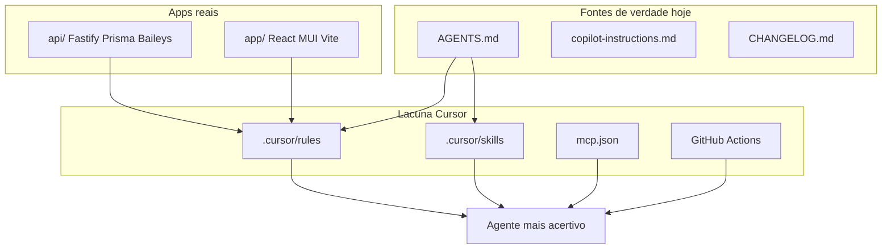
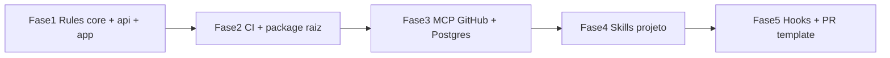

# Plano: Rules, Skills e MCPs para WaioPrime

## Diagnóstico (síntese dos subagentes)

O monorepo está na **fase 2–4** do roadmap ([AGENTS.md](AGENTS.md)): base API madura em **auth, tenants, sessions, messaging/Baileys e chat/inbox**; frontend funcional em **auth, tenant, sessões e chat** (`[app/](app/)`, n ão `panel/`).


| Área             | Forte hoje                                                          | Lacuna crítica para agentes                                                                                                |
| ---------------- | ------------------------------------------------------------------- | -------------------------------------------------------------------------------------------------------------------------- |
| **Documentação** | [AGENTS.md](AGENTS.md) (~1.2k linhas), [CHANGELOG.md](CHANGELOG.md) | Sem `.cursor/rules/` versionado; [copilot-instructions.md](.github/copilot-instructions.md) omite seções 31–36 (SemVer/PR) |
| **API**          | Camadas em sessions/chat; Baileys isolado; event bus; multi-tenant  | Prisma em hooks (`tenantHook`, `sseAuthHook`); DI manual; zero testes/CI                                                   |
| **App**          | Axios centralizado, adapters chat, WS tempo real                    | Envelope HTTP heterogêneo; `ChatPage` monolítica; portas 3000 vs 3333; código morto (SSE/mock)                             |
| **Tooling AI**   | Subagents exploraram bem o repo                                     | Sem MCP, sem skills de projeto, sem workflows GitHub                                                                       |





---

## 1. Rules Cursor recomendadas (`.cursor/rules/`)

**Não portar** `[legado2/.cursor/rules/](legado2/)` (gitignored, stack Evolution/Express). Criar regras novas espelhando o WaioPrime.

### 1.1 Regra global (always apply)


| Arquivo              | `alwaysApply` | Conteúdo essencial                                                                                                                                                                                                                                                                          |
| -------------------- | ------------- | ------------------------------------------------------------------------------------------------------------------------------------------------------------------------------------------------------------------------------------------------------------------------------------------- |
| `waioprime-core.mdc` | `true`        | pt-BR; monorepo `api/` + `app/`; ler [AGENTS.md](AGENTS.md) seções 8–20 e 31–36; usar subagents para exploração ampla; `pnpm` (não npm); proibições: Baileys fora de `engines/baileys/`, Prisma fora de `infrastructure/`, consultas sem `tenantId`; merge exige `tsc --noEmit` + CHANGELOG |


### 1.2 Rules por glob (ativam ao editar arquivos)


| Arquivo                     | `globs`                                                  | Foco                                                                                                                                                             |
| --------------------------- | -------------------------------------------------------- | ---------------------------------------------------------------------------------------------------------------------------------------------------------------- |
| `api-architecture.mdc`      | `api/src/modules/**/*.ts`                                | domain/application/infrastructure/presentation; use cases pequenos; presenters; rotas finas; **sem** Prisma em hooks                                             |
| `api-fastify.mdc`           | `api/src/**/presentation/**/*.ts`, `api/src/app/**/*.ts` | JSON Schema nas rotas; `preHandler` auth+tenant; respostas `{ success, data }` vs raw — **documentar por módulo** (sessions/tenants = raw; auth/chat = envelope) |
| `api-prisma.mdc`            | `api/prisma/`**, `api/src/**/infrastructure/**/*.ts`     | migrations versionadas; mapper obrigatório; filtro `tenantId`; nunca editar migration aplicada                                                                   |
| `api-messaging-baileys.mdc` | `api/src/modules/messaging/**`                           | só `IMessagingEngine`; adapter traduz eventos/erros; wiki Baileys; proibir import `@whiskeysockets/baileys` fora de `engines/baileys/`                           |
| `api-sessions-chat.mdc`     | `api/src/modules/sessions/**`, `api/src/modules/chat/**` | estados de sessão; SSE/WS auth via query; eventos `InternalMessagingEvent`                                                                                       |
| `app-architecture.mdc`      | `app/src/**/*.{ts,tsx}`                                  | features; lógica em hooks/services, não em pages; **sempre** `apiClient`; adapters em `types/`                                                                   |
| `app-chat-ui.mdc`           | `app/src/features/chat/`**, `app/src/pages/ChatPage.tsx` | memo/listas; WS tipado; alinhar `VITE_API_PORT` com API (3333)                                                                                                   |
| `git-release.mdc`           | `**/CHANGELOG.md`, `**/package.json`                     | SemVer; branch `feature/*` → `develop`; template PR seção 35 do AGENTS.md                                                                                        |


### 1.3 Sincronização Copilot

Atualizar [.github/copilot-instructions.md](.github/copilot-instructions.md):

- Trocar `panel/` → `**app/**`
- Incluir link explícito: *processo completo em AGENTS.md §31–36*
- Listar envelopes HTTP por módulo (evita regressões no frontend)

### 1.4 Hooks Cursor (opcional, alta produtividade)

Usar skill **create-hook** para scripts em `.cursor/hooks/`:

- **afterFileEdit** em `api/`: `pnpm typecheck` (rápido)
- **beforeSubmit** (se disponível): lembrar CHANGELOG quando `api/` ou `app/` mudou

---

## 2. Skills: globais (já no seu ambiente) vs projeto

### 2.1 Skills globais — usar por contexto de tarefa


| Skill                                                                                                                               | Quando acionar                                | Por quê no WaioPrime                                                                                                                                                 |
| ----------------------------------------------------------------------------------------------------------------------------------- | --------------------------------------------- | -------------------------------------------------------------------------------------------------------------------------------------------------------------------- |
| [verification-before-completion](~/.agents/skills/verification-before-completion/SKILL.md)                                          | Antes de “pronto”, PR ou merge                | **Zero testes**; único gate real é `pnpm typecheck` em `api/` e `app/`                                                                                               |
| [writing-plans](~/.agents/skills/writing-plans/SKILL.md)                                                                            | Features grandes (flows, campanhas, métricas) | Já existe precedente em [docs/superpowers/plans/2026-05-09-chat-media-storage-architecture.md](docs/superpowers/plans/2026-05-09-chat-media-storage-architecture.md) |
| [subagent-driven-development](~/.agents/skills/subagent-driven-development/SKILL.md)                                                | Implementação multi-módulo                    | Alinha com “use subagents” do copilot-instructions; explorar `api/` + `app/` em paralelo                                                                             |
| [typescript-advanced-types](~/.agents/skills/typescript-advanced-types/SKILL.md)                                                    | Contratos `IMessagingEngine`, event bus, DTOs | Tipagem strict sem `any` nas rotas                                                                                                                                   |
| [vercel-react-best-practices](~/.agents/skills/vercel-react-best-practices/SKILL.md)                                                | Chat/inbox, listas longas                     | `ChatPage` ~475 linhas; precisa virtualização/memo                                                                                                                   |
| [ui-ux-pro-max](~/.agents/skills/ui-ux-pro-max/SKILL.md) + [web-design-guidelines](~/.agents/skills/web-design-guidelines/SKILL.md) | Novas telas MUI, dashboard, builders futuros  | Tema em `[app/src/theme/theme.ts](app/src/theme/theme.ts)`                                                                                                           |
| [frontend-design](~/.agents/skills/frontend-design/SKILL.md)                                                                        | Landing/dashboard polish                      | Complementa MUI sem Tailwind                                                                                                                                         |
| [agent-browser](~/.agents/skills/agent-browser/SKILL.md)                                                                            | Smoke: login, QR sessão, envio chat           | Único E2E viável hoje sem Playwright no repo                                                                                                                         |
| [babysit](~/.cursor/skills-cursor/babysit/SKILL.md)                                                                                 | PRs para `develop`                            | CI ausente; skill compensa triagem manual                                                                                                                            |
| [split-to-prs](~/.cursor/skills-cursor/split-to-prs/SKILL.md)                                                                       | Features que cruzam api+app                   | Mantém PRs revisáveis                                                                                                                                                |
| [receiving-code-review](~/.agents/skills/receiving-code-review/SKILL.md)                                                            | Ao aplicar feedback de PR                     | Evita mudanças cegas em adapter Baileys                                                                                                                              |
| [token-efficiency](~/.agents/skills/token-efficiency/SKILL.md)                                                                      | Exploração do monorepo                        | Baileys adapter ~1000 linhas — ler por grep/subagent                                                                                                                 |
| [create-rule](~/.cursor/skills-cursor/create-rule/SKILL.md)                                                                         | Bootstrap das rules                           | Formato `.mdc` correto                                                                                                                                               |
| [create-skill](~/.cursor/skills-cursor/create-skill/SKILL.md)                                                                       | Criar skills de projeto abaixo                | Padronizar fluxos repetíveis                                                                                                                                         |
| [find-skills](~/.agents/skills/find-skills/SKILL.md)                                                                                | Buscar skills novos                           | `npx skills find prisma`, `fastify`, `vitest`                                                                                                                        |


### 2.2 Skills a **não** priorizar (stack diferente)


| Skill                        | Motivo                               |
| ---------------------------- | ------------------------------------ |
| better-auth-best-practices   | Auth própria JWT + refresh em Prisma |
| tailwind-design-system       | UI é **MUI 6 + Emotion**             |
| brand-guidelines (Anthropic) | Marca WaioPrime própria              |


### 2.3 Skills de projeto (criar em `.cursor/skills/`)

Versionar no repo para todo o time:


| Skill                       | Objetivo                                                                                         |
| --------------------------- | ------------------------------------------------------------------------------------------------ |
| `waioprime-release`         | Checklist SemVer: `api/package.json`, `app/package.json`, `api/CHANGELOG.md`, tag, seção release |
| `waioprime-prisma-migrate`  | `prisma migrate dev --name descricao`; revisar índices/`tenantId`; nunca `db push` em prod       |
| `waioprime-baileys-adapter` | Isolamento, `BaileysErrorTranslator`, auth state em DB, links wiki                               |
| `waioprime-api-contract`    | Ao mudar rota: atualizar `app/src/services/`*, tipos, envelope, OpenAPI se exposto               |
| `waioprime-smoke-manual`    | Roteiro: health → login → tenant switch → criar sessão → QR → chat WS                            |


Buscar skills da comunidade via `npx skills find vitest prisma fastify` antes de escrever do zero.

---

## 3. MCPs recomendados

Configurar em `**.cursor/mcp.json**` (time + máquina local). Prioridade por impacto:


| MCP                                               | Uso no WaioPrime                                                 | Prioridade                   |
| ------------------------------------------------- | ---------------------------------------------------------------- | ---------------------------- |
| **GitHub** (`gh` / server-github)                 | PRs, issues, checks, releases — processo AGENTS.md §35           | Alta                         |
| **PostgreSQL** (read-only)                        | Validar queries, índices, `tenantId`, debug inbox sem expor prod | Alta                         |
| **Fetch / HTTP**                                  | Baileys wiki, docs Render, smoke `GET /health`                   | Média                        |
| **Filesystem** (se não nativo)                    | Navegação segura em `api/src/modules/`                           | Baixa (já coberto por tools) |
| **Browser** (via agent-browser ou Playwright MCP) | Fluxo QR + chat tempo real                                       | Média                        |
| **Prisma** (oficial ou community, se disponível)  | `schema.prisma`, relações `ChatMessage` vs `Message` órfão       | Média                        |
| **Sentry / Datadog**                              | Só quando integrados no código                                   | Futuro                       |


**Segurança:** Postgres MCP com usuário read-only; nunca commitar credenciais em `mcp.json` — usar env vars.

Exemplo conceitual (ajustar nomes de pacotes à versão Cursor atual):

```json
{
  "mcpServers": {
    "github": { "command": "npx", "args": ["-y", "@modelcontextprotocol/server-github"], "env": { "GITHUB_PERSONAL_ACCESS_TOKEN": "${GITHUB_TOKEN}" } },
    "postgres": { "command": "npx", "args": ["-y", "@modelcontextprotocol/server-postgres", "${DATABASE_URL_READONLY}"] }
  }
}
```

---

## 4. Infraestrutura complementar (multiplica efeito das rules)

Sem CI, rules e skills **não se autoimpõem**. Mínimo alinhado ao AGENTS.md:


| Item                                                                   | Ação                                                                                                   |
| ---------------------------------------------------------------------- | ------------------------------------------------------------------------------------------------------ |
| `[.github/workflows/ci.yml](.github/workflows/ci.yml)`                 | `pnpm typecheck` em `api/` e `app/`; opcional `prisma validate`                                        |
| `package.json` raiz                                                    | `pnpm -r typecheck` com workspaces `api` + `app`                                                       |
| `[.github/pull_request_template.md](.github/pull_request_template.md)` | Checklist seção 35 do AGENTS.md                                                                        |
| README raiz                                                            | Onboarding: portas 3333/5174, `VITE_API_URL`, fluxo branch                                             |
| Padronizar HTTP                                                        | Helper `unwrapApiResponse<T>()` no app; migrar sessions para envelope ou documentar exceção permanente |


---

## 5. Matriz: tarefa de desenvolvimento → ferramentas


| Tarefa frequente         | Rules                                           | Skills                                                            | MCPs                     |
| ------------------------ | ----------------------------------------------- | ----------------------------------------------------------------- | ------------------------ |
| Novo use case + rota API | `api-architecture`, `api-fastify`, `api-prisma` | verification-before-completion, typescript-advanced-types         | Postgres (validar query) |
| Mudança Baileys          | `api-messaging-baileys`                         | waioprime-baileys-adapter                                         | Fetch (wiki)             |
| Tela/feature no app      | `app-architecture`, `app-chat-ui`               | vercel-react-best-practices, ui-ux-pro-max                        | Browser                  |
| Feature api+app          | `waioprime-core`                                | subagent-driven-development, waioprime-api-contract, split-to-prs | GitHub                   |
| Release                  | `git-release`                                   | waioprime-release                                                 | GitHub                   |
| PR para develop          | `waioprime-core`                                | babysit, verification-before-completion                           | GitHub                   |
| Explorar código legado   | —                                               | token-efficiency + subagent explore                               | —                        |


---

## 6. Ordem de implementação sugerida




1. **Fase 1** — `.cursor/rules/` (8 arquivos `.mdc`) + sync copilot-instructions
2. **Fase 2** — CI `typecheck` + `package.json` workspaces
3. **Fase 3** — `.cursor/mcp.json` (GitHub + Postgres read-only)
4. **Fase 4** — `.cursor/skills/` (5 skills de projeto)
5. **Fase 5** — hooks typecheck, PR template, smoke skill + agent-browser no fluxo de release

---

## 7. Correções de código que as rules devem enforçar (quick wins)

Para as rules não ficarem teóricas, priorizar débitos que os subagentes encontraram:

- Extrair Prisma de `[api/src/shared/http/tenantHook.ts](api/src/shared/http/tenantHook.ts)` e `sseAuthHook` para repositório/use case  
- Criar `GetMeUseCase` para `[api/src/modules/users/presentation](api/src/modules/users/presentation)`  
- Unificar ou remover modelo Prisma `Message` vs `ChatMessage`  
- `[app/src/services/apiClient.ts](app/src/services/apiClient.ts)`: default `localhost:3333` ou só `/api` via proxy  
- Quebrar `[app/src/pages/ChatPage.tsx](app/src/pages/ChatPage.tsx)` em hooks (`useChatConversations`, `useChatMessages`, `useChatRealtime`)

---

## Resultado esperado

Com **rules por camada**, **skills de fluxo** (release, Prisma, Baileys, contrato API↔app) e **MCPs operacionais** (GitHub + Postgres), cada sessão de agente:

- respeita arquitetura hexagonal e isolamento Baileys sem reler 1.2k linhas de AGENTS.md;
- valida com `typecheck` e CI antes de afirmar “pronto”;
- explora com subagents e implementa com menos regressões em multi-tenant e envelopes HTTP.

**Não usar** regras do `legado2/` como base — stack e pastas são incompatíveis com Fastify modular do WaioPrime.