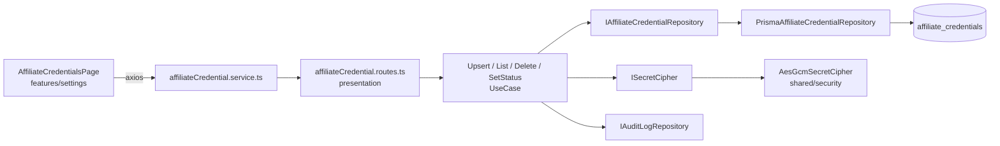

# Credenciais de afiliado — Design

**Spec**: `spec.md` · **Status**: Draft 2026-10-13

---

## Architecture Overview



Camadas conforme AGENTS.md §8. Cifra fica em `shared/security/` porque `SessionAuthState`
(`schema.prisma:230`, "encrypt at-rest") vai reutilizar depois.

## Code Reuse

| Existente | Uso aqui |
| --- | --- |
| `shared/http/hooks/authHook.ts`, `tenantHook.ts` | `preHandler` das rotas; `request.tenantContext.tenantId` |
| `shared/errors/AppError.ts` + `errors/internal/*Errors.ts` | `AffiliateCredentialErrors.ts` |
| `shared/audit/IAuditLogRepository.ts` | auditoria de upsert/delete |
| `shared/config/env.ts` (zod) | `CREDENTIALS_ENCRYPTION_KEY` |
| `modules/tenants/presentation/presenters/TenantPresenter.ts` | padrão do presenter estático |
| `modules/sessions/presentation/schemas/session.schema.ts` | padrão de JSON Schema `as const` |
| `app/src/features/settings/components/SettingsLayout.tsx` `SETTINGS_NAV` | novo item de submenu |
| `app/src/routes/AppRoutes.tsx:25-29` | rota filha de `/settings` |
| `app/src/components` `SectionCard`, `PageHeader`, `ConfirmDialog` | cards e remoção |
| `ChangePasswordForm.tsx:94-130` | campo com olho (mostrar/ocultar) |
| `services/apiClient.ts`, `services/account.service.ts` | padrão de service |
| `features/chat/strings.ts` | padrão de `strings.ts` |
| `app/src/test/renderWithTheme.tsx` | teste em modo escuro |

## Components

### API — `api/src/modules/integrations/`

```
integrations/
  domain/
    entities/AffiliateCredential.ts        # {id, tenantId, provider, publicIdentifier, hasSecret, status, lastValidatedAt?, createdAt, updatedAt}
    enums/AffiliateProvider.ts             # 'SHOPEE' | 'MERCADO_LIVRE' | 'AMAZON'
    enums/AffiliateCredentialStatus.ts     # 'ACTIVE' | 'INACTIVE'
    contracts/IAffiliateCredentialRepository.ts
    services/maskIdentifier.ts             # pura: '5577981353128' → '••••3128'
    services/affiliateProviderFields.ts    # pura: quais campos cada provider exige; valida formato
  application/
    dtos/AffiliateCredentialDTO.ts
    use-cases/ListAffiliateCredentialsUseCase.ts
    use-cases/UpsertAffiliateCredentialUseCase.ts
    use-cases/DeleteAffiliateCredentialUseCase.ts
    use-cases/SetAffiliateCredentialStatusUseCase.ts   # P2
    use-cases/ResolveAffiliateCredentialUseCase.ts     # leitura decifrada p/ offer-generator (sem rota HTTP)
  infrastructure/
    repositories/PrismaAffiliateCredentialRepository.ts
    mappers/PrismaAffiliateCredentialMapper.ts
  presentation/
    routes/affiliateCredential.routes.ts
    schemas/affiliateCredential.schema.ts
    presenters/AffiliateCredentialPresenter.ts
```

`shared/security/ISecretCipher.ts` + `AesGcmSecretCipher.ts`: `encrypt(plain) → {ciphertext, iv, tag, keyVersion}`, `decrypt(...)`. Node `crypto`, sem lib.

**Contrato do repositório**

```ts
interface IAffiliateCredentialRepository {
  listByTenant(tenantId: string): Promise<AffiliateCredential[]>;
  findByTenantAndProvider(tenantId: string, provider: AffiliateProvider): Promise<AffiliateCredentialRecord | null>; // inclui campos cifrados
  upsert(input: UpsertAffiliateCredentialRecord): Promise<AffiliateCredential>;
  delete(tenantId: string, provider: AffiliateProvider): Promise<void>;
  setStatus(tenantId: string, provider: AffiliateProvider, status: AffiliateCredentialStatus): Promise<AffiliateCredential>;
}
```

**Rotas** (prefixo `${API_PREFIX}/integrations/affiliate-credentials`, `preHandler: [authHook, tenantHook]`)

| Método | Path | Use case | Resposta |
| --- | --- | --- | --- |
| GET | `/` | List | `{ items: AffiliateCredentialItem[] }` mascarado |
| PUT | `/:provider` | Upsert | `AffiliateCredentialItem` |
| DELETE | `/:provider` | Delete | 204 |
| PATCH | `/:provider/status` | SetStatus (P2) | `AffiliateCredentialItem` |

`AffiliateCredentialItem = { provider, status, publicIdentifierMasked, hasSecret, lastValidatedAt, updatedAt }`.
Body do PUT: `{ publicIdentifier: string, secret?: string }`. `secret` ausente ou vazio em
registro existente = manter; ausente em registro novo de provider que exige secret = 422.

### App — `app/src/features/settings/`

```
features/settings/
  strings.ts                                   # novo: textos de settings (conta + credenciais)
  affiliateProviders.ts                        # catálogo: key, nome do marketplace, descrição, campos, ícone
  components/AffiliateCredentialCard.tsx       # SectionCard + chip de estado + campos mascarados + ações
  components/AffiliateCredentialDialog.tsx     # form com validação local; secret com olho
  hooks/useAffiliateCredentials.ts             # load/upsert/remove com estado local (sem store global)
pages/settings/AffiliateCredentialsPage.tsx
services/affiliateCredential.service.ts
types/api.types.ts                            # + AffiliateCredentialItem, AffiliateProvider
```

Layout: `Grid` 3 colunas em `md`, 1 em `xs`. Nomes de marketplace (Shopee, Mercado Livre,
Amazon) são de terceiros e podem aparecer; marca do produto só via `APP_NAME` se precisar
(texto do aviso usa "a ferramenta").

## Data Model

```prisma
enum AffiliateProvider { SHOPEE MERCADO_LIVRE AMAZON }
enum AffiliateCredentialStatus { ACTIVE INACTIVE }

model AffiliateCredential {
  id               String @id @default(cuid())
  tenantId         String
  provider         AffiliateProvider
  publicIdentifier String
  secretCiphertext Bytes?
  secretIv         Bytes?
  secretTag        Bytes?
  keyVersion       Int    @default(1)
  status           AffiliateCredentialStatus @default(ACTIVE)
  lastValidatedAt  DateTime?
  createdAt        DateTime @default(now())
  updatedAt        DateTime @updatedAt
  tenant Tenant @relation(fields: [tenantId], references: [id], onDelete: Cascade)
  @@unique([tenantId, provider])
  @@map("affiliate_credentials")
}
// AuditAction += AFFILIATE_CREDENTIAL_UPSERTED, AFFILIATE_CREDENTIAL_DELETED
```

Migration: `add_affiliate_credentials` (tabela + enums + 2 valores em `AuditAction`).

## Error Handling

| Erro | Código | HTTP |
| --- | --- | --- |
| provider fora do enum | `VALIDATION_ERROR` (schema Fastify) | 400 |
| campo público inválido / secret obrigatório ausente | `AFFILIATE_CREDENTIAL_INVALID` | 422 |
| delete/patch de provider não cadastrado | `AFFILIATE_CREDENTIAL_NOT_FOUND` | 404 |
| falha de cifra/decifra (chave errada) | `SECRET_CIPHER_FAILED` | 500, log |

## Tech Decisions

- **AES-256-GCM com chave em env, não KMS.** Render não oferece KMS nativo; chave de 32 bytes
  base64 em `CREDENTIALS_ENCRYPTION_KEY`, validada no boot. `keyVersion` permite rotação futura.
- **Campo público em claro, só o secreto cifrado.** Tag de associado e ID de afiliado aparecem
  na URL gerada; cifrar não protege nada e impede índice/busca. Mascaramento é só de exibição.
- **Catálogo de provedores no painel e validação de campos no domínio.** Ambos lêem a mesma
  tabela conceitual; o domínio é a fonte de verdade da regra, o painel só espelha para UX.
- **Sem store global.** Estado da página vive no hook; nenhum outro lugar consome ainda.
- **`ResolveAffiliateCredentialUseCase` sem rota.** Único ponto que decifra; o Gerador de ofertas
  injeta esse use case. Nenhuma rota devolve secret.
- **Verificar campos reais dos programas (T0)** antes de fechar enum de campos: Shopee Affiliate
  Open API usa `appId` + `secret` (assinatura HMAC); Mercado Livre e Amazon usam identificador
  na URL. Incerto: nome exato dos campos na doc oficial — não assumir sem checar (Context7/web).
