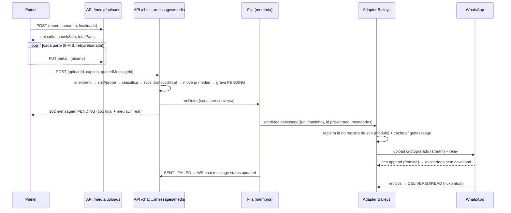

# Anexos e Mensagem de Voz — Design

**Spec**: `.specs/features/chat-media-attachments/spec.md`
**Contexto**: `.specs/features/chat-media-attachments/context.md` (D1–D4 travadas)
**Status**: Aprovado em 2026-09-25 — em execução

---

## 1. Regras duras

1. **Nada de arquivo inteiro em memória na API.** Upload grava parte a parte no disco; o
   Baileys recebe `{ url: caminhoLocal }`; ffmpeg lê e escreve em arquivo ou stream.
2. **Persistir antes de enviar.** Mensagem `PENDING` com `externalMessageId` pré-gerado entra
   no banco antes de qualquer byte ir ao WhatsApp.
3. **Eco da mídia própria nunca é baixado.** Registro de eco **de módulo** (não de instância —
   há dois adapters no processo, §9) descarta o item do `append` antes do download.
4. **O caminho de texto não muda.** `SendMessageUseCase`, `POST .../messages` e o `SENT` direto
   do texto ficam como estão.
5. **Baileys só no adapter; Prisma só na infra; ffmpeg só na infra do módulo `media`.**
6. **Tipo decidido pelo conteúdo (magic bytes + probe), nunca pelo nome/MIME do navegador.**
7. **ffmpeg sem shell**: `spawn` com array, demuxer explícito (`-f`) vindo do sniff,
   `-protocol_whitelist file`, timeout e `SIGKILL`. Nenhum dado do usuário vira argumento.
8. **Sem "grava sem enviar".** O fallback do texto (`SendMessageUseCase.ts:59-64`) é proibido
   aqui: sem sessão conectada, a API recusa antes de gravar.
9. **Nenhuma escrita em massa no banco disparada por boot sem flag.** `api/.env` aponta para o
   banco de produção com `NODE_ENV=production`; um `pnpm dev` não pode marcar mensagens de
   produção como falha (§8, recuperação).
10. **Pasta temporária fora da raiz estática** e rota estática com `dotfiles: 'deny'`.

## 2. Visão geral



Módulos: **`media`** (novo — upload, sniff, classificação, ffmpeg, arquivo; genérico,
reaproveitável por campanhas) e **`chat`** (mensagem, fila, envio). O `chat` depende dos
contratos do `media`, nunca da infraestrutura dele. Composição única em
`media/infrastructure/mediaContainer.ts` (singletons: store de upload, processador, store de
arquivo) — as rotas do `media` e do `chat` usam as **mesmas** instâncias (o mutex por
`uploadId` só serializa se o store for um só).

## 3. Reuso

| Existente | Onde | Uso |
| --- | --- | --- |
| `ReactionEchoRegistry` | `messaging/.../baileys/ReactionEchoRegistry.ts` | Generalizado para `OutboundEchoRegistry` (arquivo antigo reexporta); instâncias de **módulo** para reação e mídia |
| `BaileysSessionRegistry.get()` | `BaileysSessionRegistry.ts:34` | Modelo de singleton de módulo |
| `generateMessageIDV2` + pré-geração | `adapter:247-255` (`sendReaction`) | Mesmo padrão em `createOutboundMessageId` |
| `translateSendError` | `BaileysErrorTranslator.ts:160-170` | Erros do envio de mídia |
| `buildQuoted` / `resolveQuoteAuthor` (adapter) + `buildBaileysQuotedMessage` | `fix/chat-reply-quote`, em `develop` desde `2df4dc6` (0.11.2) | Citação no envio de mídia **pelo mesmo helper do texto** — já resolve o LID do autor em grupo, tem fallback e log `Reply quote attached` |
| `mimeTypeToExt` / `MIME_TO_EXT` | `adapter:1294-1311` | Movidos para `shared/storage/mediaFileExtension.ts` (adapter importa); mapa ampliado. Promoção e download usam a **mesma** regra de nome |
| `resolveConversationTarget` / `buildEngineMessageRef` | `chat/application/use-cases/resolveConversationTarget.ts` | Destino (individual/grupo) e referência citada |
| `mediaPublicUrl`, pasta de mídia | `shared/storage/MediaStorage.ts` | Base do `LocalMediaFileStore` |
| `buildPreview` | `IngestIncomingMessageUseCase.ts:161-174` | Extraído para `chat/domain/services/buildMessagePreview.ts` (mesma saída) |
| Porta de publicação | `IReactionUpdatePublisher` + wiring `chat.routes.ts:70-77` | Mesmo padrão: `IMessageStatusPublisher` |
| Evento WS de status | `chat.message.status.updated` (`ChatWebSocketPublisher.ts:67-75`) | SENT/FAILED do envio; painel já trata (`ChatPage.tsx:422-436`) |
| Sobreposição de pendentes | `overlayPending` (`app/.../reactionsState.ts:199`) | Mesmo padrão para bolhas de mídia em envio |
| Bolhas de mídia | `ImageMessage`, `VideoMessage`, `AudioMessage`, `DocumentMessage` | Recebem `blob:` na prévia otimista (`resolveMediaUrl` já deixa passar) |
| `formatLastMessagePreview` | `app/src/features/chat/utils.ts:106-122` | Prévia na lista após envio |

## 4. Modelo de dados

### Prisma

```prisma
enum ChatMessageStatus {
  SENT
  DELIVERED
  READ
  FAILED
  PENDING   // novo, no fim: o Postgres anexa o valor ao final do tipo (mesma ordem = sem drift)
}
```

Migration `add_pending_chat_message_status` (só `ALTER TYPE ... ADD VALUE`). Nenhuma coluna
nova: `mediaUrl`, `mimeType`, `fileName`, `durationSeconds`, `quotedMessageId`,
`externalMessageId`, `status`, `sentAt` já cobrem (`schema.prisma:372-404`). Legenda vai em
`content`, como na mídia recebida. Enum de domínio (`ChatMessageEnums.ts:20-25`) também ganha
`PENDING`.

### Repositório (`IChatMessageRepository`)

| Mudança | Motivo |
| --- | --- |
| `ChatMessageCreateData.status?` — `create` usa `data.status ?? 'SENT'` | Texto e ingestão seguem gravando `SENT` |
| `transitionStatus(id, tenantId, from[], to, sentAt?)` → entidade ou `null` | `updateMany WHERE status IN from`: `SENT` do despacho não sobrescreve `DELIVERED` que chegou antes; retry e recuperação idempotentes |
| `failPending({ olderThan, excludeIds })` → ids afetados | Recuperação (§8). Sem `tenantId` por natureza (varredura do processo) — exceção ao AGENTS.md §36.8 documentada no código e no `STATE.md` |

`updateStatusByExternalId` fica igual (recibo sobre `PENDING` é aceito: o WhatsApp já recebeu).

## 5. Upload em partes (módulo `media`)

### Estado no disco

Pasta `MEDIA_UPLOAD_TMP_PATH` — padrão `path.join(path.dirname(STORAGE_PATH), 'media-uploads')`
(`/var/data/media-uploads` na Render: **mesmo disco, fora da raiz estática**). No boot: cria a
pasta, confere escrita e compara `stat.dev` com a pasta de mídia; dispositivos diferentes só
geram `warn` (a promoção cai na cópia por stream).

Por upload:

- `<uploadId>.bin` — criado e dimensionado com `fileHandle.truncate(sizeBytes)` (esparso);
  partes escritas por posição (`fh.write(buf, 0, len, index * chunk)`); parte repetida sobrescreve igual
- `<uploadId>.json` — lateral, escrita atômica (`tmp` + `rename`):

```ts
interface UploadSessionRecord {
  uploadId: string;                // UUID v4 — validado por regex em toda rota
  tenantId: string;
  userId: string;
  purpose: 'media' | 'document' | 'voice';
  fileName: string;                // já sanitizado
  declaredMimeType: string | null;
  sizeBytes: number;
  chunkSizeBytes: number;
  totalParts: number;
  receivedParts: number[];         // ordenado, sem repetição
  state: 'OPEN' | 'CONSUMING' | 'CONSUMED';
  externalMessageId: string | null; // gravado no beginConsume (reconciliação após queda)
  messageId: string | null;         // gravado no finishConsume (idempotência)
  createdAt: string;
  updatedAt: string;
}
```

Mutex em memória por `uploadId` serializa escrita de parte + atualização do lateral.

### Regras (puras em `media/domain/services/uploadPlan.ts`)

- `totalParts = ceil(size / chunk)`; `expectedPartLength(i)`; parte de tamanho errado ou índice
  inválido → `400 VALIDATION_ERROR`
- Criação: `sizeBytes` contra o limite da finalidade → `413 MEDIA_TOO_LARGE`
- **Reserva de disco**: bytes declarados dos uploads abertos contam como ocupados (o `.bin`
  esparso não consome blocos). Recusa com `507 INSUFFICIENT_STORAGE` se
  `livre − reservado − sizeBytes < reserva` **ou** se a soma aberta passar do teto de abertos.
  A reserva protege a mídia **recebida**, que grava no mesmo disco e perde o arquivo em silêncio
  se faltar espaço (`adapter:1335-1340`)
- **Limites relativos ao disco** (`diskBudget`, pura): o disco de produção tem 974 MB (`context.md`
  D8) — valores fixos não servem. Sem env: reserva = `max(100 MiB, 10% do total)`; teto de
  abertos = `min(2 GB, 50% do total)`. Com `MEDIA_DISK_RESERVE_BYTES`/`MEDIA_UPLOAD_MAX_OPEN_BYTES`
  definidas, valem as env. Total e livre vêm de `fs.statfs` a cada criação
- Uploads abertos por usuário > `MEDIA_UPLOAD_MAX_OPEN_PER_USER` (padrão 30 = lote) → `429`
- Upload de outro tenant/usuário → `404 UPLOAD_NOT_FOUND`
- Espaço livre abaixo de 2× a reserva → log `warn` a cada varredura

### Limpeza e reconciliação

`UploadSessionSweeper` (boot + 10 min): apaga `.bin` + `.json` com `updatedAt` além de
`MEDIA_UPLOAD_TTL_MINUTES` (120); `.bin` sem lateral; `CONSUMED` mantém só o `.json` até o TTL.
Só disco local — seguro com qualquer banco.

`ReconcileInterruptedUploadsUseCase` (chat, boot): lateral em `CONSUMING` (queda entre
promoção e `finishConsume`) → busca mensagem por `externalMessageId` (**só leitura**):
existe → `CONSUMED` com `messageId`; não existe → apaga o arquivo promovido órfão e descarta o
upload (painel sobe de novo a partir do `File` retido, §14).

## 6. Sniff e classificação (`media/domain/services/`, puras)

`sniffMediaType(head)` com os primeiros 4 KiB:

| Assinatura | MIME | Demuxer ffmpeg |
| --- | --- | --- |
| `FF D8 FF` | `image/jpeg` | — |
| `89 50 4E 47 0D 0A 1A 0A` | `image/png` | — |
| `RIFF....WEBP` | `image/webp` | — |
| `GIF87a` / `GIF89a` | `image/gif` | — |
| `....ftyp` + brand `heic/heix/mif1/msf1` | `image/heic` | — |
| `....ftyp` + brand `3gp*` | `video/3gpp` | `mov` |
| `....ftyp` + brand `qt  ` | `video/quicktime` | `mov` |
| `....ftyp` + brand `M4A ` | `audio/mp4` | `mov` |
| `....ftyp` (demais) | `video/mp4` | `mov` |
| `1A 45 DF A3` | `video/webm` | `matroska` |
| `OggS` | `audio/ogg` | `ogg` |
| `%PDF-` | `application/pdf` | — |
| `PK 03 04` | `application/zip` (Office: usa o declarado se `vnd.openxmlformats*`) | — |
| nenhuma | declarado saneado, senão `application/octet-stream` | — (nunca vai ao ffmpeg) |

`classifyOutboundMedia({ purpose, sniffed, sizeBytes, probe, limits })` →
`{ kind, mimeType, reason? }` ou rejeição:

| Finalidade | Regra | Resultado |
| --- | --- | --- |
| `voice` | sniff de áudio/`webm`/`mp4` **e** `probe.hasAudio` | `voice` (transcodifica) — senão `415` |
| `media` | JPEG/PNG/WebP ≤ `MEDIA_MAX_IMAGE_BYTES` | `image` |
| `media` | MP4/3GP, `h264` **e** `pix_fmt=yuv420p`, ≤ `MEDIA_MAX_INLINE_VIDEO_BYTES` | `video` |
| `media` | vídeo sem probe (ffmpeg ausente) | `document` (codec desconhecido — HEVC tocaria mal) |
| `media` | HEIC, GIF, SVG, imagem > limite, vídeo não-H.264/10 bits/MOV/WebM, vídeo > limite inline | `document`, `reason: 'converted_to_document'` |
| `document` | qualquer, ≤ `MEDIA_MAX_DOCUMENT_BYTES` | `document` |
| qualquer | tamanho 0 | `400 VALIDATION_ERROR` (classe existente) |
| qualquer | acima do limite do tipo final | `413 MEDIA_TOO_LARGE` |

O painel roda um espelho (`app/.../mediaPolicy.ts`) só com o que sabe sem probe (tipo e
tamanho) para avisar antes do upload. **O codec só a API conhece**: um MP4 HEVC pode virar
documento depois do envio; a resposta 202 traz o tipo final e a bolha reflete.

`sanitizeFileName`: tira diretórios (`/`, `\`), controle (`\x00-\x1f`, `\x7f`), bidi
(U+202A–202E, U+2066–2069), `..` inicial; colapsa espaços; corta em 200 mantendo a extensão;
vazio vira `arquivo`.

Nome no disco: `${sessionId}_${externalId}.${mimeTypeToExt(mimeType)}` — mesma função do
download (`shared/storage/mediaFileExtension.ts`), então o `mediaFileExists` do download também
reconhece o arquivo (proteção secundária do eco). O nome original do documento vai no
`fileName` da mensagem e no WhatsApp, nunca no disco.

## 7. Processamento (`FfmpegMediaProcessor`, infra do `media`)

```ts
interface MediaCapabilities { transcodeVoice: boolean; probe: boolean }   // tipo em T5
interface MediaProbe { durationSeconds: number | null; width: number | null; height: number | null;
  videoCodec: string | null; pixelFormat: string | null; audioCodec: string | null; hasAudio: boolean }
interface IMediaProcessor {
  capabilities(): MediaCapabilities;                                   // detectado no boot
  probe(path: string, demuxer: string): Promise<MediaProbe>;
  transcodeVoiceNote(input: string, demuxer: string, output: string): Promise<void>;
  videoThumbnailBase64(path: string): Promise<string | null>;
  voiceWaveform(oggPath: string): Promise<Uint8Array | null>;
}
```

Base comum: `-hide_banner -nostdin -loglevel error -protocol_whitelist file -format_whitelist <demuxer> -f <demuxer>`.

| Operação | Argumentos (após a base) | Timeout |
| --- | --- | --- |
| Voz | `-i IN -vn -map_metadata -1 -ac 1 -ar 48000 -c:a libopus -b:a 128k -application voip -avoid_negative_ts make_zero -f ogg OUT.ogg` (receita do legado2) | 120 s |
| Probe (`ffprobe`) | `-show_entries format=duration:stream=codec_type,codec_name,pix_fmt,width,height:stream_side_data=rotation:stream_tags=rotate -of json IN` | 15 s |
| Miniatura de vídeo | `-ss 0 -i IN -vf scale=32:-1 -vframes 1 -f image2 -c:v mjpeg pipe:1` → base64 (parâmetros do Baileys, `messages-media.js:86-88`) | 20 s |
| Forma de onda | `-i OGG -ac 1 -ar 8000 -f s16le pipe:1` → níveis por bloco em stream → `buildWaveform` | 30 s |

- `parseProbeOutput(json)` pura: rotação ±90 troca largura/altura; duração arredondada
- `buildWaveform(levels)` pura: 64 blocos, média absoluta, normaliza pelo máximo, `floor(100·n)`
  (algoritmo do Baileys, `messages-media.js:196-234`); silêncio → 64 zeros
- Semáforo `MEDIA_PROCESS_CONCURRENCY` (2); timeout → `SIGKILL` + `MEDIA_PROCESSING_FAILED`
- Boot: `-version` dos dois binários; ausência só desliga capacidades (log `warn`)

## 8. Envio (módulo `chat`)

### `SendMediaMessageUseCase` — ordem importa

Entrada `{ tenantId, userId, conversationId, uploadId, caption?, quotedMessageId? }`.

1. Conversa do tenant (`NotFoundError`); destino via `resolveConversationTarget`.
2. `beginConsume(uploadId, tenantId, userId)`: `CONSUMED` → devolve a mensagem de `messageId`
   (**200**, idempotente — MEDIA-29); `CONSUMING` → `409 UPLOAD_IN_PROGRESS`; incompleto →
   `409 UPLOAD_INCOMPLETE`.
3. `engine.createOutboundMessageId(sessionId)` — lança `SessionNotConnectedError` se o socket
   não está aberto → `releaseConsume` (volta a `OPEN`). Sucesso → id gravado no lateral.
4. Sniff (4 KiB) → probe quando há demuxer → `classifyOutboundMedia`. Rejeição → `releaseConsume` + erro.
5. `voice`: transcodifica para `.ogg` na pasta temporária; probe da saída (duração).
6. Promove para `media/` (`rename`; `EXDEV` → cópia por stream + unlink).
7. Grava a mensagem `OUTBOUND` com tipo final, `content = caption || null`, `mediaUrl`,
   `mimeType`, `fileName` (só documento), `durationSeconds`, `quotedMessageId`,
   `externalMessageId`, **`status: PENDING`**. Falhou → apaga o arquivo promovido, descarta o
   upload e responde 500 (só falha de banco; o painel sobe de novo).
8. `finishConsume(uploadId, messageId)` → `CONSUMED`.
9. `updateLastMessage` com `buildMessagePreview(type, caption)`.
10. `queue.enqueue(...)`; recusado → `transitionStatus([PENDING], FAILED)` e a resposta leva `FAILED`.
11. `ChatMessageDto` → **202**.

### `DispatchOutboundMediaUseCase` (executado pela fila)

Todo o corpo em `try/finally`: qualquer exceção antes do envio → `FAILED` + publica. Nada fica
`PENDING` por erro de código.

1. Mensagem não-`PENDING` → sai.
2. Destino; citação via `buildEngineMessageRef` (com `participant` em grupo, vindo do fix de D4).
3. `resolveLocalPath(mediaUrl)`; ausente → `FAILED`.
4. `freeBytes(os.tmpdir())` < `sizeBytes + MEDIA_TMP_RESERVE_BYTES` → `FAILED` com log
   (o Baileys grava a cópia criptografada lá; `/tmp` da Render tem teto de ~2 GB).
5. Metadados de envio recalculados do arquivo final (retry-safe): vídeo → probe + miniatura;
   voz → duração + `waveform`.
6. `engine.sendMediaMessage(...)` com o id gravado.
7. `transitionStatus([PENDING], SENT|FAILED, sentAt)`; publica só se a transição ocorreu.

### Fila `InMemoryOutboundMediaQueue`

- **Serial por conversa** (ordem do lote); até `MEDIA_SEND_PER_SESSION` (2) por sessão, para um
  vídeo longo não travar os outros operadores do mesmo número; `MEDIA_SEND_CONCURRENCY` (2)
  global (limita `/tmp` e banda)
- Teto `MEDIA_SEND_QUEUE_MAX_PER_SESSION` (100) → `enqueue` devolve `false`
- `inFlightIds()` para a varredura; `drain(timeoutMs)`: para de aceitar e espera os jobs em
  andamento (shutdown)

### `RetryOutboundMediaUseCase` — `POST /chat/messages/:id/retry`

Só `OUTBOUND` + `FAILED` + mídia com arquivo presente (senão `409 CONFLICT`). Checa sessão
(`createOutboundMessageId`, descartando o id — o gravado é **reusado**). `transitionStatus([FAILED],
PENDING)`; `enqueue` recusado → volta a `FAILED`. 202.

### Recuperação (protegida por flag)

`MEDIA_PENDING_RECOVERY_ENABLED` (padrão **`false`**; `true` só na Render):

- **Boot** (`FailOrphanPendingMediaUseCase`): `failPending({ olderThan: agora })` antes do `listen`
- **Varredura** (a cada 5 min): `failPending({ olderThan: agora − MEDIA_PENDING_STALE_MINUTES (60), excludeIds: queue.inFlightIds() })` + publica

Com a flag desligada (dev), nada no banco muda por boot. `try/finally` do despacho cobre o resto.

### Shutdown

`SIGTERM`/`SIGINT`: `queue.drain(25_000)` **antes** de `app.close()` (Render dá 30 s). Job que
não terminar fica `PENDING` e a recuperação do próximo boot resolve.

### Reação em mensagem que o contato não tem

`SetMessageReactionUseCase` passa a recusar `PENDING`/`FAILED` com `ConflictError` (o id
pré-gerado existe, mas a mensagem pode não ter chegado ao WhatsApp). Painel: `canReact` exige
status fora de `sending`/`failed` (`MessageBubble.tsx:226`).

## 9. Porta e adapter

### `IMessagingEngine` (`sendMediaMessage` não tem chamador hoje; só uma implementação, `adapter:84`)

```ts
export type OutboundMediaKind = 'image' | 'video' | 'voice' | 'document';

export interface OutboundMedia {
  kind: OutboundMediaKind;
  filePath: string;                 // absoluto, dentro da storage de mídia
  mimeType: string;
  fileName?: string | null;         // documento (obrigatório para document)
  caption?: string | null;
  durationSeconds?: number | null;
  width?: number | null;
  height?: number | null;
  thumbnailJpegBase64?: string | null;
  waveform?: Uint8Array | null;
  sizeBytes: number;
}

export interface SendMediaMessageInput {
  sessionId: string;
  tenantId: string;
  to: string;
  messageId: string;                // pré-gerado por createOutboundMessageId
  media: OutboundMedia;
  quotedMessage?: QuotedMessageRef | null;   // vira { quoted } via buildBaileysQuotedMessage (D4)
}

createOutboundMessageId(sessionId: string): string;   // lança SessionNotConnectedError
sendMediaMessage(input: SendMediaMessageInput): Promise<SendMessageResult>;
```

`MediaType` e o `SendMediaMessageInput` antigos saem (só `IMessagingEngine.ts:82-91` e o import
em `adapter:31`). Mocks de teste usam objetos parciais com cast — não quebram.

### Registros de módulo (há duas instâncias do adapter)

`server.ts:100-111` cria um adapter no bootstrap e `session.routes.ts:43-53` outro (o das rotas).
Os sockets vivem no `BaileysSessionRegistry.get()` compartilhado, mas os handlers ficam presos ao
`this` de quem abriu o socket. Registro por instância faz o envio registrar numa e o eco conferir
noutra — **já acontece com a reação hoje** quando o bootstrap está ligado. Por isso:

- `outboundEchoRegistries()` de módulo: `{ reactions, media }`, cada um um `OutboundEchoRegistry`
  (TTL/teto de env: `REACTION_*` e `MEDIA_ECHO_TTL_MS`/`MEDIA_ECHO_MAX_PER_SESSION`)
- `sentMediaCache()` de módulo: `fullMsg.message` por id (TTL = eco), consultado pelo
  `getMessage` do socket (hoje sempre `undefined`, `adapter:455-458`) — responde pedido de
  reenvio de criptografia de mídia nossa em grupos. Texto e reação continuam `undefined`.

### Adapter

- `createOutboundMessageId`: exige `socket.user` e `ws.isOpen`; `generateMessageIDV2(user.id)`.
- `sendMediaMessage`:
  1. Pré-condições iguais às da reação.
  2. `refreshMediaConn(false)`; `max = Math.min(...hosts.map(h => h.maxContentLengthBytes).filter(Number.isFinite))`;
     se finito e `sizeBytes > max` → `MediaTooLargeError` sem subir. Valor logado em `info`.
  3. Registro de eco **antes** do envio (TTL 60 min: o eco sai depois do upload).
  4. `sendMessage(jid, buildBaileysMediaContent(media), { messageId, mediaUploadTimeoutMs, quoted? })`
     (`quoted` = `await this.buildQuoted(socket, tenantId, input.quotedMessage, jid, sessionId)` —
     o mesmo do texto, com autor LID em grupo; nunca chamar o builder direto); guarda
     `result.message` no cache.
  5. Erro → `translateSendError` ("Media upload failed on all hosts" → `MESSAGE_SEND_FAILED`).
- `buildBaileysMediaContent` (pura, arquivo próprio):

| kind | conteúdo |
| --- | --- |
| image | `{ image: { url }, caption, mimetype }` (miniatura pelo sharp do Baileys → cópia `-original` de até 16 MB em `/tmp`, aceitável) |
| video | `{ video: { url }, caption, mimetype, seconds, width, height, jpegThumbnail, gifPlayback: false }` |
| voice | `{ audio: { url }, ptt: true, mimetype: 'audio/ogg; codecs=opus', seconds, waveform }` |
| document | `{ document: { url }, mimetype, fileName, caption }` — sempre `mimetype` e `fileName` (padrões do Baileys: `application/pdf` e `file`) |

  `ptt` no nível de cima (hoje dentro do objeto e ignorado, `adapter:213`). Campos vazios
  omitidos. `seconds` de vídeo e `waveform` passam com cast (fora do tipo; o proto aceita).
  Miniatura de vídeo ausente → Baileys tenta a dele (`exec` com caminhos internos, sem entrada
  do usuário).

### Eco

Em `mapMessagesToHistoryItems`, **logo após ler `key`** (`adapter:912`), antes do filtro de
LID/broadcast, do `extractBaileysMessage`, do roteamento e do download:
`if (key?.fromMe && key.id && echoes.media.consume(sessionId, key.id)) continue;`
Mídia enviada pelo **celular** não está no registro → fluxo atual.

## 10. Contrato HTTP

Todas com `preHandler: [authHook, tenantHook]`; erros no formato do `errorHandler`.

| Método | Rota | Corpo | Resposta |
| --- | --- | --- | --- |
| GET | `/api/media/uploads/config` | — | `200 { chunkSizeBytes, maxFilesPerBatch, maxVoiceSeconds, maxCaptionLength, limits: { imageBytes, inlineVideoBytes, documentBytes, voiceBytes }, capabilities: { voiceNotes, videoMetadata } }` |
| POST | `/api/media/uploads` | `{ fileName, sizeBytes, purpose, declaredMimeType? }` | `201 { uploadId, chunkSizeBytes, totalParts, receivedParts: [], expiresAt }` |
| PUT | `/api/media/uploads/:uploadId/parts/:index` | binário | `200 { receivedParts, complete }` |
| GET | `/api/media/uploads/:uploadId` | — | `200 { receivedParts, complete, state, messageId }` |
| DELETE | `/api/media/uploads/:uploadId` | — | `204` (idempotente) |
| POST | `/api/chat/conversations/:id/messages/media` | `{ uploadId, caption?, quotedMessageId? }` | `202 ChatMessage` (`200` se repetido) |
| POST | `/api/chat/messages/:messageId/retry` | — | `202 ChatMessage` |

- Parser `application/octet-stream` (`parseAs: 'buffer'`, `bodyLimit: chunk + 1 KiB`) só no
  plugin de upload (plugins filhos copiam os parsers, `fastify/lib/pluginOverride.js:45`).
  **Sem `bodyLimit` na rota** — o da rota tem prioridade sobre o do parser (`lib/route.js:381`).
  `bodyLimit` global (1 MiB) inalterado.
- CORS: `PUT`/`DELETE` e `Content-Type` já liberados (`app.ts:83-84`). Nenhum header novo.
- Schemas: `uploadId` UUID v4, `index` inteiro ≥ 0, `purpose` enum, `caption` ≤ 4096,
  `fileName` 1..255, `sizeBytes` inteiro ≥ 1, `additionalProperties: false`.
- 413/400 gerados pelo próprio Fastify saem com `code: 'HTTP_ERROR'` (`errorHandler.ts:55-63`):
  o painel decide por **status** nesses casos.

### Erros internos novos (`shared/errors/internal/MediaErrors.ts`, base `AppError`)

| Código | HTTP | Quando |
| --- | --- | --- |
| `MEDIA_TOO_LARGE` | 413 | Limite do tipo ou `maxContentLengthBytes` do WhatsApp |
| `UNSUPPORTED_MEDIA_TYPE` | 415 | Voz que não é áudio |
| `MEDIA_PROCESSING_FAILED` | 422 | ffmpeg falhou/estourou tempo |
| `MEDIA_PROCESSOR_UNAVAILABLE` | 503 | Voz sem ffmpeg |
| `UPLOAD_NOT_FOUND` | 404 | Inexistente, expirado ou de outro dono |
| `UPLOAD_INCOMPLETE` | 409 | Confirmação antes de todas as partes |
| `UPLOAD_IN_PROGRESS` | 409 | Confirmação concorrente |
| `INSUFFICIENT_STORAGE` | 507 | Disco sem folga |

## 11. Tempo real

Nenhum evento novo. `chat.message.status.updated` leva `SENT`/`FAILED` do despacho, do retry e
da recuperação. `PENDING` nunca é publicado. O WS pode chegar **antes** do 202 (despacho rápido
ou falha imediata): o painel guarda status antecipados por id real (§14).

## 12. Rota estática (endurecimento)

`app.ts:103-115`:

- `dotfiles: 'deny'` (o `@fastify/static` 7 troca o padrão do send para `'allow'`, `index.js:35-37`)
- `allowedPath`: `path.posix.normalize(pathName)` começa com `/media/` — sem normalizar,
  `/media/../x` passaria e o send resolveria o `..` (`SendStream.js:534`)
- `setHeaders` (mantém o CORP atual) + `Content-Disposition` por **allowlist** do que abre
  inline (`jpg jpeg png webp gif mp4 3gp ogg opus mp3 m4a aac pdf`); o resto — incluindo
  `svg`, `html`, `xml` — `attachment`. `nosniff` já vem do helmet (`app.ts:70`)

## 13. Configuração (`shared/config/env.ts`, zod com padrão)

| Variável | Padrão |
| --- | --- |
| `MEDIA_UPLOAD_TMP_PATH` | `dirname(STORAGE_PATH)/media-uploads` |
| `MEDIA_UPLOAD_CHUNK_BYTES` | `8388608` (8 MiB) |
| `MEDIA_UPLOAD_TTL_MINUTES` | `120` |
| `MEDIA_UPLOAD_MAX_OPEN_PER_USER` | `30` |
| `MEDIA_UPLOAD_MAX_OPEN_BYTES` | sem padrão fixo: `min(2 GB, 50% do disco)` (§5) |
| `MEDIA_DISK_RESERVE_BYTES` | sem padrão fixo: `max(100 MiB, 10% do disco)` (§5, protege a mídia recebida) |
| `MEDIA_TMP_RESERVE_BYTES` | `268435456` (256 MiB) |
| `MEDIA_MAX_IMAGE_BYTES` | `16000000` |
| `MEDIA_MAX_INLINE_VIDEO_BYTES` | `180000000` (limite do WhatsApp Web confirmado pelo usuário — `context.md` D5) |
| `MEDIA_MAX_DOCUMENT_BYTES` | `180000000` |
| `MEDIA_MAX_VOICE_SECONDS` | `900` |
| `MEDIA_MAX_FILES_PER_BATCH` | `30` |
| `MEDIA_SEND_CONCURRENCY` / `MEDIA_SEND_PER_SESSION` | `2` / `2` |
| `MEDIA_SEND_QUEUE_MAX_PER_SESSION` | `100` |
| `MEDIA_PROCESS_CONCURRENCY` | `2` |
| `MEDIA_UPLOAD_IDLE_TIMEOUT_MS` | `60000` (`mediaUploadTimeoutMs`: ociosidade do socket, não tempo total) |
| `MEDIA_ECHO_TTL_MS` / `MEDIA_ECHO_MAX_PER_SESSION` | `3600000` / `200` |
| `MEDIA_PENDING_RECOVERY_ENABLED` | `false` (ligar na Render) |
| `MEDIA_PENDING_STALE_MINUTES` | `60` |
| `FFMPEG_PATH` / `FFPROBE_PATH` | `ffmpeg` / `ffprobe` |

`voiceBytes` derivado (`MAX_VOICE_SECONDS × 64 KiB/s`).

## 14. Painel

### Estrutura

```txt
app/src/services/media.service.ts                  config, createUpload, putPart, getUpload, cancelUpload
app/src/services/chat.service.ts                   + sendMediaMessage, retryMessage
app/src/features/chat/media/
  mediaPolicy.ts (+test)                           espelho da §6 (tipo e tamanho)
  chunkedUpload.ts (+test)                         partes, retry exponencial até ~3 min, retomada, abort
  outgoingMediaState.ts (+test)                    redutor + sobreposição + status antecipado
  pickRecorderMimeType.ts (+test)
  voiceRecorderMachine.ts (+test)
  dataTransferFiles.ts (+test)
  useMediaUploadConfig.ts / useOutgoingMedia.ts / useVoiceRecorder.ts
app/src/features/chat/components/
  AttachmentMenu.tsx  AttachmentPreviewPanel.tsx  DropZoneOverlay.tsx  VoiceRecorderBar.tsx (+tests)
  messages/UploadProgressOverlay.tsx  messages/FailedMessageActions.tsx (+tests)
```

### HTTP no painel

- `putPart`: `Content-Type: application/octet-stream` **por chamada** (a instância fixa JSON,
  `apiClient.ts:23`, e o axios mandaria o Blob com ele), `signal`, `onUploadProgress`,
  `timeout` 120 s por chamada
- O interceptor rejeita com `Error` só com `status`/`code` da API (`apiClient.ts:154-159`):
  cancelamento detectado por `signal.aborted`; sem `status` = erro de rede
- Retry de parte: exponencial 1 s → 30 s, total ~3 min (cobre deploy com disco, que não tem
  zero-downtime), retomando por `GET` do upload

### Estado otimista (MEDIA-08)

Bolhas de envio vivem no estado do hook (`useOutgoingMedia`, no `ChatPage`) e são
**sobrepostas** à lista do servidor na renderização (`overlayOutgoing`, padrão `overlayPending`)
— recarregar, buscar ou paginar não as apaga. Bolha `tmp-<uuid>`: `mediaUrl = blob:`,
`status: 'sending'`, `upload: { phase: 'uploading' | 'confirming', progress, uploadId?, error? }`.

| Evento | Transição |
| --- | --- |
| parte concluída | `progress` |
| 202/200 | mensagem real (tipo final) entra na lista via `setMessages` funcional; tmp sai do overlay; `blob:` revogado; status antecipado aplicado |
| WS `status.updated` com id ainda desconhecido | guardado em `earlyStatusById` (TTL 2 min) |
| rede esgotada | `error: 'network'` → "Tentar de novo" retoma pelo `uploadId` |
| `SESSION_NOT_CONNECTED` | `error: 'session'` → "Tentar de novo" só reconfirma |
| `UPLOAD_IN_PROGRESS` | reconfirma a cada 2 s até 200 (idempotente) |
| `UPLOAD_INCOMPLETE` | retoma partes |
| `UPLOAD_NOT_FOUND` (TTL, queda) | sobe de novo a partir do `File` retido |
| 413/415/422 | `error: 'rejected'` → só "Descartar" |
| cancelar | `abort()` + `DELETE upload` + remove bolha |
| `FAILED` do servidor | "Tentar de novo" → `POST /messages/:id/retry` |

Lote em sequência (upload i → confirmação i → i+1). `beforeunload` só com upload ativo.
`handleLoadMore` (`ChatPage.tsx:602-615`) passa a usar `setState` funcional — o fechamento sobre
`messages` velho (dívida do `STATE.md`) regrediria bolhas reais recém-inseridas.

`ApiMessageStatus` ganha `'PENDING'` → `'sending'` (`chat.api.types.ts:187-195`).

### Gravador (MEDIA-11..14, 31)

- `getUserMedia({ audio: { channelCount: 1, echoCancellation: true, noiseSuppression: true, autoGainControl: true } })`
- `MediaRecorder(stream, { mimeType: pickRecorderMimeType(), audioBitsPerSecond: 64000 })`, `start(250)`
- Ondas: `AudioContext` (+ `resume()` — no Safari pode nascer suspenso após o `await`) +
  `AnalyserNode` (`fftSize 256`), RMS por quadro, últimas 48 barras
- Cronômetro só do tempo gravando; no máximo → `pause()` automático
- Pausa: `requestData()` → `Blob` → `<audio>` de pré-escuta; erro → tocar desabilitado (Safari INCERTO)
- Enviar: `stop()` → `File('voz-<ts>.<ext>')` → finalidade `voice`; < 1 s → descarta + aviso
- **Trocar/desselecionar conversa** (inclusive arquivamento vindo do WS, `ChatPage.tsx:416-418`):
  `stop()`, libera o microfone e guarda o áudio como **rascunho da conversa** (estado no
  `ChatPage`); ao voltar, a barra abre em pré-escuta com enviar/descartar (sem retomar)
- Limpeza sempre: `track.stop()`, `AudioContext.close()`, revogar URLs
- Erros: `NotAllowedError`, `NotFoundError`, `NotReadableError`, sem `mediaDevices` (HTTPS),
  sem `MediaRecorder`
- `capabilities.voiceNotes === false` → microfone desabilitado com tooltip

### Prévia do lote

- Sobre a lista de mensagens do `ChatWindow`; `Esc` fecha; `role="dialog"`
- Miniaturas de 96 px via `createImageBitmap` (canvas); só o item atual em tamanho cheio;
  `<video>` só para o item atual — 30 imagens cheias decodificadas custariam GBs
- Aviso por item; legenda por item (≤ 4096); Enter envia tudo; Shift+Enter quebra linha
- Remover, "+" da mesma origem, contador no enviar; bloqueado com item inválido ou lote > máximo
- Resposta ativa → `quotedMessageId` só no 1º item
- Arrastar: contador enter/leave; ignora arrasto sem `Files`; desabilitado com conversa encerrada
- Colar: com arquivos → `preventDefault` + prévia (`auto`); sem → texto normal

### Visual, tema e acessibilidade (MEDIA-23)

- Cores só do tema; teste de cada componente no escuro
- Todo botão de ícone com `Tooltip` do MUI e `aria-label`
- Cronômetro `role="status"` + `aria-live="polite"`; ondas `aria-hidden`
- Foco inicial na legenda, devolvido ao clipe; alvos ≥ 40 px; `prefers-reduced-motion`
- Textos em `strings.ts` (`composer`, `attachments`, `voice`, `upload`); literais do composer migram
- `canReact` exige status fora de `sending`/`failed`

## 15. Deploy e rollout

Produção: **runtime nativo** da Render (`context.md` D7) —
build `pnpm install --frozen-lockfile && pnpm run prisma:generate && pnpm run prisma:deploy && pnpm run build`,
start `pnpm run start`.

1. **Pré-voo** (feito em 2026-09-25, `context.md` D8): tudo ok, **exceto o disco** — 974 MB,
   287 MB livres. **Aumentar o disco (≥ 10 GB) antes do deploy da feature**; sem isso, vídeo
   grande recebe 507 e a mídia recebida continua ameaçada.
2. `fix/chat-reply-quote` em `develop` (`2df4dc6`, 0.11.2, smoke aprovado) — pré-requisito cumprido.
3. Render: `MEDIA_PENDING_RECOVERY_ENABLED=true`. Nenhuma outra variável é obrigatória.
4. Migration roda no **build** (`prisma:deploy`), antes do código novo — o valor de enum novo
   não é usado pelo código antigo, então a janela é segura. O disco persistente não existe no
   build; nada desta feature depende dele ali.
5. Ordem: **API primeiro** (rotas novas sem consumidor), **painel depois**.
6. Rollback: painel volta sozinho; API volta sem reverter a migration (enum sem uso é inofensivo).
7. `api/Dockerfile` recebe `ffmpeg` só para o `docker-compose` local (smoke com banco local).

## 16. Guardas de regressão

| Área | Prova |
| --- | --- |
| Envio de texto | `SendMessageUseCase` sem diff; `create` sem `status` grava `SENT` |
| Mídia recebida | Pulo só para `fromMe` registrado (teste do predicado); smoke recebendo |
| Mídia enviada pelo celular | Não registrada → baixada como hoje |
| Nome do arquivo recebido | `mimeTypeToExt` movido com teste travando o mapa atual; entradas novas só acrescentam |
| Reações | Registro vira de módulo; testes atuais sem mudança; reação em `PENDING`/`FAILED` recusada |
| Prévia da lista | `buildMessagePreview` com rótulos travados |
| Estática | Mídia antiga e avatares abrem; `.uploads`, dotfiles e `../` bloqueados |
| Painel | Status desconhecido segue `'sent'`; composer de texto igual; `handleLoadMore` funcional |
| Banco em dev | Boot com flag desligada não escreve nada |
| Tipos | `tsc --noEmit` nos dois apps |

## 17. Riscos

| Risco | Mitigação |
| --- | --- |
| Envio de 180 MB pelo Baileys se comportar diferente do WhatsApp Web (180 MB confirmado no Web — D5) | `maxContentLengthBytes` checado antes de subir + log; smoke com 180 MB; limite por env |
| Upload de 180 MB ao WhatsApp falha (issue #1477, 6.7.x) | rc14 sobe por `node:https` em stream; smoke; FAILED reenviável |
| Voz não toca no Android (16 kHz/OpusTags — INCERTO) | Receita do legado2 em produção; smoke 4 plataformas; plano B `-ar 16000` |
| Retry após timeout que o WhatsApp aceitou → duplicata | Mesmo `externalMessageId` (dedupe por id: INCERTO); log |
| "Aguardando esta mensagem" em grupo | `getMessage` com cache da mídia enviada |
| Duas instâncias do adapter | Registros e cache de módulo |
| Dev contra banco de produção | Recuperação atrás de flag; smoke só com banco local |
| Disco/`/tmp` cheios (produção tem 974 MB, 71% usados) | Aumento do disco antes do deploy; reserva e teto relativos ao disco; checagem de `/tmp` no despacho; log de alerta |
| ffmpeg 5.1 em produção × 8.x local | Argumentos da §7 validados no 5.1.9 (T16) |
| Deploy no meio | Drain de 25 s; lateral no disco; retry do painel até ~3 min; recuperação |
| Arquivo malicioso ao ffmpeg | Demuxer explícito + whitelist, sem shell, timeout |
| Memória do navegador no lote | Miniaturas 96 px; só o item atual cheio |
| Texto enviado durante envio de mídia chega antes | Documentado (texto não passa pela fila) |

## 18. Nomenclatura (white label)

`media`, `upload`, `OutboundMedia`, `voiceNote`, `OutboundEchoRegistry`, `MediaErrors`,
`media-uploads`. Nada com nome do app.

## 19. Revisão de 2026-09-24

Incorporado da verificação factual: `dotfiles`/normalização na estática; `bodyLimit` só no
parser; `Number.isFinite` no limite da `mediaConn`; `truncate` (não existe `ftruncate` em
`FileHandle`); `Content-Type` por chamada e aborto por `signal`; `mimetype`/`fileName` sempre no
documento; imagem gera `-original`; linhas corrigidas (`app.ts:83-84`, `chat.routes.ts:70-77`).

Incorporado do pre-mortem: recuperação atrás de flag (dev aponta para produção); registros de
módulo (duas instâncias do adapter); status antecipado e sobreposição no painel; `try/finally`
no despacho e varredura de `PENDING`; reserva de disco e checagem de `/tmp`; fila serial por
conversa; limite de vídeo inline e `yuv420p`; decisões por `error.code` no painel;
reconciliação de `CONSUMING` e drain no shutdown; reação bloqueada em `PENDING`/`FAILED`; cache
para `getMessage`; pasta temporária fora da raiz estática, bidi e demuxer explícito; miniaturas
reduzidas, rascunho de voz ao trocar de conversa e `AudioContext.resume()`.

Respostas do usuário (2026-09-25): 180 MB confirmado no WhatsApp Web (D5); versão sobe a cada
alteração (D6); produção em runtime nativo com migration no build (D7); citação deve funcionar —
regressão achada no histórico, corrigida antes em `fix/chat-reply-quote` (D4).
