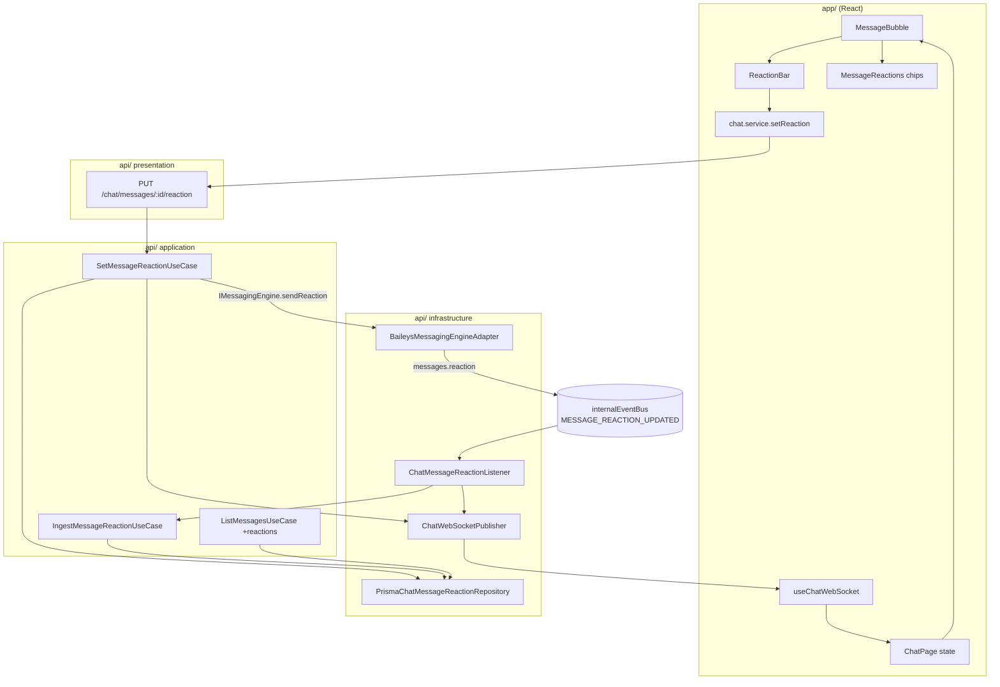

# Reações em Mensagens — Design

**Spec**: `.specs/features/message-reactions/spec.md`
**Context**: `.specs/features/message-reactions/context.md`
**Status**: Draft — revisado em 2026-09-24 (robustez; ver cabeçalho de `tasks.md`)

---

## 1. Princípio arquitetural

A feature é uma **fatia vertical simétrica ao que já existe para "Responder" (quoted message)**:
o mesmo caminho de dados, as mesmas fronteiras, os mesmos sufixos. Nada de padrão novo — quem
entende `quotedMessage` hoje entende reações amanhã.

Regras herdadas do AGENTS.md que o design respeita literalmente:

- Baileys só dentro de `messaging/infrastructure/engines/baileys/` — a UI e os use cases falam com
  `IMessagingEngine` (§9, §11)
- Evento cru da lib nunca cruza a fronteira — vira `MESSAGE_REACTION_UPDATED` no `internalEventBus` (§12)
- Prisma só na infraestrutura; use case fala com `IChatMessageReactionRepository` (§15)
- Toda consulta carrega `tenantId` (§15 multi-tenancy)
- Erro cru da engine traduzido para erro interno (§13)

## 2. Visão geral



> `mermaid-studio` não está instalado neste ambiente — diagramas ficam inline. Instalar dá
> renderização SVG/PNG e validação. (Aviso exibido uma vez.)

## 3. Reuso de código

| O que reusar | Onde | Como |
| --- | --- | --- |
| Padrão de listener de evento interno | `chat/infrastructure/listeners/ChatMessageStatusListener.ts` | Copiar a forma: `register...Listener(repo)` + `internalEventBus.on` + publish WS. `ChatMessageReactionListener` é gêmeo dele |
| Resolução de mensagem por ID externo | `IChatMessageRepository.findByExternalId` / `updateStatusByExternalId` | Reação chega com o `key.id` do WhatsApp → mesma porta de entrada |
| Envio com referência a outra mensagem | `SendMessageUseCase` monta `QuotedMessageRef` (externalId, remoteJid, fromMe) | `ReactionTargetRef` reaproveita exatamente a mesma montagem — extrair helper `buildEngineMessageRef` |
| Resolução de destinatário (grupo vs individual) | `SendMessageUseCase.execute` linhas de `recipientPhone`/`contactPhone` | Extrair para `resolveConversationTarget` e usar nos dois use cases (remove duplicação existente) |
| Publicação WS tipada | `ChatWebSocketPublisher.ChatWsEvent` | Adicionar mais um membro à união discriminada; frontend espelha em `useChatWebSocket.ts` |
| Mapper Prisma → domínio | `PrismaChatMessageMapper` | Novo `PrismaChatMessageReactionMapper` no mesmo formato |
| Ações de hover na bolha | `MessageBubble.tsx` (botão Responder, `hovered`, Menu) | O botão de reação entra no mesmo cluster de hover e no mesmo `Menu` de contexto |
| Preview de citação | `messages/QuotedMessage.tsx` | Referência de estilo para os chips (mesma linguagem visual, `alpha()` sobre a cor da bolha) |
| Tratamento de LID | `BaileysMessagingEngineAdapter.extractParticipantJid` + `resolveParticipantPhone` | Resolve o telefone do autor (`participantAlt`/`remoteJidAlt`, depois `lidMapping`) só para exibição; a chave usa a identidade crua (§4) |
| Normalização pura no adapter | `engines/baileys/normalizeChatState.ts` (+ teste) | Mesmo formato para `normalizeReactionEvent` |
| Listener com teste | `chat/infrastructure/listeners/ChatConversationStateListener.ts` (+ `.test.ts`) | Modelo mais recente que o `ChatMessageStatusListener`: pula publicação quando nada mudou, já testado |

## 4. Modelo de dados

### Prisma — novo model

```prisma
model ChatMessageReaction {
  /// Gerado na aplicação (`crypto.randomUUID()`): a escrita não passa pelo `create` do Prisma,
  /// então `@default(cuid())` nunca rodaria — e a api/ não tem lib de cuid.
  id            String   @id
  tenantId      String
  messageId     String
  /// Emoji da reação. NULL = tombstone (reação removida): a linha fica para guardar `reactedAt`
  /// da remoção — sem ela, remoção e reação fora de ordem não teriam com o que comparar.
  /// Nunca string vazia. Regra completa no use case (§7, passo 2): ≤ 64 bytes, não composto só
  /// de ASCII, sem whitespace/controle. Tamanho em bytes, não em code points: emoji com ZWJ
  /// (👨‍👩‍👧‍👦) e tag sequences (🏴󠁧󠁢󠁳󠁣󠁴󠁿) passam de 7 code points.
  emoji         String?
  /// Identidade estável do autor dentro da mensagem: "self" quando a reação é nossa (painel ou
  /// celular do operador); senão a identidade CRUA do protocolo — "lid:<id>" ou "pn:<dígitos>".
  /// Nunca o telefone resolvido: o mapeamento LID→telefone pode surgir entre dois eventos e a
  /// chave mudaria. Constante "self", não derivada do sessionId: se a conversa migrar de sessão,
  /// um mesmo autor viraria duas linhas na mesma mensagem.
  reactorKey    String
  /// Telefone do autor quando conhecido (null quando o autor usa privacidade de número).
  reactorPhone  String?
  /// pushName do autor no momento da reação (grupos).
  reactorName   String?
  /// true = reação emitida pela nossa própria conta (painel ou celular do operador).
  fromMe        Boolean  @default(false)
  /// key.id da mensagem de reação — usado para descartar reprocessamento.
  externalId    String?
  /// Carimbo de ordem do gesto (last-write-wins). Terceiros: `senderTimestampMs` do protocolo
  /// (um relógio por autor). Nossas ("self"): relógio do servidor no envio ou no recebimento —
  /// nunca o do celular do operador, que diverge do servidor (ver "Relógio" abaixo).
  reactedAt     DateTime
  createdAt     DateTime @default(now())
  /// Momento da última escrita desta linha (tombstone incluído). O maior `updatedAt` da mensagem
  /// é a `revision` do agregado — é o que o painel usa para descartar agregado velho (§8).
  updatedAt     DateTime @updatedAt

  tenant  Tenant      @relation(fields: [tenantId], references: [id])
  message ChatMessage @relation(fields: [messageId], references: [id], onDelete: Cascade)

  @@unique([messageId, reactorKey])
  @@index([tenantId, messageId])
  @@map("chat_message_reactions")
}
```

Em `ChatMessage`: `reactions ChatMessageReaction[]` **e** `@@index([tenantId, externalMessageId])`.
Em `Tenant`: `chatMessageReactions ChatMessageReaction[]`.

O índice em `ChatMessage` é pré-requisito, não otimização: toda reação recebida resolve o alvo por
`findByExternalId` (`tenantId` + `externalMessageId`), e hoje `chat_messages` só tem índice em
`[tenantId, conversationId]` e `[conversationId, createdAt]` — cada reação seria scan da tabela. O
mesmo índice acelera o `ChatMessageStatusListener`, que já faz essa busca. Custo de criar agora:
~8,7 mil linhas em produção (contagem read-only em 2026-09-24), lock de segundos.

**Migration**: `prisma migrate dev --name add_chat_message_reactions` — snake_case, alinhado com a
migration existente `20260907060000_add_conversation_state_flags`.
Aditiva (tabela nova + um índice), sem backfill, sem breaking change.

### Escrita: last-write-wins serializado por autor

Set e remoção passam pela mesma porta (`apply`). Três requisitos: ordem por carimbo (evento velho
não sobrescreve novo), atomicidade entre o `PUT` e o eco da engine, e saber se o **estado visível**
mudou — é isso que decide se alguém publica no WS.

`INSERT … ON CONFLICT … WHERE` resolve os dois primeiros, mas não o terceiro: não devolve o emoji
anterior, e uma CTE lendo o anterior falha no primeiro insert concorrente (as duas transações veem
"sem linha", as duas dizem "mudou", saem dois eventos WS). Por isso:

```ts
// PrismaChatMessageReactionRepository.apply — uma transação curta por gesto
await prisma.$transaction(async (tx) => {
  // Serializa só este par (mensagem, autor). Lock de transação: some no commit/rollback,
  // funciona atrás de pool/pgbouncer em modo transação.
  // Casts explícitos: o bind do Prisma pode chegar como `unknown` e a resolução de
  // `hashtextextended(text, bigint)` falharia. `$executeRaw`, nunca `$queryRaw`: a função devolve
  // `void`, coluna que o Prisma não desserializa.
  const lockKey = `${messageId}:${reactorKey}`;
  await tx.$executeRaw`SELECT pg_advisory_xact_lock(hashtextextended(${lockKey}::text, 0::bigint))`;
  const current = await tx.chatMessageReaction.findUnique({ where: { messageId_reactorKey } });
  if (current && current.tenantId !== tenantId) throw …; // defesa multi-tenant
  const decision = decideReactionWrite(current && toDomain(current), input); // regra pura
  if (decision.write) await tx.chatMessageReaction.upsert(…);                // id: randomUUID()
  return decision; // { applied, changed }
}, { maxWait: 2_000, timeout: 5_000 });
```

`maxWait`/`timeout` explícitos: pool esgotado ou lock preso vira erro do Prisma
(`P2028`, transação expirada), que o repositório traduz para `EngineTemporarilyUnavailableError`
(503, AGENTS.md §13) em vez de deixar erro cru subir. No `PUT`, a engine já enviou quando isso
acontece; o eco grava depois pela ingestão (auto-cura, §7).

Regra pura `decideReactionWrite(current, incoming)` em `chat/domain/services/` (AGENTS.md §8):

| Estado gravado | Evento | `applied` | `changed` |
| --- | --- | --- | --- |
| nenhum | set | sim | sim |
| nenhum | remoção | sim (tombstone guarda o carimbo) | **não** — nada visível mudou |
| qualquer | `reactedAt` menor que o gravado | não | não |
| emoji X | set X, carimbo ≥ | sim (atualiza carimbo/nome) | não |
| emoji X | set Y ou remoção, carimbo ≥ | sim | sim |
| tombstone | set, carimbo ≥ | sim | sim |
| tombstone | remoção, carimbo ≥ | sim | não |

- **Publica só quem recebe `changed = true`** — use case do painel ou listener, quem gravar
  primeiro. O segundo recebe `changed = false`. Um evento WS por gesto, em qualquer ordem de
  chegada entre `PUT` e eco, inclusive no primeiro insert concorrente (o lock serializa)
- Carimbo igual conta como "≥": o eco do nosso envio reaplica sem publicar
- Lock por `hashtextextended` de 64 bits: colisão entre pares diferentes só serializa sem
  necessidade, nunca corrompe
- Primeiro `$transaction` e primeiro `$executeRaw` do projeto — restritos a este repositório,
  tagged template (nunca `$executeRawUnsafe`)
- `find*` devolvem tombstones também: `aggregateReactions` os ignora na lista e os conta na
  `revision` (uma remoção precisa avançar a revisão). Tombstone nunca vira chip no HTTP/WS

### Relógio: de onde vem o `reactedAt`

Last-write-wins só é correto quando os carimbos comparados vêm do mesmo relógio. Cada
`reactorKey` tem um só:

- **Terceiros** (`pn:`/`lid:`): `senderTimestampMs` do evento — gestos da mesma pessoa, no mesmo aparelho
- **Nossos pelo painel** (`'self'`, `isEcho: true`): relógio do **servidor**, fixado pelo use case
  (`now`, antes de enviar) e enviado como `senderTimestampMs`. O eco devolve esse mesmo carimbo, e a
  ingestão o usa como está
- **Nossos pelo celular do operador** (`'self'`, `fromMe` e `isEcho: false`): `now` do servidor no
  recebimento, ignorando o `senderTimestampMs` do aparelho, que pode estar minutos atrás — com
  ele, um gesto feito no celular depois do painel perderia e o painel divergiria do aparelho

Por que o eco **não** pode usar `now` no recebimento: com cliques rápidos (👍 em T0 e ❤️ em T1), o
eco do 👍 processado depois de T1 ganharia carimbo maior e sobrescreveria o ❤️; com envios
concorrentes, os ecos podem voltar fora de ordem e o painel terminaria no gesto antigo. Com o
carimbo original, o eco do 👍 (T0) perde para o ❤️ (T1), como deve.

**Como o eco é reconhecido** (adapter, T6/T7): o adapter gera o id da reação **antes** de enviar
(`generateMessageIDV2`, passado em `sendMessage(jid, content, { messageId })` — a opção sobrescreve
o id gerado pela lib, `messages-send.js:1086-1087`) e o registra num `Set` em memória por sessão,
com TTL e teto de tamanho. Registrar antes de enviar fecha a corrida: o eco é emitido
**dentro** do `sendMessage` (§6). No `messages.reaction`, `reaction.key.id` presente no `Set` →
`isEcho: true` e o id sai do `Set`. Memória basta: eco e envio acontecem no mesmo processo; se o
processo cair entre os dois, não há eco. Id não encontrado (TTL estourado) cai na regra do
celular (`now`) — degrada para o comportamento anterior, não para erro.

**Falha de envio não remove o id do `Set`.** Um timeout no `sendMessage` pode acontecer depois de o
WhatsApp aceitar a reação; o eco então chega tarde. Sem a marca, cairia na regra do celular
(`now` do servidor) e sobrescreveria um gesto mais novo do painel — o bug que o `isEcho` fecha. Id
que nunca volta é inofensivo e sai pelo TTL; só o eco recebido retira o id.

**Teto do `Set` derivado do limite, nunca fixo à parte.** Se o teto for menor que o que pode estar
em voo, descartar o mais antigo tira a marca de um eco legítimo e reabre o bug do eco tardio. O
limite de envio (§7, passo 5) garante que por sessão não passam mais de `REACTION_MAX_PER_MINUTE`
reações por minuto, então:

```
REACTION_ECHO_TTL_MS  = 120_000                                     (env.ts, padrão)
teto por sessão       = REACTION_MAX_PER_MINUTE × ceil(TTL / 60_000) × 2   (calculado em env.ts)
                      = 30 × 2 × 2 = 120
```

O fator 2 cobre a folga entre a janela deslizante do limite e o TTL. Os três valores ficam em
`shared/config/env.ts`, que o adapter já lê para os `BAILEYS_*`: o adapter não importa nada do
módulo de chat. Com o teto calculado assim, id dentro do TTL nunca é descartado; ao atingir o teto,
sai primeiro o id já vencido e, só se não houver nenhum, o mais antigo, com `logger.warn` (sinal de
que o limite foi afrouxado sem ajustar o TTL).

- Eco e `apply` do use case chegam **em qualquer ordem**; com o mesmo carimbo e emoji, quem vier
  depois recebe `applied`, não `changed` (carimbo igual conta como ≥)

Quem escolhe o relógio é a aplicação (`IngestMessageReactionUseCase`), não o adapter: o adapter
entrega o `senderTimestampMs` convertido, `fromMe` e `isEcho` (fato técnico: "fui eu que enviei
este id"), sem decidir regra.

### Por que tabela e não coluna JSON

Precisamos de: unicidade por autor (idempotência), contagem por emoji, tooltip com nomes, e
"reagi eu?" por conversa. JSON exigiria ler-modificar-escrever com corrida entre WS e REST.

### Domínio

```ts
// chat/domain/entities/ChatMessageReaction.ts
export interface ChatMessageReaction {
  id: string; tenantId: string; messageId: string;
  /** null = tombstone; os `find*` devolvem tombstones (entram na `revision`, não na lista). */
  emoji: string | null; reactorKey: string;
  reactorPhone: string | null; reactorName: string | null;
  fromMe: boolean; externalId: string | null;
  reactedAt: Date; createdAt: Date; updatedAt: Date;
}

// chat/domain/contracts/IChatMessageReactionRepository.ts
export interface ApplyReactionInput {
  tenantId: string; messageId: string; reactorKey: string;
  /** null = remover (grava tombstone) */
  emoji: string | null;
  reactorPhone: string | null; reactorName: string | null;
  fromMe: boolean; externalId: string | null; reactedAt: Date;
}

export interface ApplyReactionResult {
  /** A linha foi gravada (evento não era mais antigo que o estado). */
  applied: boolean;
  /** O estado visível (emoji ativo) mudou — só então alguém publica no WS. */
  changed: boolean;
}

export interface IChatMessageReactionRepository {
  /**
   * Aplica set ou remoção do autor por last-write-wins em `reactedAt`, serializado por
   * (mensagem, autor). A decisão é de `decideReactionWrite` (domínio); o repositório só a executa.
   */
  apply(input: ApplyReactionInput): Promise<ApplyReactionResult>;
  /** Linhas da mensagem, tombstones incluídos (para o agregado publicado no WS). */
  findByMessageId(messageId: string, tenantId: string): Promise<ChatMessageReaction[]>;
  /** Lote — evita N+1 na listagem de mensagens. Tombstones incluídos (revision). */
  findByMessageIds(messageIds: string[], tenantId: string): Promise<ChatMessageReaction[]>;
}
```

Um método de escrita, não `upsert` + `remove`: duas portas para o mesmo estado permitiriam que um
chamador fizesse `DELETE` e reabrisse o problema de ordem que o tombstone resolve.

### Regra pura: agregação (`chat/domain/services/aggregateReactions.ts`)

Função pura, conforme AGENTS.md §8 (regra fora de entidade → `domain/services/`):
`aggregateReactions(rows, contactsByPhone) → ReactionAggregate` (`{ revision, reactions }`).
`revision` = maior `updatedAt` entre todas as linhas, tombstones incluídos; `null` sem linhas.
Na lista, ignora tombstones, agrupa por emoji, ordena por
contagem desc e depois pela primeira `reactedAt`, `reactedByMe` = `fromMe`, resolve nome
(contato → `reactorName` → `null`), corta autores em 10. Usada por `ListMessagesUseCase`, pelos dois
use cases de reação e pelo listener — um cálculo só, então `PUT`, `GET` e WS nunca divergem.

## 5. Contrato da engine (port)

`messaging/domain/contracts/IMessagingEngine.ts`:

```ts
export interface ReactionTargetRef {
  /** key.id da mensagem alvo no WhatsApp */
  externalId: string;
  /** Telefone (individual) ou "<groupJid>@g.us" (grupo) */
  remoteJid: string;
  /** true quando a mensagem alvo foi enviada por nós */
  fromMe: boolean;
  /** JID do participante autor da mensagem alvo (obrigatório em grupo p/ montar a key) */
  participant?: string | null;
}

export interface SendReactionInput {
  sessionId: string;
  tenantId: string;
  target: ReactionTargetRef;
  /** Emoji a aplicar; `null` remove a reação existente. */
  emoji: string | null;
  /**
   * Carimbo do gesto, fixado pelo use case (relógio do servidor). A engine o envia como
   * `senderTimestampMs` — sem ele a lib usa `Date.now()` próprio (`Utils/messages.js:323-324`).
   * O destinatário recebe o mesmo carimbo que gravamos; a nossa ordenação não depende disso (§4).
   */
  reactedAt: Date;
}

// no IMessagingEngine:
/** Aplica ou remove nossa reação em uma mensagem. `emoji: null` remove. */
sendReaction(input: SendReactionInput): Promise<SendMessageResult>;
```

Um método só, `null` = remover — espelha o protocolo (`react.text === ''` remove) sem inflar o port,
e evita dois caminhos de erro para a mesma operação.

## 6. Adapter Baileys

**Envio** — `BaileysMessagingEngineAdapter.sendReaction`:

```ts
const key = {
  id: target.externalId,
  remoteJid: toJid(target.remoteJid),
  fromMe: target.fromMe,
  ...(target.participant ? { participant: toJid(target.participant) } : {}),
};
const sent = await socket.sendMessage(key.remoteJid, {
  react: { text: emoji ?? '', key, senderTimestampMs: reactedAt.getTime() },
});
```

Pré-condições checadas **antes** de chamar o socket (falha rápida, sem envio parcial):
sessão presente e `open` → senão `SESSION_NOT_CONNECTED`; em grupo com alvo de terceiro,
`participant` obrigatório → senão `MESSAGE_SEND_FAILED` com motivo — key de grupo sem `participant`
é aceita pelo WhatsApp e não aplicada, falha silenciosa.

Erros passam por `BaileysErrorTranslator` (§13): sessão fora do ar → `SESSION_NOT_CONNECTED`,
falha de envio → `MESSAGE_SEND_FAILED`.

**Recebimento** — novo handler ao lado de `messages.upsert`:

```ts
socket.ev.on('messages.reaction', (items) => { /* por item: normaliza e emite */ });
```

#### Qual campo é o quê (verificado no pacote instalado — NÃO inverter)

`lib/Utils/process-message.js:411-421` monta o evento assim:

```js
const reaction = { ...content.reactionMessage, key: message.key };
ev.emit('messages.reaction', [{ reaction, key: content.reactionMessage?.key }]);
```

Ou seja, ao contrário do que a intuição sugere:

| Campo do evento | O que realmente é |
| --- | --- |
| `key` (nível do item) | **key da mensagem ALVO** — `key.id` é o `externalMessageId` que procuramos no banco |
| `reaction.key` | **key da mensagem DE REAÇÃO** — carrega o autor: `participant` (grupo), `remoteJid` (chat), `fromMe` (fomos nós), `id` (id da reação) |
| `reaction.text` | Emoji; vazio/ausente = reação removida (comentário da própria lib em `Types/Events.d.ts:83`) |
| `reaction.senderTimestampMs` | `Long` do protobuf → converter |

Antes disso, `processMessage` já normalizou o `fromMe`/`remoteJid` do alvo para a nossa perspectiva
(`normaliseKey`, linhas 87-104), então `key.fromMe` pode ser usado direto.

Normalização obrigatória no adapter (nada disso vaza):

- alvo = `item.key.id`; chat = `item.key.remoteJid`
- autor = `item.reaction.key.participant` (grupo) senão `item.reaction.key.remoteJid`; `fromMe` = `item.reaction.key.fromMe`
- `reactorKey`: `'self'` se `fromMe`; senão identidade crua — `lid:<id>` se o autor é `@lid`, senão `pn:<dígitos>`
- `reactorPhone` (só exibição): reusar os helpers que o adapter já tem para remetente de grupo —
  `participantAlt`/`remoteJidAlt` primeiro, depois `resolveParticipantPhone` (mapeamento
  `lidMapping.getPNForLID` da sessão). **Não** repetir a regra do `messages.upsert` para 1:1, que
  descarta a mensagem quando `@lid` vem sem `remoteJidAlt`: aqui a reação é mantida com `reactorPhone: null`
- ignorar `@broadcast` / `status@broadcast`
- `senderTimestampMs` (`Long`) → `Date` via `Number(...)`; ausente, zero ou não finito → agora. O adapter só converte; a escolha do relógio para `fromMe` é da ingestão (§4)

A parte síncrona (campos, chave, carimbo, filtros) sai como função pura `normalizeReactionEvent`,
no mesmo formato de `normalizeChatState.ts`, que já está nesse diretório. A resolução de telefone
(assíncrona, depende do socket) fica no handler e entra depois da função pura.

#### O que já acontece hoje com reações (e não muda)

Reação também chega por `messages.upsert`. Nesse caminho, `buildIncomingMessageRoutingInfo` roda
**antes** de `extractBaileysMessage` descartar o `reactionMessage` (adapter, ~linhas 547-555) — em
grupo, isso consulta o snapshot de metadados do grupo e resolve o LID do participante para nada.
Custo pré-existente, não criado por esta feature. Fica registrado em §10; mexer na ordem do upsert é
outro escopo, com smoke próprio.

#### O eco das nossas próprias reações

`emitOwnEvents` é `true` por padrão (`lib/Defaults/index.js:55`) e o adapter não o sobrescreve.
`sendMessage` chama `upsertMessage(fullMsg, 'append')` (`lib/Socket/messages-send.js:1135-1139`), que
emite `messages.upsert` **e** roda `processMessage` (`lib/Socket/chats.js:1013`). Consequências
confirmadas:

1. Toda reação enviada pelo painel volta pelo `messages.reaction` com `reaction.key.fromMe = true`
   → a ingestão auto-cura o caso "enviado pela engine, falhou ao gravar" (§7, ordem 6→7)
2. O eco vem marcado `isEcho` e com o carimbo que nós fixamos; ele é emitido **dentro** do
   `sendMessage`, então costuma chegar **antes** do `apply` do use case. Quem gravar primeiro
   (listener ou use case) recebe `changed = true` e publica; o outro recebe `changed = false`. Um
   evento WS por gesto, em qualquer ordem (§4, T13)
3. O `messages.upsert` desse eco chega como `type: 'append'`, que o adapter roteia para o history
   sync (e nem chega lá quando `BAILEYS_SYNC_FULL_HISTORY=false`, guard já existente) — inofensivo
   nos dois casos, porque `extractBaileysMessage` devolve `null` para `reactionMessage`

`extractBaileysMessage` continua devolvendo `null` para `reactionMessage` — sem duplicidade de
ingestão, o caminho de reação é exclusivamente o evento `messages.reaction`.

**Evento interno** (`shared/events/InternalMessagingEvent.ts`):

```ts
| {
    type: 'MESSAGE_REACTION_UPDATED';
    sessionId: string; tenantId: string;
    /** key.id da mensagem que recebeu a reação */
    targetExternalMessageId: string;
    /** Emoji aplicado; null = reação removida */
    emoji: string | null;
    reactorKey: string;
    reactorPhone: string | null;
    reactorName: string | null;
    fromMe: boolean;
    /** true = eco de reação que esta engine acabou de enviar (id registrado antes do envio). */
    isEcho: boolean;
    reactionExternalId: string | null;
    reactedAt: string; // ISO — senderTimestampMs convertido; a ingestão decide se usa (§4)
  }
```

## 7. Componentes — API

| Componente | Local | Responsabilidade | Depende de |
| --- | --- | --- | --- |
| `ChatMessageReaction` (entity) | `chat/domain/entities/` | Estrutura pura | — |
| `IChatMessageReactionRepository` | `chat/domain/contracts/` | Contrato de persistência | entity |
| `PrismaChatMessageReactionRepository` | `chat/infrastructure/repositories/` | `apply` (last-write-wins atômico, tombstone), buscas em lote (tombstones incluídos, para a `revision`) | Prisma, mapper |
| `PrismaChatMessageReactionMapper` | `chat/infrastructure/mappers/` | Prisma ↔ domínio | — |
| `SetMessageReactionUseCase` | `chat/application/use-cases/` | Reagir/remover pelo painel: valida emoji, resolve alvo + destino, chama engine, persiste, publica WS | repos, `IMessagingEngine` |
| `IngestMessageReactionUseCase` | `chat/application/use-cases/` | Reação vinda do WhatsApp: resolve mensagem por `externalMessageId`, `apply`, devolve agregado (`null` quando nada mudou). **Nunca toca na conversa** (§7.1) | repos |
| `ChatMessageReactionListener` | `chat/infrastructure/listeners/` | `MESSAGE_REACTION_UPDATED` → use case → publish WS (pula publish quando a ingestão devolve `null`) | bus, use case, publisher |
| `ListMessagesUseCase` (alterado) | `chat/application/use-cases/` | Anexa `reactions` agregadas ao `ChatMessageDto` (1 query em lote) + resolve nome do autor reusando o `findByPhones` que já existe ali | reaction repo, contact repo |
| `ChatWebSocketPublisher` (alterado) | `chat/infrastructure/ws/` | Novo evento na união tipada | — |
| `chat.routes.ts` (alterado) | `chat/presentation/routes/` | `PUT /messages/:messageId/reaction` (handler fino) | use case, presenter |
| `chat.schema.ts` (alterado) | `chat/presentation/schemas/` | `messageIdParamSchema`, `reactionBodySchema` | — |
| `ChatPresenter` (alterado) | `chat/presentation/presenters/` | `toReactionSummaryList` — DTO HTTP das reações | — |

### Ordem interna do `SetMessageReactionUseCase` (importa)

1. Carrega mensagem + conversa (`tenantId` sempre) → `NotFoundError` se faltar
2. Valida emoji quando não-nulo: não vazio, ≤ 64 bytes, **não composto só de ASCII** e sem
   whitespace/controle (keycap `1️⃣` = `1`+U+FE0F+U+20E3 contém ASCII e é válido). "Controle" é
   `\p{Cc}` e whitespace é `\s`/`\p{Z}` — **nunca `\p{C}`**, que inclui `Cf` e rejeitaria ZWJ (U+200D)
   e tag sequences de bandeira →
   `ValidationError` (400)
3. Pré-condições de envio, **sem o fallback do `SendMessageUseCase`** (que grava sem enviar quando
   falta engine ou `sessionId`, `SendMessageUseCase.ts:53-78`): sem engine ou sem `conv.sessionId` →
   `SessionNotConnectedError` (409); mensagem sem `externalMessageId` → `ConflictError` (409) — ambos
   já existem em `shared/errors/internal/`, nenhum erro novo.
   Reação é gesto no WhatsApp; gravada sem envio, o painel mostra algo que o contato nunca vê
4. Resolve destino/participante (helper compartilhado com `SendMessageUseCase`, T8). Alvo:
   `fromMe` = `direction === OUTBOUND`; em grupo com alvo de terceiro, `participant` =
   `fromParticipant` — ausente → erro, não key incompleta
5. **Limite de envio** (`IReactionSendThrottle.tryAcquire(sessionId, messageId)` → reserva ou
   `null`): intervalo mínimo por mensagem e teto por sessão por minuto, valores em
   `shared/config/env.ts` (`REACTION_MIN_INTERVAL_MS`, padrão **700**; `REACTION_MAX_PER_MINUTE`,
   padrão 30). A vaga é **reservada** na checagem, de forma síncrona — registrar só depois do envio
   deixaria duas requisições simultâneas passarem juntas. Se a engine falhar no passo 6, o use case
   chama `release(reserva)` e a vaga volta: a nova tentativa do operador recebe o erro real
   (sessão caída), não um 429 enganoso. Estourou →
   `TooManyRequestsError` (429, novo e genérico em `ResourceErrors.ts`, código `TOO_MANY_REQUESTS`)
   e nada é enviado nem gravado. Motivo: rajada de reações é volume de saída fora do padrão humano,
   o risco que o `STATE.md` registra para o número do cliente. É defesa; a contenção primária é o
   painel juntar os cliques (§8). Implementação em memória
   (`chat/infrastructure/throttle/InMemoryReactionSendThrottle.ts`), por instância — o limite não é
   estado crítico, e perder o contador num restart só afrouxa o limite por um minuto
6. Fixa `reactedAt = now` (relógio do servidor) e **envia pela engine primeiro** — se falhar, devolve a vaga do limite (`release`), propaga e não grava
7. `apply` com `reactorKey = 'self'`, `fromMe: true`, o mesmo `reactedAt` do envio
8. Publica `chat.message.reaction.updated` com o agregado completo (`aggregateReactions`) **só se
   `changed`** — se o eco chegou antes e já publicou, não repete
9. Devolve o agregado lido depois do `apply`, sempre (o `PUT` responde com a lista final mesmo sem
   publicar — o cliente reconcilia sem esperar o WS)

### 7.1 Reação NÃO é mensagem (regra dura)

Nenhum caminho de reação — painel ou ingestão — pode alterar `lastMessageAt`, `lastMessagePreview`,
`unreadCount` ou `status` da conversa, nem emitir `chat.conversation.updated` /
`chat.unread.updated`. Uma reação em mensagem de três dias atrás não pode saltar a conversa para o
topo da lista nem marcá-la como não lida. É o oposto do `IngestIncomingMessageUseCase`, que
atualiza os três — por isso a ingestão de reação é um use case separado e não um ramo daquele.

**Exceção que não viola a regra**: `archived`. Quando um contato reage a mensagem nossa e a conta
tem `unarchiveChats` ligado, o Baileys emite `chats.update { archived: false }`
(`process-message.js:200-205`) e o espelhamento de estado já existente (`CHAT_STATE_UPDATED` →
`applyRemoteState`) desarquiva a conversa. É fiel ao celular e acontece fora do caminho de reação,
que continua sem escrever na conversa. Não suprimir: bloquear isso seria divergir do aparelho.
Timestamp e não lidas ficam de fora porque `isRealMessage` exclui `reactionMessage`
(`process-message.js:108-118`) — verificado no Baileys 7.0.0-rc14 instalado.

### 7.2 Resolução do nome do autor (REACT-11)

`ListMessagesUseCase` já monta um `Map` de telefone → contato via `contactRepo.findByPhones` para os
avatares de participante de grupo (`ListMessagesUseCase.ts:85`). O presenter das reações reusa
**o mesmo lote**, sem query adicional:

1. `reactorPhone` conhecido e presente no mapa → nome do `ChatContact`
2. senão → `reactorName` gravado no momento da reação (pushName)
3. senão (LID sem alternativa) → `null`, e a UI exibe a string "Participante"

O mesmo encadeamento vale no `ChatMessageReactionListener` antes de publicar o agregado no WS.

Ordem 6→7 evita persistir reação que o WhatsApp não aceitou. O caso residual — "enviado mas não
gravado" — se resolve sozinho: o eco `messages.reaction` do próprio envio (confirmado em §6) entra
pela ingestão (carimbo de recebimento) e grava a linha com a mesma `reactorKey`.

### Contrato HTTP

```
PUT /api/chat/messages/:messageId/reaction
body: { "emoji": "👍" }   ou   { "emoji": null }   → remove
200: { success: true, data: { messageId, conversationId, reactionsRevision, reactions: ReactionSummary[] } }
404 mensagem inexistente | 409 sessão não conectada ou mensagem sem id externo | 400 emoji inválido
429 limite de envio de reações | 503 engine/banco temporariamente indisponível
```

```ts
export interface ReactionSummary {
  emoji: string;
  count: number;
  reactedByMe: boolean;
  /** Autores, para o tooltip (limitado a 10 no presenter). `name` já resolvido: nome do
   *  `ChatContact` quando o telefone é conhecido, senão o `reactorName` gravado na reação. */
  reactors: { name: string | null; phone: string | null }[];
}
```

O mesmo par `reactionsRevision` (ISO ou `null`) + `ReactionSummary[]` aparece em três lugares —
`PUT`, `GET /messages` (por mensagem) e evento WS. Um shape só, um render só, uma regra de ordem.

### Evento WS

```ts
| {
    event: 'chat.message.reaction.updated';
    data: {
      tenantId: string; conversationId: string; messageId: string;
      reactionsRevision: string | null; // maior updatedAt da mensagem; ordena agregados
      reactions: ReactionSummary[]; // agregado COMPLETO, substitui o estado do servidor no painel
    };
  }
```

Agregado completo (não delta) porque o cliente pode ter perdido eventos durante uma reconexão de WS;
substituição é sempre convergente.

## 8. Componentes — Painel

| Componente | Local | Responsabilidade |
| --- | --- | --- |
| `strings.ts` | `features/chat/` | Todas as labels da feature (D3) |
| `types.ts` (alterado) | `features/chat/` | `MessageReaction` + `reactions?: MessageReaction[]` em `ChatMessage` |
| `chat.api.types.ts` (alterado) | `types/` | `ReactionSummaryApiDto`, campo em `ChatMessageApiDto` |
| `chat.service.ts` (alterado) | `services/` | `setMessageReaction(messageId, emoji \| null)` |
| `EmojiPicker.tsx` | `components/` (compartilhado) | Wrapper `React.lazy` sobre `emoji-picker-react`, tema plugado no MUI (`theme.palette.mode`) |
| `ReactionBar.tsx` | `features/chat/components/messages/` | Barra rápida (6 emojis) + `+`; `Popover` do MUI |
| `MessageReactions.tsx` | `features/chat/components/messages/` | Chips agrupados por emoji, contagem, tooltip de autores, clique = toggle |
| `MessageBubble.tsx` (alterado) | `features/chat/components/` | Botão de reagir no cluster de hover + item no `Menu`; renderiza `MessageReactions` no rodapé da bolha |
| `reactionDispatcher.ts` | `features/chat/` | Temporizadores do envio agrupado, fora do React; `subscribe`, `reset` (logout/tenant) |
| `ChatPage.tsx` (alterado) | `pages/` | Handler do evento WS; `handleSetReaction` otimista com rollback |
| `useChatWebSocket.ts` (alterado) | `hooks/` | Novo membro em `ChatWsPayload` |

### Estado otimista (REACT-04)

Por mensagem, o painel guarda duas coisas separadas — é o que dispensa snapshot e retenção:

- `server`: último agregado de servidor aceito, `{ revision, reactions }`
- `pending`: cliques do operador ainda sem resposta, em ordem (`{ requestId, emoji | null }[]`)

O que a bolha mostra é **derivado**: `server.reactions` com o **último** clique pendente aplicado
por cima (toggle da reação `'self'`). Nada é sobrescrito à mão.

Regras (redutor puro, T21):

1. **Aceitar agregado de servidor** (resposta do `PUT`, evento WS ou página do `GET`): só se
   `revision >= server.revision` (ou se não há `server`). Menor → descarta. Resolve os três
   desordenamentos: resposta HTTP de um `PUT` antigo depois do WS de um novo, WS atrasado após
   reconexão, e página do `GET` carregada antes de um WS já aplicado
2. **Clique**: acrescenta em `pending` como `draft` e a bolha já mostra o gesto. **Não envia na hora**
3. **Envio agrupado**: por mensagem, 400 ms sem novo clique **e** pelo menos 1000 ms desde o último
   envio da mesma mensagem → envia só o **último** `draft` (os anteriores saem de `pending` sem
   requisição). Regra de folga: **intervalo do painel (1000) > intervalo da API (700)**. O painel
   mede no envio e a API na chegada; com intervalos iguais, o jitter de rede aproximaria dois
   envios legítimos e daria 429 em uso normal. Mudar um exige conferir o outro.
   Descarte do vai e volta: se o gesto final é igual à **base efetiva** — o alvo do último
   `inflight` da mensagem, quando houver; senão o estado `self` em `server` —, descarta sem enviar.
   Comparar só com `server` erraria: server 👍 → remoção em voo → novo 👍 compararia com o 👍 velho,
   seria descartado, e a remoção venceria contra a intenção do operador. Um `draft` enviado vira
   `inflight`. Motivo: cada envio é uma mensagem ao WhatsApp; rajada é sinal de automação
   (`STATE.md`).

   **Onde vivem os temporizadores**: num módulo TS sem React
   (`features/chat/reactionDispatcher.ts`), singleton por aba, com `subscribe` para quem quiser os
   resultados; `useReactionDispatcher` é só o adaptador React. A decisão do que enviar é função
   pura (`selectReactionToSend`), testável. Consequências:
   - **Trocar de conversa** não desmonta o `ChatPage` (a conversa é estado dele) nem o despachante:
     os temporizadores seguem. Não há flush na troca
   - **Sair da rota do chat** desmonta o `ChatPage`, não o despachante: o gesto em espera sai no
     horário normal, **sempre respeitando os 400 ms e o intervalo de 1000 ms** — nunca adiantado,
     porque um envio antecipado tomaria 429 sem ninguém para mostrar
   - **Resultado sem inscrito** (página já saiu): sucesso não precisa de nada; erro vai para
     `console.warn` com `messageId` e código. Não há notificação global no painel e criar uma é
     outro escopo; ao voltar, o `GET` traz o estado real e a `revision` descarta o otimista velho
   - **Logout ou troca de tenant** cancela tudo o que está em espera (`reactionDispatcher.reset()`,
     chamado onde `AuthContext`/`TenantContext` trocam o contexto). Sem isso, um envio agendado
     sairia com o token ou o tenant novo para uma mensagem do anterior
   - **Fechar ou recarregar a aba** perde o que estava em espera (até ~1 s). Aceito: o painel
     volta mostrando o estado real do servidor, sem reação fantasma
4. **Resposta ok**: remove aquele `requestId` de `pending` e aplica a regra 1 ao agregado retornado
5. **Erro**: remove aquele `requestId` de `pending` e mostra o `Snackbar` (429 tem texto próprio: "aguarde um instante"). Nada é restaurado: a
   bolha volta a mostrar `server` (com o próximo clique pendente por cima, se houver). Se um WS
   com o gesto aplicado chegou durante o `PUT` (timeout HTTP com envio ok), ele já está em
   `server` e continua visível — o painel não diz "sem reação" enquanto o WhatsApp tem o emoji

`revision` é o `updatedAt` do servidor (relógio da API): ordem total por mensagem enquanto houver
uma instância gravando; empate aceita o que chega (regra `>=`).

### Visual, tema e acessibilidade (REACT-12)

- Chips ancorados no canto inferior da bolha, sobrepondo levemente a borda (como no WhatsApp),
  `position: relative` na bolha + margem inferior reservada para não cortar a última linha
- Cores só por tokens MUI (`theme.palette.*`, `alpha()`), zero hex — funciona nos três modos
- Chip é `<button>` com `aria-label` do tipo "👍 3 reações — clique para reagir", `aria-pressed`
  quando `reactedByMe`
- `Tooltip` do MUI (já usado no bubble) com os nomes; abre por foco de teclado, não só hover
- Barra rápida navegável por setas, `Esc` fecha, foco volta ao botão de origem
- Botão de reagir aparece no hover **e** no foco por teclado (o botão de Responder hoje só aparece
  no hover — corrigido de passagem, mesma linha de código)

## 9. Nomenclatura (white label)

`ChatMessageReaction`, `SetMessageReactionUseCase`, `IngestMessageReactionUseCase`,
`chat_message_reactions`, `chat.message.reaction.updated` — todos descrevem o recurso, nenhum cita a
marca do produto nem o nome da engine.

## 10. Riscos

| Risco | Mitigação |
| --- | --- |
| Eco das nossas reações (`emitOwnEvents`, confirmado em §6) → estado e WS duplicados | `apply` serializado por `[messageId, reactorKey]` com `reactorKey = 'self'`; publica só quem recebe `changed` — um evento por gesto em qualquer ordem |
| Relógio do celular do operador fora do servidor → gesto do celular perde para o do painel | Gestos `self` carimbados pelo relógio do servidor, nos dois caminhos (§4, "Relógio") |
| Keycap (`1️⃣`, `#️⃣`) rejeitado por conter ASCII | Validação recusa só emoji composto **inteiro** de ASCII (§7) |
| Reação chega antes da mensagem alvo (race no upsert inicial) | Descarte com log `debug`; a próxima reação corrige (reload não, porque a reação descartada não foi gravada). Backfill fora de escopo (D2) |
| `emoji-picker-react` pesar no bundle | `React.lazy` + `Suspense`; só carrega ao clicar em `+` |
| `senderTimestampMs` vem como `Long` do protobuf | Converter com `Number(...)` guardado; ausente/zero/não finito → agora |
| Volume de reações em grupo grande | Índice `[tenantId, messageId]` + busca em lote na listagem |
| Divergência entre a união `ChatWsEvent` (api) e `ChatWsPayload` (app) | Alterar os dois na mesma task (T12) — é a mesma regra que já vale para os eventos existentes |
| Refactor do `SendMessageUseCase` (T8) regride o envio de mensagens, sem testes que peguem isso | Vai como commit `refactor(chat):` isolado, com teste de caracterização do helper **antes** de mover o código, e smoke de envio (individual, grupo, com citação) antes de T9 encostar nele |
| Remoção e reação fora de ordem (`DELETE` perderia o carimbo) | Tombstone + last-write-wins atômico no banco (§4) |
| Corrida `PUT` × eco da engine gravando a mesma linha | Lock por (mensagem, autor) + decisão pura (§4); inclui o primeiro insert concorrente |
| Mesmo autor vira duas reações quando o LID passa a resolver para telefone | `reactorKey` usa a identidade crua do protocolo; telefone resolvido só em `reactorPhone` |
| T9 copiar o fallback "grava sem enviar" do `SendMessageUseCase` | Proibido no §7 (passo 3) e coberto por teste da T9 |
| Grupo: key sem `participant` é aceita e não aplicada pelo WhatsApp | Adapter recusa antes do socket (§6); T23 valida em grupo com participante `@lid` |
| Busca do alvo por `externalMessageId` sem índice | `@@index([tenantId, externalMessageId])` na mesma migration (§4) |
| Reação desarquiva conversa (`unarchiveChats`) e parece bug | Comportamento fiel ao celular (§7.1); documentado e no roteiro da T23 |
| Reação em grupo passa pelo roteamento do `messages.upsert` antes de ser descartada (metadados do grupo, LID) | Pré-existente; fora de escopo. Registrar em `STATE.md` como dívida; não reordenar o upsert nesta feature |
| Cliques rápidos piscam estado antigo no painel; resposta HTTP velha chega depois de WS novo | Estado do servidor separado dos cliques pendentes; agregado aceito só com `revision` ≥ (§8), no redutor puro |
| Eco carimbado no recebimento sobrescreve gesto mais novo do painel | Eco reconhecido por id pré-gerado (`isEcho`) e mantido com o carimbo original (§4, "Relógio") |
| `revision` depende do relógio da API | Uma instância grava por sessão hoje; com várias, a deriva entre relógios pode inverter duas escritas no mesmo ms — aceito e registrado |
| Flush ao desmontar enviaria antes do intervalo e tomaria 429 sem ninguém para mostrar | Despachante fora do React, envio sempre no horário normal; sem flush na troca de conversa (§8, regra 3) |
| Timeout no envio com o WhatsApp aceitando → eco tardio sem marca sobrescreve gesto novo | Id fica no `Set` até o TTL mesmo em falha (§4) |
| Teto do `Set` de ecos menor que o volume em voo descarta marca legítima | Teto calculado do limite de envio e do TTL em `env.ts` (§4); descarte prefere id vencido e avisa se tiver de tirar um válido |
| Descarte do vai e volta comparado com estado que ainda não reflete o envio em voo | Base efetiva = último `inflight`, senão `server` (§8, regra 3) |
| Jitter de rede faz envio legítimo tomar 429 | Intervalo da API (700 ms) menor que o do painel (1000 ms), regra registrada no §8 |
| Vaga do limite gasta num envio que falhou mascara o erro real com 429 | Reserva síncrona + `release` quando a engine falha (§7, passos 5-6) |
| Rajada de reações (cliques ou toggle) vira rajada de mensagens ao WhatsApp — risco para o número | Painel junta os cliques e envia só o último após 400 ms (§8); API limita por mensagem e por sessão, 429 antes da engine (§7, passo 5) |
| Bind do Prisma sem tipo quebra `hashtextextended`; `$queryRaw` quebra com `void` | Casts `::text`/`::bigint` e `$executeRaw` (§4) |
| Pool esgotado ou lock preso estoura a transação com erro cru | `maxWait`/`timeout` explícitos; `P2028` traduzido para 503 (§4) |
| Primeiros `$transaction` e `$executeRaw` do projeto | Restritos ao repositório de reações; lock de transação (`pg_advisory_xact_lock`), tagged template; decisão em função pura testada; coberto no smoke |
