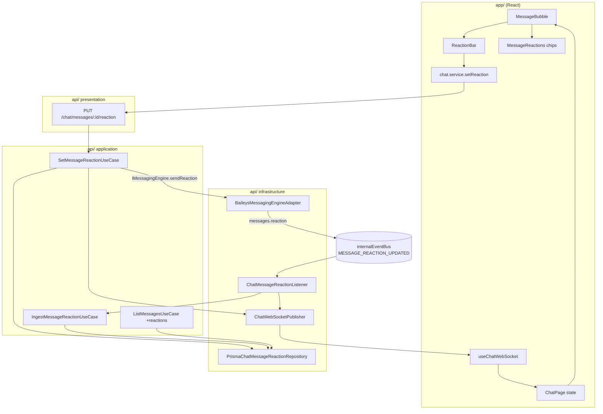

# Reações em Mensagens — Design

**Spec**: `.specs/features/message-reactions/spec.md`
**Context**: `.specs/features/message-reactions/context.md`
**Status**: Draft

---

## 1. Princípio arquitetural

A feature é uma **fatia vertical simétrica ao que já existe para "Responder" (quoted message)**:
o mesmo caminho de dados, as mesmas fronteiras, os mesmos sufixos. Nada de padrão novo — quem
entende `quotedMessage` hoje entende reações amanhã.

Regras herdadas do AGENTS.md que o design respeita literalmente:

- Baileys só dentro de `messaging/infrastructure/engines/baileys/` — a UI e os use cases falam com
  `IMessagingEngine` (§9, §11)
- Evento cru da lib nunca cruza a fronteira — vira `MESSAGE_REACTION_UPDATED` no `internalEventBus` (§12)
- Prisma só na infraestrutura; use case fala com `IChatMessageReactionRepository` (§15)
- Toda consulta carrega `tenantId` (§15 multi-tenancy)
- Erro cru da engine traduzido para erro interno (§13)

## 2. Visão geral



> `mermaid-studio` não está instalado neste ambiente — diagramas ficam inline. Instalar dá
> renderização SVG/PNG e validação. (Aviso exibido uma vez.)

## 3. Reuso de código

| O que reusar | Onde | Como |
| --- | --- | --- |
| Padrão de listener de evento interno | `chat/infrastructure/listeners/ChatMessageStatusListener.ts` | Copiar a forma: `register...Listener(repo)` + `internalEventBus.on` + publish WS. `ChatMessageReactionListener` é gêmeo dele |
| Resolução de mensagem por ID externo | `IChatMessageRepository.findByExternalId` / `updateStatusByExternalId` | Reação chega com o `key.id` do WhatsApp → mesma porta de entrada |
| Envio com referência a outra mensagem | `SendMessageUseCase` monta `QuotedMessageRef` (externalId, remoteJid, fromMe) | `ReactionTargetRef` reaproveita exatamente a mesma montagem — extrair helper `buildEngineMessageRef` |
| Resolução de destinatário (grupo vs individual) | `SendMessageUseCase.execute` linhas de `recipientPhone`/`contactPhone` | Extrair para `resolveConversationTarget` e usar nos dois use cases (remove duplicação existente) |
| Publicação WS tipada | `ChatWebSocketPublisher.ChatWsEvent` | Adicionar mais um membro à união discriminada; frontend espelha em `useChatWebSocket.ts` |
| Mapper Prisma → domínio | `PrismaChatMessageMapper` | Novo `PrismaChatMessageReactionMapper` no mesmo formato |
| Ações de hover na bolha | `MessageBubble.tsx` (botão Responder, `hovered`, Menu) | O botão de reação entra no mesmo cluster de hover e no mesmo `Menu` de contexto |
| Preview de citação | `messages/QuotedMessage.tsx` | Referência de estilo para os chips (mesma linguagem visual, `alpha()` sobre a cor da bolha) |
| Tratamento de LID | `BaileysMessagingEngineAdapter` (`@lid` → `remoteJidAlt`) | Mesma normalização aplicada ao autor da reação |

## 4. Modelo de dados

### Prisma — novo model

```prisma
model ChatMessageReaction {
  id            String   @id @default(cuid())
  tenantId      String
  messageId     String
  /// Emoji da reação. Nunca vazio — remoção apaga a linha. Validado por tamanho (≤ 64 bytes),
  /// não por contagem de code points: emoji com ZWJ (👨‍👩‍👧‍👦) e tag sequences (🏴󠁧󠁢󠁳󠁣󠁴󠁿) passam de 7.
  emoji         String
  /// Identidade estável do autor dentro da mensagem: telefone em dígitos, LID, ou a constante
  /// "self" quando a reação é nossa (painel ou celular do operador). Constante — não derivada do
  /// sessionId: se a conversa migrar de sessão, um mesmo autor viraria duas linhas na mesma mensagem.
  reactorKey    String
  /// Telefone do autor quando conhecido (null quando o autor usa privacidade de número).
  reactorPhone  String?
  /// pushName do autor no momento da reação (grupos).
  reactorName   String?
  /// true = reação emitida pela nossa própria conta (painel ou celular do operador).
  fromMe        Boolean  @default(false)
  /// key.id da mensagem de reação — usado para descartar reprocessamento.
  externalId    String?
  /// senderTimestampMs do protocolo; resolve reações fora de ordem.
  reactedAt     DateTime @default(now())
  createdAt     DateTime @default(now())

  tenant  Tenant      @relation(fields: [tenantId], references: [id])
  message ChatMessage @relation(fields: [messageId], references: [id], onDelete: Cascade)

  @@unique([messageId, reactorKey])
  @@index([tenantId, messageId])
  @@map("chat_message_reactions")
}
```

Em `ChatMessage`: `reactions ChatMessageReaction[]`. Em `Tenant`: `chatMessageReactions ChatMessageReaction[]`.

**Migration**: `prisma migrate dev --name add_chat_message_reactions` — snake_case, alinhado com a
migration existente `20260907060000_add_conversation_state_flags`.
Aditiva, sem backfill, sem breaking change.

### Por que tabela e não coluna JSON

Precisamos de: unicidade por autor (idempotência), contagem por emoji, tooltip com nomes, e
"reagi eu?" por conversa. JSON exigiria ler-modificar-escrever com corrida entre WS e REST.

### Domínio

```ts
// chat/domain/entities/ChatMessageReaction.ts
export interface ChatMessageReaction {
  id: string; tenantId: string; messageId: string;
  emoji: string; reactorKey: string;
  reactorPhone: string | null; reactorName: string | null;
  fromMe: boolean; externalId: string | null;
  reactedAt: Date; createdAt: Date;
}

// chat/domain/contracts/IChatMessageReactionRepository.ts
export interface IChatMessageReactionRepository {
  /** Insere ou substitui a reação do autor (idempotente por [messageId, reactorKey]). */
  upsert(input: UpsertReactionInput): Promise<ChatMessageReaction>;
  /** Remove a reação do autor. Retorna true quando algo foi removido. */
  remove(messageId: string, reactorKey: string, tenantId: string): Promise<boolean>;
  /** Reações de uma mensagem (para o agregado publicado no WS). */
  findByMessageId(messageId: string, tenantId: string): Promise<ChatMessageReaction[]>;
  /** Lote — evita N+1 na listagem de mensagens. */
  findByMessageIds(messageIds: string[], tenantId: string): Promise<ChatMessageReaction[]>;
}
```

## 5. Contrato da engine (port)

`messaging/domain/contracts/IMessagingEngine.ts`:

```ts
export interface ReactionTargetRef {
  /** key.id da mensagem alvo no WhatsApp */
  externalId: string;
  /** Telefone (individual) ou "<groupJid>@g.us" (grupo) */
  remoteJid: string;
  /** true quando a mensagem alvo foi enviada por nós */
  fromMe: boolean;
  /** JID do participante autor da mensagem alvo (obrigatório em grupo p/ montar a key) */
  participant?: string | null;
}

export interface SendReactionInput {
  sessionId: string;
  tenantId: string;
  target: ReactionTargetRef;
  /** Emoji a aplicar; `null` remove a reação existente. */
  emoji: string | null;
}

// no IMessagingEngine:
/** Aplica ou remove nossa reação em uma mensagem. `emoji: null` remove. */
sendReaction(input: SendReactionInput): Promise<SendMessageResult>;
```

Um método só, `null` = remover — espelha o protocolo (`react.text === ''` remove) sem inflar o port,
e evita dois caminhos de erro para a mesma operação.

## 6. Adapter Baileys

**Envio** — `BaileysMessagingEngineAdapter.sendReaction`:

```ts
const key = {
  id: target.externalId,
  remoteJid: toJid(target.remoteJid),
  fromMe: target.fromMe,
  ...(target.participant ? { participant: toJid(target.participant) } : {}),
};
const sent = await socket.sendMessage(key.remoteJid, { react: { text: emoji ?? '', key } });
```

Erros passam por `BaileysErrorTranslator` (§13): sessão fora do ar → `SESSION_NOT_CONNECTED`,
falha de envio → `MESSAGE_SEND_FAILED`.

**Recebimento** — novo handler ao lado de `messages.upsert`:

```ts
socket.ev.on('messages.reaction', (items) => { /* por item: normaliza e emite */ });
```

#### Qual campo é o quê (verificado no pacote instalado — NÃO inverter)

`lib/Utils/process-message.js:411-421` monta o evento assim:

```js
const reaction = { ...content.reactionMessage, key: message.key };
ev.emit('messages.reaction', [{ reaction, key: content.reactionMessage?.key }]);
```

Ou seja, ao contrário do que a intuição sugere:

| Campo do evento | O que realmente é |
| --- | --- |
| `key` (nível do item) | **key da mensagem ALVO** — `key.id` é o `externalMessageId` que procuramos no banco |
| `reaction.key` | **key da mensagem DE REAÇÃO** — carrega o autor: `participant` (grupo), `remoteJid` (chat), `fromMe` (fomos nós), `id` (id da reação) |
| `reaction.text` | Emoji; vazio/ausente = reação removida (comentário da própria lib em `Types/Events.d.ts:83`) |
| `reaction.senderTimestampMs` | `Long` do protobuf → converter |

Antes disso, `processMessage` já normalizou o `fromMe`/`remoteJid` do alvo para a nossa perspectiva
(`normaliseKey`, linhas 87-104), então `key.fromMe` pode ser usado direto.

Normalização obrigatória no adapter (nada disso vaza):

- alvo = `item.key.id`; chat = `item.key.remoteJid`
- autor = `item.reaction.key.participant` (grupo) senão `item.reaction.key.remoteJid`; `fromMe` = `item.reaction.key.fromMe`
- `@lid` → `remoteJidAlt`, mesma regra do `messages.upsert`; sem alternativa, `reactorPhone: null` e a reação é mantida
- ignorar `@broadcast` / `status@broadcast`
- `senderTimestampMs` (`Long`) → `Date` via `Number(...)`; ausente → agora

#### O eco das nossas próprias reações

`emitOwnEvents` é `true` por padrão (`lib/Defaults/index.js:55`) e o adapter não o sobrescreve.
`sendMessage` chama `upsertMessage(fullMsg, 'append')` (`lib/Socket/messages-send.js:1135-1139`), que
emite `messages.upsert` **e** roda `processMessage` (`lib/Socket/chats.js:1013`). Consequências
confirmadas:

1. Toda reação enviada pelo painel volta pelo `messages.reaction` com `reaction.key.fromMe = true`
   → a ingestão auto-cura o caso "enviado pela engine, falhou ao gravar" (§7, ordem 4→5)
2. O mesmo agregado é publicado duas vezes (use case + listener) → o listener **deve** comparar o
   agregado antes de publicar e pular quando nada mudou (T13)
3. O `messages.upsert` desse eco chega como `type: 'append'`, que o adapter roteia para o history
   sync (e nem chega lá quando `BAILEYS_SYNC_FULL_HISTORY=false`, guard já existente) — inofensivo
   nos dois casos, porque `extractBaileysMessage` devolve `null` para `reactionMessage`

`extractBaileysMessage` continua devolvendo `null` para `reactionMessage` — sem duplicidade de
ingestão, o caminho de reação é exclusivamente o evento `messages.reaction`.

**Evento interno** (`shared/events/InternalMessagingEvent.ts`):

```ts
| {
    type: 'MESSAGE_REACTION_UPDATED';
    sessionId: string; tenantId: string;
    /** key.id da mensagem que recebeu a reação */
    targetExternalMessageId: string;
    /** Emoji aplicado; null = reação removida */
    emoji: string | null;
    reactorKey: string;
    reactorPhone: string | null;
    reactorName: string | null;
    fromMe: boolean;
    reactionExternalId: string | null;
    reactedAt: string; // ISO
  }
```

## 7. Componentes — API

| Componente | Local | Responsabilidade | Depende de |
| --- | --- | --- | --- |
| `ChatMessageReaction` (entity) | `chat/domain/entities/` | Estrutura pura | — |
| `IChatMessageReactionRepository` | `chat/domain/contracts/` | Contrato de persistência | entity |
| `PrismaChatMessageReactionRepository` | `chat/infrastructure/repositories/` | `upsert` (`@@unique`), `remove`, buscas em lote | Prisma, mapper |
| `PrismaChatMessageReactionMapper` | `chat/infrastructure/mappers/` | Prisma ↔ domínio | — |
| `SetMessageReactionUseCase` | `chat/application/use-cases/` | Reagir/remover pelo painel: valida emoji, resolve alvo + destino, chama engine, persiste, publica WS | repos, `IMessagingEngine` |
| `IngestMessageReactionUseCase` | `chat/application/use-cases/` | Reação vinda do WhatsApp: resolve mensagem por `externalMessageId`, upsert/remove, devolve agregado. **Nunca toca na conversa** (§7.1) | repos |
| `ChatMessageReactionListener` | `chat/infrastructure/listeners/` | `MESSAGE_REACTION_UPDATED` → use case → publish WS (pula publish quando o agregado não mudou) | bus, use case, publisher |
| `ListMessagesUseCase` (alterado) | `chat/application/use-cases/` | Anexa `reactions` agregadas ao `ChatMessageDto` (1 query em lote) + resolve nome do autor reusando o `findByPhones` que já existe ali | reaction repo, contact repo |
| `ChatWebSocketPublisher` (alterado) | `chat/infrastructure/ws/` | Novo evento na união tipada | — |
| `chat.routes.ts` (alterado) | `chat/presentation/routes/` | `PUT /messages/:messageId/reaction` (handler fino) | use case, presenter |
| `chat.schema.ts` (alterado) | `chat/presentation/schemas/` | `messageIdParamSchema`, `reactionBodySchema` | — |
| `ChatPresenter` (alterado) | `chat/presentation/presenters/` | `toReactionSummaryList` — DTO HTTP das reações | — |

### Ordem interna do `SetMessageReactionUseCase` (importa)

1. Carrega mensagem + conversa (`tenantId` sempre) → `NotFoundError` se faltar
2. Valida emoji quando não-nulo: não vazio, ≤ 64 bytes, sem ASCII imprimível e sem whitespace →
   `ValidationError` (400)
3. Resolve destino/participante (helper compartilhado com `SendMessageUseCase`)
4. **Envia pela engine primeiro** — se falhar, propaga e não grava
5. Persiste (`upsert` ou `remove`) com `reactorKey = 'self'`, `fromMe: true`
6. Publica `chat.message.reaction.updated` com o agregado completo
7. Devolve o agregado (o `PUT` responde com a lista final — o cliente reconcilia sem esperar o WS)

### 7.1 Reação NÃO é mensagem (regra dura)

Nenhum caminho de reação — painel ou ingestão — pode alterar `lastMessageAt`, `lastMessagePreview`,
`unreadCount` ou `status` da conversa, nem emitir `chat.conversation.updated` /
`chat.unread.updated`. Uma reação em mensagem de três dias atrás não pode saltar a conversa para o
topo da lista nem marcá-la como não lida. É o oposto do `IngestIncomingMessageUseCase`, que
atualiza os três — por isso a ingestão de reação é um use case separado e não um ramo daquele.

### 7.2 Resolução do nome do autor (REACT-11)

`ListMessagesUseCase` já monta um `Map` de telefone → contato via `contactRepo.findByPhones` para os
avatares de participante de grupo (`ListMessagesUseCase.ts:84-86`). O presenter das reações reusa
**o mesmo lote**, sem query adicional:

1. `reactorPhone` conhecido e presente no mapa → nome do `ChatContact`
2. senão → `reactorName` gravado no momento da reação (pushName)
3. senão (LID sem alternativa) → `null`, e a UI exibe a string "Participante"

O mesmo encadeamento vale no `ChatMessageReactionListener` antes de publicar o agregado no WS.

Ordem 4→5 evita persistir reação que o WhatsApp não aceitou. O caso residual — "enviado mas não
gravado" — se resolve sozinho: o eco `messages.reaction` do próprio envio (confirmado em §6) entra
pela ingestão e grava a linha com a mesma `reactorKey`.

### Contrato HTTP

```
PUT /api/chat/messages/:messageId/reaction
body: { "emoji": "👍" }   ou   { "emoji": null }   → remove
200: { success: true, data: { messageId, conversationId, reactions: ReactionSummary[] } }
404 mensagem inexistente | 409 sessão não conectada | 400 emoji inválido
```

```ts
export interface ReactionSummary {
  emoji: string;
  count: number;
  reactedByMe: boolean;
  /** Autores, para o tooltip (limitado a 10 no presenter). `name` já resolvido: nome do
   *  `ChatContact` quando o telefone é conhecido, senão o `reactorName` gravado na reação. */
  reactors: { name: string | null; phone: string | null }[];
}
```

O mesmo `ReactionSummary[]` aparece em três lugares — `PUT`, `GET /messages` e evento WS. Um shape
só, um render só.

### Evento WS

```ts
| {
    event: 'chat.message.reaction.updated';
    data: {
      tenantId: string; conversationId: string; messageId: string;
      reactions: ReactionSummary[]; // agregado COMPLETO, substitui o estado local
    };
  }
```

Agregado completo (não delta) porque o cliente pode ter perdido eventos durante uma reconexão de WS;
substituição é sempre convergente.

## 8. Componentes — Painel

| Componente | Local | Responsabilidade |
| --- | --- | --- |
| `strings.ts` | `features/chat/` | Todas as labels da feature (D3) |
| `types.ts` (alterado) | `features/chat/` | `MessageReaction` + `reactions?: MessageReaction[]` em `ChatMessage` |
| `chat.api.types.ts` (alterado) | `types/` | `ReactionSummaryApiDto`, campo em `ChatMessageApiDto` |
| `chat.service.ts` (alterado) | `services/` | `setMessageReaction(messageId, emoji \| null)` |
| `EmojiPicker.tsx` | `components/` (compartilhado) | Wrapper `React.lazy` sobre `emoji-picker-react`, tema plugado no MUI (`theme.palette.mode`) |
| `ReactionBar.tsx` | `features/chat/components/messages/` | Barra rápida (6 emojis) + `+`; `Popover` do MUI |
| `MessageReactions.tsx` | `features/chat/components/messages/` | Chips agrupados por emoji, contagem, tooltip de autores, clique = toggle |
| `MessageBubble.tsx` (alterado) | `features/chat/components/` | Botão de reagir no cluster de hover + item no `Menu`; renderiza `MessageReactions` no rodapé da bolha |
| `ChatPage.tsx` (alterado) | `pages/` | Handler do evento WS; `handleSetReaction` otimista com rollback |
| `useChatWebSocket.ts` (alterado) | `hooks/` | Novo membro em `ChatWsPayload` |

### Estado otimista (REACT-04)

`ChatPage` mantém `messages: Record<conversationId, ChatMessage[]>`. `handleSetReaction`:

1. snapshot das `reactions` atuais da mensagem
2. aplica localmente o agregado previsto (toggle sobre `reactedByMe`)
3. `await chatService.setMessageReaction(...)` → substitui pelo agregado retornado
4. `catch` → restaura o snapshot + `Snackbar` com a string de erro

O evento WS que chega depois carrega o mesmo agregado — como é substituição, não há flicker nem
duplicação.

### Visual, tema e acessibilidade (REACT-12)

- Chips ancorados no canto inferior da bolha, sobrepondo levemente a borda (como no WhatsApp),
  `position: relative` na bolha + margem inferior reservada para não cortar a última linha
- Cores só por tokens MUI (`theme.palette.*`, `alpha()`), zero hex — funciona nos três modos
- Chip é `<button>` com `aria-label` do tipo "👍 3 reações — clique para reagir", `aria-pressed`
  quando `reactedByMe`
- `Tooltip` do MUI (já usado no bubble) com os nomes; abre por foco de teclado, não só hover
- Barra rápida navegável por setas, `Esc` fecha, foco volta ao botão de origem
- Botão de reagir aparece no hover **e** no foco por teclado (o botão de Responder hoje só aparece
  no hover — corrigido de passagem, mesma linha de código)

## 9. Nomenclatura (white label)

`ChatMessageReaction`, `SetMessageReactionUseCase`, `IngestMessageReactionUseCase`,
`chat_message_reactions`, `chat.message.reaction.updated` — todos descrevem o recurso, nenhum cita a
marca do produto nem o nome da engine.

## 10. Riscos

| Risco | Mitigação |
| --- | --- |
| Eco das nossas reações (`emitOwnEvents`, confirmado em §6) → estado duplicado | `upsert` por `[messageId, reactorKey]` com `reactorKey = 'self'` nos dois caminhos torna o eco um no-op; listener não republica agregado idêntico |
| Reação chega antes da mensagem alvo (race no upsert inicial) | Descarte com log `debug`; a próxima reação/reload corrige. Backfill fora de escopo (D2) |
| `emoji-picker-react` pesar no bundle | `React.lazy` + `Suspense`; só carrega ao clicar em `+` |
| `senderTimestampMs` vem como `Long` do protobuf | Converter com `Number(...)` guardado; comparar com `reactedAt` antes de sobrescrever |
| Volume de reações em grupo grande | Índice `[tenantId, messageId]` + busca em lote na listagem |
| Divergência entre a união `ChatWsEvent` (api) e `ChatWsPayload` (app) | Alterar os dois na mesma task (T12) — é a mesma regra que já vale para os eventos existentes |
| Refactor do `SendMessageUseCase` (T8) regride o envio de mensagens, sem testes que peguem isso | Vai como commit `refactor(chat):` isolado, com smoke de envio (individual, grupo, com citação) antes de T9 encostar nele |
