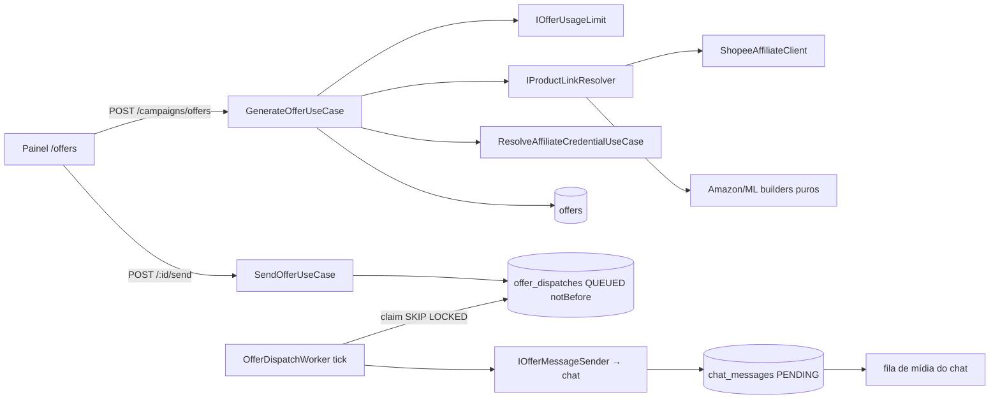

# Gerador de ofertas — Design

**Spec**: `spec.md` · **Context**: `context.md` · **Status**: Draft

## Visão geral



Módulo novo `api/src/modules/campaigns/` em camadas (domain/application/infrastructure/presentation),
sub-recurso `offers`. Painel em `app/src/features/offers/`.

## Reuso

| Componente | Onde | Uso |
| --- | --- | --- |
| `ResolveAffiliateCredentialUseCase` | `integrations/application/use-cases/` | Único ponto que dá AppID/Secret/tag |
| `IMediaFileStore` (`saveBuffer`, `acquireLocalFile`, `promote`) | `media/` via `mediaContainer` | Foto da oferta guardada uma vez; cada destino promove a própria cópia |
| Fluxo `PENDING` + `chatMediaContainer.queue` | `chat/` | Envio de imagem; `SendMessageUseCase` para texto |
| `resolveConversationTarget` | `chat/application` | Valida destino (grupo/contato) |
| `chunkedUpload` + `beginConsume` | `media/` + painel | Troca de foto pelo operador |
| `OpaqueCursor` | `shared/http/pagination` | Histórico (P2) |
| `AppError` + `shared/errors/internal/*` | `shared/errors` | Erros novos |
| Padrão de rotas/serviço/strings | `integrations/presentation`, `app/src/services/affiliateCredential.service.ts`, `features/settings/strings.ts` | Mesma forma |

## Domínio (`campaigns/domain/`)

- `enums/OfferStatus.ts`: `DRAFT | SENDING | SENT | FAILED`
- `enums/OfferDispatchStatus.ts`: `QUEUED | SENDING | SENT | FAILED | SKIPPED`
- `services/detectMarketplace.ts` (pura): `(url: URL) → AffiliateProvider | null` por host exato ou sufixo `.<host>`.
  Allowlist: Shopee `shopee.com.br`, `s.shopee.com.br`, `shope.ee`, `*.shopee.com.br`; ML `mercadolivre.com.br`, `*.mercadolivre.com.br`,
  `mercadolivre.com`, `mercadolibre.com`; Amazon `amazon.com.br`, `*.amazon.com.br`, `amzn.to`.
  Recusa: esquema ≠ https, porta, userinfo, host IP.
- `services/parseProductRef.ts` (pura): Shopee `-i\.(\d+)\.(\d+)`, `/product/(\d+)/(\d+)`, `/opaanlp/(\d+)/(\d+)`, query `shopid/itemid`;
  Amazon `/(?:dp|gp/product|gp/aw/d|exec/obidos/ASIN)/([A-Z0-9]{10})`i; ML `MLB-?(\d+)` e `/p/(MLB\d+)`.
- `services/buildAffiliateUrl.ts` (pura): Amazon `https://www.amazon.com.br/dp/{ASIN}?tag={id}`; ML `{origin}{pathname}?matt_word={tag}`.
- `services/renderOfferText.ts` (pura): modelo padrão com marcadores `{titulo} {preco} {preco_original} {desconto} {link}`,
  preço em centavos formatado pt-BR; linhas com marcador vazio somem.
- `services/scheduleDispatches.ts` (pura): `(destinos, agora, {minMs,maxMs}, rand) → notBefore[]`; 1º imediato.
- `services/startOfDayInZone.ts` (pura): início do dia em `America/Sao_Paulo` (via `Intl`, sem lib).
- `contracts/`: `IOfferRepository`, `IOfferDestinationRepository`, `IOfferDispatchRepository`, `IShopeeAffiliateClient`,
  `IShortLinkExpander`, `IOfferImageFetcher`, `IEntitlementReader`, `IOfferMessageSender`.

Preço sempre em **centavos (Int)**, moeda BRL.

## Aplicação (`campaigns/application/use-cases/`)

| Use case | Faz |
| --- | --- |
| `GenerateOfferUseCase` | limite → expandir URL → detectar → credencial → Shopee (produto + link, foto via fetcher → `saveBuffer`) ou builder → grava `Offer DRAFT` |
| `UpdateOfferUseCase` | PATCH título/preços/texto/`imageUploadId`; recalcula texto se `textEdited=false`; só `DRAFT`/`FAILED` |
| `ListOfferDestinationsUseCase` / `ReplaceOfferDestinationsUseCase` | lista/substitui; valida posse de cada `conversationId` |
| `SendOfferUseCase` | `DRAFT→SENDING` atômico (409 se não); cria dispatches com `notBefore`; 422 sem destino |
| `ProcessDueOfferDispatchesUseCase` | claim de N vencidos (`QUEUED→SENDING`), envia por `IOfferMessageSender`, grava status; fecha `Offer` quando não há pendente |
| `GetOfferUsageUseCase` | `{ used, limit }` do dia |

Erro de envio traduzido em `failureReason` (código interno), nunca mensagem crua.

## Infraestrutura

- **`ShopeeAffiliateClient`**: `fetch` + `AbortSignal.timeout(8000)`, POST `https://open-api.affiliate.shopee.com.br/graphql`,
  header `SHA256 Credential={appId}, Timestamp={ts}, Signature={sha256(appId+ts+body+secret)}`; o corpo assinado é a mesma string enviada.
  Mapeia `10035→AFFILIATE_API_ACCESS_DENIED`, `10020`/assinatura→`AFFILIATE_CREDENTIAL_REJECTED`, `10030`/429→`AFFILIATE_API_RATE_LIMITED`,
  timeout/5xx→`AFFILIATE_API_UNAVAILABLE`. Campos de `productOfferV2` **não verificados**: o mapper tolera ausência; o preço original vem de
  `priceMin / (1 - priceDiscountRate/100)`. Nunca loga corpo nem header.
- **`HttpShortLinkExpander`**: `redirect: 'manual'`, `HEAD` (cai para `GET` se 405), ≤ 5 saltos, cada `Location` revalidado por `detectMarketplace`.
- **`HttpOfferImageFetcher`**: host da imagem em allowlist (`*.susercontent.com`, `cf.shopee.com.br`), `content-type image/*`, ≤ 5 MB, timeout 8 s.
- **`PrismaEntitlementReader`** (`tenants/infrastructure` ou `campaigns/infrastructure`): `TenantEntitlement` por `(tenantId,key)`; `number | null`.
- **`ChatOfferMessageSender`** (adapter em `campaigns/infrastructure`, chama use case novo do chat):
  `chat/application/use-cases/SendStoredMediaMessageUseCase` — `{ tenantId, conversationId, sourceMediaUrl, mimeType, caption }`:
  acha a conversa, valida destino e sessão, gera `externalMessageId`, `acquireLocalFile` → copia para tmp → `promote`, grava `PENDING`, `queue.enqueue`.
  Sem foto: `SendMessageUseCase`. Devolve `{ chatMessageId }`.
- **`OfferDispatchWorker`**: `setInterval` 2 s, `unref`, só se `OFFER_DISPATCH_WORKER_ENABLED=true` (padrão `false`; `true` na Render e no
  `.env.dev` local) — `api/.env` aponta para produção (AGENTS §22). Claim: `UPDATE … SET status='SENDING' WHERE id IN (SELECT id … WHERE status='QUEUED'
  AND "notBefore"<=now() ORDER BY "notBefore" LIMIT 10 FOR UPDATE SKIP LOCKED) RETURNING *` (multi-instância seguro). `SENDING` órfão há > 5 min
  volta a `QUEUED` no tick (restart no meio). Parado no shutdown (`server.ts`). Equivalente futuro: fila BullMQ `broadcast.post` (doc de escala §3.6).

## Dados (migration `create-offers-and-dispatches`)

```prisma
enum OfferStatus { DRAFT SENDING SENT FAILED }
enum OfferDispatchStatus { QUEUED SENDING SENT FAILED SKIPPED }

model Offer {
  id String @id @default(uuid())
  tenantId String
  provider AffiliateProvider
  sourceUrl String
  productRef String?
  title String?
  priceCents Int?
  originalPriceCents Int?
  imageUrl String?        // URL do media store
  affiliateUrl String
  attributionVerified Boolean @default(true)
  text String
  textEdited Boolean @default(false)
  status OfferStatus @default(DRAFT)
  createdById String?
  createdAt DateTime @default(now())
  updatedAt DateTime @updatedAt
  dispatches OfferDispatch[]
  @@index([tenantId, createdAt(sort: Desc)])
  @@map("offers")
}

model OfferDispatch {
  id String @id @default(uuid())
  tenantId String
  offerId String
  conversationId String
  status OfferDispatchStatus @default(QUEUED)
  notBefore DateTime
  claimedAt DateTime?
  chatMessageId String?
  failureReason String?
  updatedAt DateTime @updatedAt
  offer Offer @relation(fields: [offerId], references: [id], onDelete: Cascade)
  @@unique([offerId, conversationId])
  @@index([status, notBefore])
  @@map("offer_dispatches")
}

model OfferDestination {
  tenantId String
  conversationId String
  createdAt DateTime @default(now())
  @@id([tenantId, conversationId])
  @@map("offer_destinations")
}
```

FK para `tenants` e `chat_conversations` (`onDelete: Cascade`) seguindo o padrão do schema. Contagem do limite: `count offers where tenantId and createdAt >= startOfDay`.

## HTTP (`/api/campaigns/offers`, `authHook` + `tenantHook`, envelope `{ success, data }`)

| Método | Path | Corpo / resposta |
| --- | --- | --- |
| POST | `/` | `{ url }` → `OfferDTO` (201) |
| PATCH | `/:id` | `{ title?, priceCents?, originalPriceCents?, text?, imageUploadId? }` → `OfferDTO` |
| POST | `/:id/send` | → `{ offer, dispatches[] }` (202) |
| GET | `/:id` | `OfferDTO` com `dispatches` |
| GET | `/usage` | `{ used, limit }` |
| GET/PUT | `/destinations` | `{ conversationIds[] }` → lista com nome/sessão/isGroup |
| GET | `/` (P2) | histórico com cursor opaco |

`OfferDTO` nunca carrega credencial. `GET /chat/conversations` ganha `isGroup` opcional (filtro) para o seletor.

## Erros novos (`shared/errors/internal/OfferErrors.ts`, `PlanErrors.ts`)

`OFFER_URL_UNSUPPORTED` 422 · `OFFER_PRODUCT_NOT_FOUND` 404 · `OFFER_NOT_FOUND` 404 · `OFFER_ALREADY_SENT` 409 · `OFFER_NO_DESTINATIONS` 422 ·
`AFFILIATE_API_ACCESS_DENIED` 422 · `AFFILIATE_CREDENTIAL_REJECTED` 422 · `AFFILIATE_API_RATE_LIMITED` 429 · `AFFILIATE_API_UNAVAILABLE` 503 ·
`PLAN_LIMIT_REACHED` 403 (`meta {key, limit}`).

## Painel (`app/src/features/offers/`)

- Rota `/offers`, item no `NAV_ITEMS` ("Gerador de ofertas"); `pages/offers/OfferGeneratorPage.tsx`.
- Componentes: `OfferLinkInput`, `OfferPreviewCard`, `OfferEditor` (campos + texto), `OfferDestinationsDialog`, `OfferDispatchProgress`, `OfferUsageChip`.
- `services/offer.service.ts`; tipos em `types/api.types`; textos em `features/offers/strings.ts` (sem marca).
- Tooltips MUI em ações com ícone; tokens do tema (claro/escuro/sistema); progresso por destino por polling de `GET /:id` a cada 3 s enquanto `SENDING`.
- Aviso ML: "Atribuição pelo parâmetro do link não confirmada pelo Mercado Livre".

## Riscos

- Campos da Shopee não verificados em conta real → mapper tolerante + smoke com AppID real antes do merge.
- Atribuição ML por `matt_word` não verificada → aviso na UI, doc.
- Worker em `setInterval` é por processo; `SKIP LOCKED` garante que 2 instâncias não dupliquem.
