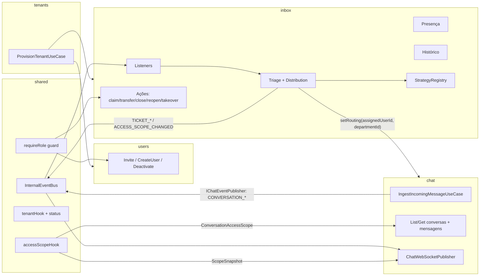
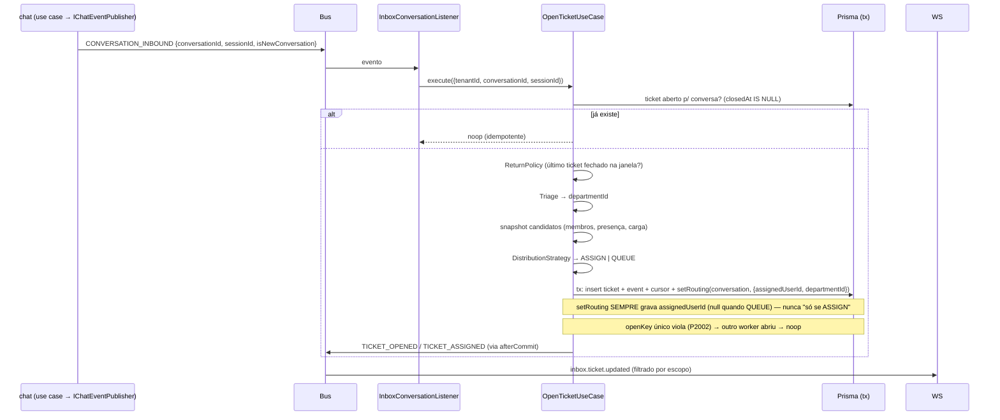

# Central de Atendimento Multiusuário — Design

**Spec**: `.specs/features/service-desk/spec.md`
**Contexto**: `context.md` (D1–D7 travadas) · `integracao-api-central.md` (D7 superada em 2026-10-26: opção A decidida, ver §9 dele)
**Status**: Rascunho — aguardando aprovação

---

## 1. Regras duras

1. **`chat` e `messaging` não importam nada de `inbox`.** O `inbox` consome eventos internos e
   contratos do `chat`; o `chat` só aplica um escopo de acesso que recebe pronto.
2. **Escopo é aplicado no repositório, não na UI.** Toda consulta de conversa/mensagem/mídia
   tenant-aware recebe `ConversationAccessScope`; fora do escopo → `404`.
3. **Um atendimento aberto por conversa.** `Ticket.openKey` (= `conversationId` enquanto aberto,
   `null` ao fechar) com `@unique` garante no banco — nulos não colidem no Postgres e o Prisma
   representa a restrição no schema (sem SQL manual, sem drift). A aplicação trata `P2002` como
   "já existe", nunca duplica.
4. **Estratégia é função pura + registry.** Nenhuma estratégia toca Prisma; recebe um retrato
   (membros, presença, carga, cursor) e devolve uma decisão.
5. **Papel conferido por guard, antes do handler.** `requireRole('ADMIN')` em toda rota de gestão;
   `SUPER_ADMIN` satisfaz qualquer papel (`tenantContext.role` chega como `'SUPER_ADMIN'`,
   `tenantHook.ts:40`) — sem isso a plataforma não gere tenant nenhum. SUPER_ADMIN **não tem
   membership**: `TenantContext.membershipId?` é opcional; `claim`, `presence/me` e `mine=`
   respondem 403 para ele; `TicketEvent.actorUserId` registra a ação dele.
6. **Nada de escrita em massa no boot.** Departamento padrão dos tenants existentes nasce na
   migration SQL, versionada, não em startup.
7. **Sem senha em texto: convite e senha provisória entram como `tokenHash`/`passwordHash`.**
   O token do convite só aparece uma vez, na resposta de criação.
8. **Multi-tenancy intacto**: toda tabela nova tem `tenantId`; toda consulta filtra por ele.
9. **White label**: nomes de módulo, evento e tela falam do recurso (`inbox`, `department`,
   `ticket`), nunca do produto.
10. **Atribuição sempre condicional.** Atribuição **competitiva** (claim, distribuição,
    redistribuição, retorno ao último atendente, auto-claim) grava com
    `updateMany … WHERE "assigneeId" IS NULL AND "closedAt" IS NULL`; 0 linhas = outro processo
    chegou antes — o chamador desiste em silêncio (redistribuição) ou responde conflito (`claim`).
    Ação **administrativa** que troca responsável (assign, transfer, takeover) grava com
    `WHERE "assigneeId" = <valor carregado> AND "closedAt" IS NULL` (otimista); 0 linhas =
    `TICKET_CHANGED` (409), o painel recarrega e o usuário decide de novo. Nunca `update` cego.
11. **Nenhum fluxo de gestão toca senha de conta existente.** Convite, criação direta e
    provisionamento só gravam `passwordHash`/`mustChangePassword` em conta **nova** ou em conta
    sem senha **e sem outro vínculo**. Qualquer outro caso = só o vínculo `UserTenant` (§10).
    Motivo: e-mail é identidade global; o ADMIN de um tenant não pode virar dono da conta em
    outro.
12. **Regra de escopo é uma só.** HTTP (`where`) e WS (`canSeeConversation`) consomem a mesma
    função pura e a mesma tabela de testes; divergência é bug de teste, não de produção.

## 2. Visão geral



**Módulos tocados**

| Módulo      | Papel nesta feature                                                           |
| ----------- | ----------------------------------------------------------------------------- |
| `tenants`   | `ProvisionTenantUseCase` (PROV-01..04), campos neutros de billing              |
| `users`     | convite, criação direta, desativação, listagem da equipe (USR-*)               |
| `inbox` ★   | departamentos, roteamento de números, atendimentos, estratégias, ações, presença, histórico |
| `chat`      | publica eventos de conversa pela porta `IChatEventPublisher`; aplica escopo; publica WS por escopo; campos denormalizados |
| `integrations` | porta `IEmailSender` + adapters SMTP/Noop (AGENTS.md §5 já prevê o módulo)            |
| `sessions`  | mutações + QR/pairing viram `[A]`; listagem/detalhe/status filtrados pelo escopo (§11)   |
| `users` (`/me`) | item de tenant ganha `membershipId`, `canTakeOver`, `presenceStatus`; rota de senha é `PATCH` |
| `shared`    | `requireRole`, `resolveMembership` (usado por `tenantHook` **e** `sseAuthHook`), `accessScopeHook`, eventos e erros novos |
| `app/`      | Equipe, Departamentos, Números, Fila, ações no chat, presença, primeiro acesso |

★ módulo novo — o `inbox/` previsto na estrutura obrigatória do AGENTS.md §5.

## 3. Reuso

| Existente                                                | Onde                                                        | Uso                                              |
| -------------------------------------------------------- | ----------------------------------------------------------- | ------------------------------------------------ |
| `UserTenant` + `UserRole`                                | `prisma/schema.prisma:155`                                  | ganha status, presença e limite                  |
| `tenantHook` / `sseAuthHook`                             | `shared/http/hooks/`                                        | ponto único para status do tenant e escopo       |
| `TenantContext`                                          | `shared/types/TenantContext.ts`                             | ganha `membershipId?` (ausente p/ SUPER_ADMIN) e `accessScope` |
| `ForbiddenError`, `NotFoundError`, `ConflictError`       | `shared/errors/internal/`                                   | base dos erros novos                             |
| `InternalEventBus`                                       | `shared/events/InternalEventBus.ts`                         | generalizar tipo do bus para união de eventos    |
| `IAuditLogRepository` + `AuditAction`                    | `shared/audit/`                                             | ações de equipe e provisionamento; enum ganha `MEMBER_INVITED`, `MEMBER_CREATED`, `MEMBER_DEACTIVATED`, `MEMBER_ROLE_CHANGED`, `DEPARTMENT_CREATED/UPDATED/ARCHIVED`, `ROUTING_CHANGED`, `TICKET_ASSIGNED_BY_ADMIN`, `TENANT_STATUS_CHANGED` (enum Postgres → `ALTER TYPE … ADD VALUE` na migration, gerado pelo Prisma) |
| `ChatConversation.assignedUserId` + `"AssignedConversations"` | `schema.prisma:338`, `User`                            | vira campo denormalizado mantido pelo `inbox`    |
| `IngestIncomingMessageUseCase.isNewConversation`         | `chat/application/use-cases/IngestIncomingMessageUseCase.ts:44` | gatilho dos eventos de conversa            |
| `ChatWebSocketPublisher` (mapa por tenant)               | `chat/infrastructure/ws/ChatWebSocketPublisher.ts`          | passa a `Map<WebSocket, ScopeSnapshot>` por tenant (§7) |
| `chat.ws.routes` (auth por query)                        | `chat/presentation/routes/chat.ws.routes.ts`                | heartbeat de presença sem endpoint novo; após remover o SSE, `sseAuthHook` serve **só** o WS e ganha `resolveMembership` + `assertFullAccessToken` (§10) |
| `PrismaUserRepository.create`                            | `users/infrastructure/repositories/`                        | criação direta e aceite de convite               |
| `ChangePasswordUseCase` + `passwordPolicy.ts` (app)      | `users/`, `app/src/features/settings/utils/`                | definir senha no primeiro acesso                 |
| `strings.ts` por feature, `renderWithTheme`, `ConfirmDialog`, `SectionCard`, `PageHeader` | `app/src/features/chat/strings.ts`, `app/src/components/` | padrão das telas novas |
| MUI `Tooltip`                                            | `@mui/material`                                             | acessibilidade nas ações (AGENTS.md)             |

## 4. Modelo de dados

### Prisma — alterações

```prisma
model Tenant {
  // + neutros, para o webhook de billing futuro (D7)
  billingCustomerId String?  @unique
  planSlug          String?   // era planSnapshot Json?; trocado em 2026-10-26 (AGENTS §26, docs/arquitetura-central-billing.md)
  suspendedAt       DateTime?
}

model User {
  passwordHash       String?   // null até o primeiro acesso (convite / provisionamento)
  passwordSetAt      DateTime?
  mustChangePassword Boolean   @default(false) // senha provisória (USR-03)
}

enum MembershipStatus { ACTIVE INACTIVE }
enum PresenceStatus   { ONLINE PAUSED OFFLINE }

model UserTenant {
  status            MembershipStatus @default(ACTIVE)
  deactivatedAt     DateTime?
  canTakeOver       Boolean          @default(false) // ACT-03 para OPERATOR
  maxOpenTickets    Int?             // null = sem limite (PRES-02)
  presenceStatus    PresenceStatus   @default(OFFLINE)
  presenceChangedAt DateTime?
  lastSeenAt        DateTime?
  departmentMembers DepartmentMember[]
}

model UserInvite {
  id           String    @id @default(cuid())
  tenantId     String
  email        String
  role         UserRole  @default(OPERATOR)
  tokenHash    String    @unique   // sha256 do token; token só na resposta de criação
  expiresAt    DateTime
  acceptedAt   DateTime?
  invitedById  String?
  departmentIds String[] @default([]) // no aceite: DepartmentMember com position = n (fim da fila);
                                      // id arquivado/de outro tenant é ignorado com log, nunca erro
  createdAt    DateTime  @default(now())
  @@index([tenantId, email])
  @@map("user_invites")
}
```

`passwordHash` nullable obriga guarda em `LoginUseCase.ts:27` (`verifyPassword(input.password,
user.passwordHash)`): `passwordHash === null` → `InvalidCredentialsError`, **antes** do compare e
com a mesma resposta de senha errada (não revela que a conta existe sem senha). Em
`ChangePasswordUseCase`, hash nulo → `InvalidCredentialsError` (conta sem senha nunca chega lá,
porque não loga; a defesa é só contra chamada direta). Primeiro acesso acontece **somente** pelo
aceite do convite (§10).

### Prisma — módulo `inbox`

```prisma
enum VisibilityMode   { ASSIGNED_AND_QUEUE  ALL_OF_NUMBER  ASSIGNED_ONLY }
enum DistributionMode { ROUND_ROBIN  LEAST_LOAD  PULL  FIXED_BY_NUMBER }
enum TriageMode       { BY_NUMBER  MENU  RULES  MANUAL }        // MENU/RULES = P2
enum PresenceMode     { PRESENCE_AND_LIMIT  PRESENCE_AND_SCHEDULE  IGNORE }
enum ReturnMode       { LAST_ASSIGNEE  RETRIAGE }
enum TicketStatus     { QUEUED  OPEN  CLOSED }
enum TicketOrigin     { INBOUND  OPERATOR  REOPEN  RETURN }

model Department {
  id                String   @id @default(cuid())
  tenantId          String
  name              String
  activeNameKey     String?  @unique // = `${tenantId}:${normalizeDepartmentName(name)}` enquanto ativo; null ao arquivar
                                     // normalizeDepartmentName (pura, inbox/domain/services/) = lower(trim); única fonte
                                     // para criar/renomear; o backfill SQL imita ('geral')
  isDefault         Boolean  @default(false)
  defaultKey        String?  @unique // = tenantId quando isDefault; null caso contrário → um padrão por tenant
  position          Int      @default(0)
  visibilityMode    VisibilityMode   @default(ALL_OF_NUMBER)
  distributionMode  DistributionMode @default(PULL)
  triageMode        TriageMode       @default(MANUAL)
  presenceMode      PresenceMode     @default(PRESENCE_AND_LIMIT)
  returnMode        ReturnMode       @default(LAST_ASSIGNEE)
  returnWindowHours Int      @default(24)
  roundRobinCursor  Int      @default(0)
  schedule          Json?    // P2 (PRES-04)
  menu              Json?    // P2 (TRI-01)
  archivedAt        DateTime? // soft delete: sai da triagem e da gestão; histórico preserva o nome
  createdAt DateTime @default(now())
  updatedAt DateTime @updatedAt
  members  DepartmentMember[]
  routings SessionRouting[]
  tickets  Ticket[]
  // sem @@unique([tenantId, name]): incluiria arquivados e "Vendas" nunca poderia renascer.
  // activeNameKey faz a unicidade só entre ativos, case-insensitive (mesmo padrão de openKey).
  @@index([tenantId, isDefault])
  @@index([tenantId, archivedAt])
  @@map("departments")
}

model DepartmentMember {
  id             String  @id @default(cuid())
  tenantId       String
  departmentId   String
  membershipId   String          // UserTenant.id (não User.id: papel/presença são por tenant)
  position       Int             // ordem do rodízio (DEPT-02)
  visibilityMode VisibilityMode? // override por usuário (D2)
  @@unique([departmentId, membershipId])
  @@index([tenantId, membershipId])
  @@map("department_members")
  // `position` sem unicidade: `PUT …/members` reescreve 0..n-1 numa transação (delete + insert),
  // nunca update parcial — falha no meio não deixa rodízio ambíguo.
}

/** Número (Session) → departamento e/ou usuário fixo (ASG-01, DIST-05). */
model SessionRouting {
  id           String  @id @default(cuid())
  tenantId     String
  sessionId    String  @unique
  departmentId String? // triagem BY_NUMBER + regra do departamento no escopo (§7)
  membershipId String? // "fixo por número" + regra base do membro no escopo; os dois coexistem
  @@index([tenantId])
  @@index([tenantId, membershipId]) // escopo: números roteados direto ao membro (§7)
  @@map("session_routings")
}

/** Atendimento: ciclo de vida de uma conversa sob responsabilidade de alguém. */
model Ticket {
  id             String       @id @default(cuid())
  tenantId       String
  conversationId String
  openKey        String?      @unique // = conversationId enquanto closedAt IS NULL; null ao fechar (regra 3)
  sessionId      String?
  departmentId   String       // triagem sempre resolve (cai no padrão do tenant)
  assigneeId     String?      // UserTenant.id
  status         TicketStatus @default(QUEUED)
  openedAt       DateTime     @default(now())
  assignedAt     DateTime?
  closedAt       DateTime?
  closedById     String?
  origin         TicketOrigin
  events         TicketEvent[]
  @@index([tenantId, status, departmentId])
  @@index([tenantId, assigneeId, status])
  @@index([tenantId, conversationId, closedAt])
  @@map("tickets")
}

enum TicketEventType { OPENED ASSIGNED CLAIMED TRANSFERRED TAKEN_OVER CLOSED REOPENED RETURNED_TO_QUEUE }

model TicketEvent {
  id           String          @id @default(cuid())
  tenantId     String
  ticketId     String
  type         TicketEventType
  actorId      String?         // UserTenant.id; null = sistema ou plataforma
  actorUserId  String?         // User.id — preenchido também p/ SUPER_ADMIN (sem membership); HIST-01
  fromAssigneeId String?
  toAssigneeId   String?
  fromDepartmentId String?
  toDepartmentId   String?
  note         String?
  strategy     String?         // ex.: "ROUND_ROBIN"
  createdAt    DateTime        @default(now())
  @@index([tenantId, ticketId, createdAt])
  @@map("ticket_events")
}

model ChatConversation {
  // denormalizado, mantido só pelo inbox via IChatConversationRepository.setRouting
  departmentId String?
  @@index([tenantId, assignedUserId])
  @@index([tenantId, departmentId])
}
```

**Relações e `onDelete`** (omitidas acima por brevidade; obrigatórias no schema):
`DepartmentMember.membershipId → UserTenant` **Cascade**; `DepartmentMember.departmentId →
Department` **Cascade**; `TicketEvent.ticketId → Ticket` **Cascade**; `Ticket.departmentId →
Department` **Restrict** (por isso o soft delete); `Ticket.conversationId → ChatConversation`
**Cascade**; `Ticket.assigneeId → UserTenant` **SetNull**; `SessionRouting.sessionId → Session`
**Cascade**; `SessionRouting.membershipId → UserTenant` **SetNull**; `UserInvite.tenantId →
Tenant` **Cascade**; `ChatConversation.departmentId → Department` **Restrict** (departamento
nunca é apagado, só arquivado; sem a FK um id órfão faria `departmentId = d` casar com nada em
silêncio). Campos de **histórico** (`TicketEvent.actorId/actorUserId/fromAssigneeId/
toAssigneeId/fromDepartmentId/toDepartmentId`, `Ticket.closedById`, `UserInvite.invitedById`)
ficam **sem FK**: histórico é imutável e sobrevive à exclusão de quem agiu; `tenantId` já
garante o filtro. Todas as tabelas com `tenantId` redundante para o filtro de tenant não
depender de join.

**Transações entre módulos (UoW).** `setRouting` (repositório do `chat`) roda na mesma transação
do ticket (`inbox`); o provisionamento grava `tenants` + `users` + `inbox` de uma vez. Passar
`tx` pelos contratos vazaria o tipo Prisma para `application`/`domain` (AGENTS.md §15). Solução:
`shared/database/unitOfWork.ts`:

- `runInTransaction(fn, opts?)` abre `prisma.$transaction(async (tx) => …, { timeout, maxWait })`
  com `AsyncLocalStorage<UowContext>` (`{ client: Prisma.TransactionClient; afterCommit: Deferred[] }`).
  **Reentrante**: se já há contexto ambiente, executa `fn` nele sem abrir outra transação
  (`Prisma.TransactionClient` **não tem** `$transaction`).
- `getClient(): Prisma.TransactionClient` devolve o client ambiente ou o `prisma` global (tipo
  comum). Repositórios trocam `prisma.` por `getClient().`; contratos não mudam; o use case só
  chama `runInTransaction`. Vale para **todo** repositório que participa de uma UoW, inclusive
  `shared/audit/PrismaAuditLogRepository.ts:7` (fora de `modules/`, hoje usa `prisma.` direto —
  sem migrar, o `AuditLog` "dentro da transação" escapa dela).
- **Repositório nunca chama `$transaction`.** Os dois que hoje chamam
  (`PrismaChatListRepository`, `PrismaChatMessageReactionRepository`) migram para
  `runInTransaction` na mesma task — migrados para `getClient()` quebrariam dentro de UoW; mantidos
  em `prisma` escapariam dela.
- `afterCommit<T>(cb: () => Promise<T>): Promise<T>`: dentro de UoW enfileira e devolve uma
  promessa que **resolve após o drain** com o retorno de `cb`; fora de UoW executa `cb` na hora.
  É por aqui que saem eventos internos, e-mails e publicações WS (abaixo). O use case guarda a
  promessa dentro da transação e a lê **depois** de `runInTransaction` resolver (ex.:
  `emailSent`). **Onde drena**: fora do `als.run` —
  `const result = await als.run(ctx, () => prisma.$transaction(fn, opts)); await drain(ctx); return result;`
  — assim os callbacks já veem `getClient()` global; drenar dentro do `run` entregaria um
  `TransactionClient` fechado. **Como drena**: em sequência, cada callback em `try/catch` com
  `logger.error`, **nunca** rethrow — operação comitada não falha por efeito colateral. Contrato
  do callback: **não lança**; adapters devolvem resultado (`{sent:false}`), o `try/catch` é só
  rede de segurança (se lançar, a promessa devolvida rejeita e o drain segue). **Rollback**:
  a fila é descartada e cada promessa pendente é rejeitada com `UowRolledBack` já marcada como
  tratada (`.catch(noop)`) — sem isso vira `unhandledRejection`; quem aguardava nunca chega ao
  `await`, porque `runInTransaction` lançou antes. **Aninhamento**: chamada reentrante empilha na
  **mesma** fila do contexto externo; só o `runInTransaction` mais externo drena — drenar no
  interno dispararia evento antes do commit real.
- Timeouts explícitos: `DB_TX_TIMEOUT_MS` (10 000) e `DB_TX_MAX_WAIT_MS` (3 000) — o padrão do
  Prisma é 5 s / 2 s e a Render adiciona latência. Hash de senha (bcrypt), snapshot de candidatos
  e qualquer I/O externo ficam **fora** da transação.

**Eventos nunca dentro da transação.** O `InternalEventBus` é um `EventEmitter` **síncrono**:
`emit()` chama o listener na hora, no mesmo contexto assíncrono do emissor. Com ALS, um
`CONVERSATION_INBOUND` publicado dentro do `runInTransaction` do `chat` faria o listener do
`inbox` herdar o `TransactionClient` do `chat` e gravar o ticket na transação alheia — que
comita ou reverte sem saber dele ("Transaction already closed", ticket perdido). Duas defesas,
ambas obrigatórias:
1. `InternalBusChatEventPublisher` / `InternalBusInboxEventPublisher` publicam via
   `afterCommit` quando há UoW ambiente (direto quando não há).
2. `InternalEventBus` invoca cada listener com `als.exit(() => listener(payload))`, para
   nunca herdar contexto de transação, mesmo num publish direto por engano. Implementação: o
   embrulho acontece no `on()`/`once()` (não no `emit`, que delega a `super.emit`), com
   `WeakMap<listener, wrapped>` para `off()` continuar removendo pelo listener original —
   `chat.routes.ts:605` já chama `internalEventBus.off('MESSAGE_RECEIVED', …)` num handler de
   longa duração; sem o mapa o `off` falharia em silêncio e o listener vazaria a cada request.

Testes `unitOfWork.test.ts`: rollback atravessa dois repositórios; fora de transação usa o
global; reentrância reutiliza o client; `afterCommit` roda após commit e é descartado no
rollback; publish dentro de UoW não alcança o listener antes do commit; listener nunca vê
`getClient()` transacional.

**SQL fora do Prisma (na mesma migration):**

Convenção do banco: **tabela** em snake_case via `@@map`, **coluna** em camelCase entre aspas
(ver `prisma/migrations/20260925180000_add_chat_lists/migration.sql`). `cuid()` é gerado pelo
client, não pelo Postgres — `INSERT` manual precisa fornecer `id`.

Unicidade condicional ("um ticket aberto por conversa", "um padrão por tenant") **não** usa
índice parcial: o Prisma não o representa no schema, não há precedente no repo e o próximo
`migrate dev` poderia gerar `DROP INDEX` por drift. Em vez disso, colunas `@unique` anuláveis
(`Ticket.openKey`, `Department.defaultKey`): nulos não colidem, o Prisma gera o índice, e a
regra vive no schema. O único SQL manual é o backfill:

```sql
-- backfill: departamento padrão "Geral" para todo tenant existente (DEPT-04); idempotente
INSERT INTO "departments"
  ("id", "tenantId", "name", "activeNameKey", "isDefault", "defaultKey", "position", "createdAt", "updatedAt")
SELECT gen_random_uuid()::text, t."id", 'Geral', t."id" || ':geral', true, t."id", 0, now(), now()
FROM "tenants" t
WHERE NOT EXISTS (
  SELECT 1 FROM "departments" d WHERE d."tenantId" = t."id" AND d."isDefault" = true
);
```

Os demais campos do departamento padrão saem dos `@default` do schema (`MANUAL`,
`ALL_OF_NUMBER`, `PULL`, …). `gen_random_uuid()` é nativo no Postgres ≥ 13; em versão menor,
`CREATE EXTENSION IF NOT EXISTS pgcrypto` na própria migration. Ids uuid convivem com cuid
porque a coluna é `TEXT`. Testar a migration em banco local **antes** de `migrate deploy`
(a `api/.env` aponta para produção).

**Checklist pré-deploy** — painel da Render: `PRISMA_DEPLOY_ALLOW_UNAVAILABLE` ausente ou
`false` (§16.5c); número de instâncias (§7). Banco de produção (leitura, credencial read-only do
AGENTS.md):
`SELECT version()`; `SELECT count(*) FROM user_tenants WHERE role = 'OPERATOR'` (esperado 0 —
se > 0, avisar esses tenants que o operador só vê a fila após entrar num departamento);
`SELECT count(*) FROM chat_conversations WHERE "assignedUserId" IS NOT NULL` (conversas que
nascerão com ticket `OPEN` no primeiro evento, §16.3);
`SELECT lower(email), count(*) FROM users GROUP BY 1 HAVING count(*) > 1` (esperado 0 linhas —
colisão bloqueia a normalização de e-mail abaixo e exige merge manual antes da migration).

**E-mail normalizado.** `User.email @unique` é case-sensitive e o `LoginUseCase` busca o valor
cru (`PrismaUserRepository.ts:13`). Sem normalizar, `Ana@x.com` e `ana@x.com` viram duas contas
e a regra 11 ("conta existente") falha em silêncio. `normalizeEmail` (`trim().toLowerCase()`,
pura, `users/domain/services/`) aplicada em login, convite, aceite, criação direta e
provisionamento; migration `UPDATE "users" SET email = lower(trim(email))` protegida pela
consulta acima (aborta com `RAISE` se houver colisão).

Migrations, **nesta ordem** (§16.5b): `add-team-invites-and-membership-status`,
`create-inbox-departments-routing-tickets`, `normalize-user-emails` (a única com `UPDATE` de
dado e `RAISE`; por último para encurtar a janela de incompatibilidade com o código antigo,
§16.5a). `assignedUserId` continua guardando `User.id` (compatibilidade com o painel);
`Ticket.assigneeId` guarda `UserTenant.id`. O mapper traduz.

## 5. Estratégias (registry)

`inbox/domain/strategies/` — funções puras, uma por modo, registradas por chave:

```ts
export interface CandidateSnapshot {
  membershipId: string; position: number;
  presence: PresenceStatus; openTickets: number; maxOpenTickets: number | null;
  inSchedule: boolean;                       // P2: sempre true na v1
}
export interface DistributionInput {
  department: { distributionMode; presenceMode; roundRobinCursor };
  candidates: CandidateSnapshot[];
  fixedMembershipId?: string | null;         // SessionRouting.membershipId
}
export type DistributionDecision =
  | { kind: 'ASSIGN'; membershipId: string; nextCursor?: number }
  | { kind: 'QUEUE'; reason: 'NO_ONE_AVAILABLE' | 'PULL_MODE' | 'FIXED_UNAVAILABLE' };

export type DistributionStrategy = (input: DistributionInput) => DistributionDecision;
export const distributionRegistry: Record<DistributionMode, DistributionStrategy>;
```

- `isAvailable(candidate, presenceMode)` — pura, compartilhada: `IGNORE` → sempre; demais →
  `ONLINE` e `openTickets < maxOpenTickets` (e `inSchedule` no modo com expediente).
- `ROUND_ROBIN`: ordena por `position`, começa em `cursor`, pega o primeiro disponível,
  devolve `nextCursor` (DIST-02). Cursor gravado na mesma transação do ticket com
  `updateMany where roundRobinCursor = <lido>` (otimista; 0 linhas → não avança). Dois
  `OpenTicket` simultâneos que leram o mesmo cursor podem entregar ao mesmo membro — afeta só a
  uniformidade, nunca a correção.
- `LEAST_LOAD`: menor `openTickets` entre disponíveis; empate por `position` (DIST-03).
- `PULL`: sempre `QUEUE` (DIST-04).
- `FIXED_BY_NUMBER`: `fixedMembershipId` se disponível, senão `QUEUE` (DIST-05, DIST-06).

Triagem (`TriageStrategy`): recebe `{ routing: SessionRouting | null, defaultDepartmentId,
mode }` → `departmentId`. v1: `BY_NUMBER` (roteamento do número, senão padrão) e `MANUAL`
(padrão). `MENU`/`RULES` entram no registry no P2 sem tocar o núcleo. **`defaultDepartmentId`
é obrigatório no tipo** (`string`, não `string | undefined`): `OpenTicketUseCase` carrega o
padrão antes e, se não existir, lança `DEFAULT_DEPARTMENT_MISSING` (500, §13) com
`logger.error` — nunca silêncio, nunca criação lazy (regra 6; o único caminho de criação é
§10). Sem isso, tenant sem padrão gera `P2011` em `Ticket.departmentId NOT NULL`, o listener
engole no `catch` e o cliente fica sem ticket sem ninguém saber.

Retorno (`ReturnPolicy`): `{ mode, lastTicket, windowHours, lastAssigneeAvailable, now }` →
`{ kind: 'REASSIGN', membershipId } | { kind: 'RETRIAGE' }` (ACT-04). `lastAssigneeAvailable`
é calculado pelo chamador com `isAvailable` **e** membership `ACTIVE`; membro desativado nunca é
"último atendente disponível".

Testes: um `*.test.ts` por estratégia, tabela de casos. Sem banco.

## 6. Triagem e distribuição — fluxo



- **Quem emite**: os use cases do `chat` (`IngestIncomingMessage`, `SendMessage`,
  `SendMediaMessage`, `StartConversation`) recebem a porta `IChatEventPublisher`
  (`chat/domain/contracts/`), implementada por `InternalBusChatEventPublisher`
  (`chat/infrastructure/events/`). Use case continua sem conhecer o bus; o padrão atual de
  listener (bus → use case) fica para o sentido inverso. Testes injetam um dublê.
- **Backlog offline** (`BaileysMessagingEngineAdapter.ts:630-640`): mensagens acumuladas
  enquanto a API estava fora chegam como `type === 'append'` e vão **direto** para
  `IngestHistorySyncUseCase`, que grava pelos repositórios sem passar por
  `IngestIncomingMessageUseCase` — sem evento, sem ticket; em `PULL` nem aparecem na fila.
  Correção: `IngestHistorySyncUseCase` ganha `origin: 'OFFLINE_BACKLOG' | 'FULL_HISTORY'` no
  input (o adapter já distingue `append` de `messaging-history.set`, `:631` e `:827`) e a porta
  `IChatEventPublisher`. `OFFLINE_BACKLOG` → publica **um** `CONVERSATION_INBOUND
  {isNewConversation}` por conversa que recebeu ao menos uma mensagem não-`fromMe` no lote (após
  o commit, como os demais). `FULL_HISTORY` (retrato na hora do pareamento) → publica **nada**:
  importar histórico não pode abrir centenas de tickets. `sessionId` do lote é o da sessão que
  sincroniza.
- `fromMe: true` (eco do celular): `IngestIncomingMessageUseCase` **não publica nada** — nem
  `CONVERSATION_INBOUND` nem `CONVERSATION_OUTBOUND` (que exige `byUserId`) — logo não abre
  ticket nem muda ticket existente. **Decidido (§17)**: dono do número que responde pelo celular
  a uma conversa `QUEUED` deixa o ticket na fila; outro operador pode dar `claim`. O painel marca
  o item da fila com "respondida pelo aparelho" (a conversa tem `OUTBOUND` mais recente que o
  `openedAt` do ticket, dado que a listagem já traz) para o operador decidir.
  Resposta pelo painel: `SendMessageUseCase`
  publica `CONVERSATION_OUTBOUND {byUserId}` e o inbox: (a) ticket `QUEUED` sem responsável →
  **auto-claim** condicional (regra 10); (b) **sem ticket aberto** (conversa anterior à feature ou
  já finalizada) → `OpenTicket` com `origin: OPERATOR`, `OPEN`, assignee = quem respondeu, sem
  passar pela estratégia (DIST-07). Sem (b), o próximo inbound abriria ticket e distribuiria a
  conversa para outra pessoa no meio do atendimento. ADMIN fora do departamento também assume
  por este caminho: `MEMBER_NOT_IN_DEPARTMENT` **não** se aplica ao auto-claim (quem respondeu
  já está atendendo).
- `StartConversationUseCase` (painel) → `CONVERSATION_CREATED {byUserId}` → ticket já OPEN com
  `assigneeId` do autor (DIST-07). **Antes**, valida `sessionId ∈ escopo` (`kind:'ALL'`, ou
  `directSessionIds ∪ rules[].sessionIds`); fora → `NotFoundError` (VIS-02). Hoje o use case só
  checa existência (`StartConversationUseCase.ts:39-40`); sem a checagem, o operador iniciaria
  conversa por um número fora do escopo e o DIST-07 lhe entregaria o ticket — autoatribuição. Conversa nova por **inbound** publica só
  `CONVERSATION_INBOUND {isNewConversation: true}` — nunca os dois, senão o inbox tentaria abrir
  duas vezes (o segundo seria noop por `P2002`, mas dobraria o trabalho e confundiria o log).
- Fila sem candidato (DIST-06): `RedistributeQueuedTicketsUseCase` roda quando
  `OPERATOR_PRESENCE_CHANGED → ONLINE`, `TICKET_CLOSED` (vaga liberada),
  `TICKET_RETURNED_TO_QUEUE` (desativação, saída do depto) ou `TICKET_TRANSFERRED` com
  `toDepartmentId` (ticket novo na fila do depto). Só para os departamentos afetados. Sem cron.
  Também recolhe `status = OPEN AND "assigneeId" IS NULL` (estado impossível pelo fluxo normal —
  só por `SetNull` da FK se a membership for apagada) e devolve à fila antes de distribuir.
  **Concorrência**: dois gatilhos simultâneos podem escolher o mesmo
  ticket; cada atribuição é `updateMany where id AND "assigneeId" IS NULL AND "closedAt" IS NULL`
  (regra 10) — 0 linhas = pula para o próximo. O cursor do rodízio só avança quando a atribuição
  gravou. Limite de `INBOX_REDISTRIBUTE_BATCH` tickets por execução para não segurar a transação.
- `CONVERSATION_INBOUND` em ticket **OPEN** não faz nada; em **QUEUED** só reprocessa se o
  departamento não é `PULL`.

## 7. Visibilidade

### Resolução (uma vez por request)

`accessScopeHook` (depois de `tenantHook`), em `shared/http/hooks/`:

```ts
export type ConversationAccessScope =
  | { kind: 'ALL' }                                          // ADMIN, SUPER_ADMIN
  | {
      kind: 'SCOPED';
      userId: string;                 // sempre vê o que está atribuído a si (regra base)
      directSessionIds: string[];     // números roteados direto ao membro (SessionRouting.membershipId)
      rules: ScopeRule[];             // uma por departamento; vazio é válido
    };
export interface ScopeRule {
  mode: VisibilityMode; departmentId: string; sessionIds: string[]; // números roteados p/ o depto
}
```

**Regra base** (sempre presente no `SCOPED`): `assignedUserId = me OR sessionId IN
directSessionIds`. Cobre OPERATOR sem departamento com conversas já atribuídas (dado existente
em produção) e "fixo por número" antes da atribuição. Regras de departamento entram em `OR`.

Resolvido por `ResolveAccessScopeUseCase` (`inbox/application`), com cache em memória chaveado
por `tenantId:userId` (TTL `INBOX_SCOPE_CACHE_TTL_SECONDS`) invalidado por
`ACCESS_SCOPE_CHANGED {userIds}` — mesma chave do evento, sem mapa auxiliar. O hook fica em
`shared` mas recebe o resolvedor por injeção — `shared` não importa `inbox`.

**Limitação conhecida (multi-instância)**: cache e bus são por processo. Com 2+ instâncias na
Render, a instância que não recebeu `ACCESS_SCOPE_CHANGED` serve escopo antigo por até o TTL.
Efeito: operador removido de um departamento ainda vê a fila por ≤ 30 s naquela instância.
Aceito na v1 (o WS já tem a mesma limitação); **confirmar o número de instâncias no painel da
Render antes do deploy** e registrar no `CHANGELOG`. Mitigação futura: pub/sub externo ou TTL
menor; registrado em §17.

**Quem publica `ACCESS_SCOPE_CHANGED`** (toda mutação que altera *regras*, não só atribuição):
`PUT /inbox/departments/:id/members` (membros antigos ∪ novos), `PATCH /inbox/departments/:id`
quando muda `visibilityMode` (todos os membros), `PUT /inbox/routing/sessions/:sessionId`
(membros do depto antigo ∪ novo ∪ membro fixo antigo ∪ novo), arquivar departamento (membros),
`DeactivateMemberUseCase` (o próprio + membros dos deptos `FIXED_BY_NUMBER` afetados),
**`PATCH /team/members/:id` quando muda `role`** (o próprio: ADMIN→OPERATOR sai de `kind:'ALL'`
para `SCOPED`; sem o evento, o cache REST segura `ALL` por até o TTL e o snapshot do WS até
reconectar — o `resolveMembership` já lê o papel por request, falta só a invalidação do escopo).
Ações de ticket **não** publicam: atribuição entra na regra base direto do banco, sem cache.

**O painel também precisa saber.** `ACCESS_SCOPE_CHANGED` recarrega o snapshot do servidor e
invalida o cache, mas sozinho o painel não recebe nada: membro removido de departamento, número
re-roteado, departamento arquivado ou papel rebaixado continuariam vendo a lista antiga até
recarregar (a mentira da transferência, em massa); membro **adicionado** não veria a fila nova.
`ChatTicketListener` traduz `ACCESS_SCOPE_CHANGED` em WS `inbox.scope.changed {userId}`,
entregue **só** aos sockets dos `userIds` do evento, **depois** do refresh do snapshot (ordem
importa: refetch com snapshot velho traria a lista velha). Sem payload de escopo — o painel não
precisa dele. Ao receber, o painel refaz em cascata: `/me` (papel, `canTakeOver`),
`/inbox/departments`, `/sessions` e a lista de conversas; conversa selecionada que sumiu é
fechada com aviso. `inbox.scope.changed` **não** carrega `conversationId` — passa pelo caminho
"sem conversa" do `publish`, mas com destinatários explícitos, nunca broadcast.

### Aplicação nas consultas (`chat`)

`chat/infrastructure/repositories/conversationScopeWhere.ts` — função **pura** que transforma
o escopo em `where` do Prisma, testada em tabela:

| Parte                | Cláusula                                                                               |
| -------------------- | -------------------------------------------------------------------------------------- |
| base (sempre)        | `assignedUserId = me OR sessionId IN directSessionIds`                                  |
| `ASSIGNED_ONLY`      | (nada além da base)                                                                     |
| `ASSIGNED_AND_QUEUE` | `assignedUserId IS NULL AND (departmentId = d OR sessionId IN s)`                       |
| `ALL_OF_NUMBER`      | `departmentId = d OR sessionId IN s`                                                    |

Tudo em `OR`; `kind: 'ALL'` não adiciona nada. `directSessionIds` e `s` vazios geram cláusula
`false`, nunca `IN ()` (Prisma trata, mas o teste cobre).

**Tickets usam a mesma função.** `GET /inbox/tickets` e o histórico filtram por relação:
`where: { tenantId, conversation: conversationScopeWhere(scope), ...filtros }`. Nenhuma segunda
função de escopo sobre `Ticket` (`assigneeId` é membership, `assignedUserId` é user — duas
tabelas de verdade quebrariam a regra 12). `mine=true` acrescenta `assigneeId = membershipId`
**dentro** do escopo, nunca no lugar dele.
**Regra geral: toda leitura de `ChatConversation` no `chat` recebe `scope` no tipo** —
`findMany`, `findById`, **contagens** (`countArchived`, `listWithCounts` das listas) e o caminho
**indireto por mensagem**. `scope` é **obrigatório no tipo** (nunca opcional): chamador que
esquece não compila; ADMIN passa `{ kind: 'ALL' }` explícito. Chamadas **de sistema** (sem
request: listeners do `inbox` como `OpenTicket` lendo a conversa para triagem,
`ChatTicketListener`, backlog offline, sweeps) usam a constante nomeada `SYSTEM_SCOPE`
(`shared/types`, `= { kind: 'ALL' } as const`) — o `grep` de auditoria distingue "sistema" de
"esqueceu".
- Por conversa: `ListMessages`, `GetConversationById`, mídia por conversa, `MarkAsRead`,
  `UpdateConversation`, `UpdateConversationState`, `ListGroupParticipants` (input ganha
  `scope`), presença e **toda rota do `inbox` que recebe id de conversa ou ticket** →
  `findById` com escopo → `null` → `NotFoundError` (VIS-02).
  - `POST /conversations/:id/presence` hoje **não tem use case**: o handler
    (`chat.routes.ts:540-560`) chama `conversationRepo`, `contactRepo` e
    `engine.presenceSubscribe` direto. Com `scope` obrigatório no tipo, alguém montaria o escopo
    dentro do handler para compilar. Extrair `SubscribeContactPresenceUseCase({conversationId,
    tenantId, scope})` → `{subscribed}`; handler fino. Resposta continua `200 {subscribed:false}`
    para fora do escopo — não vaza existência, coerente com VIS-02.
- **Por mensagem** (`POST /messages/:messageId/retry`, `POST /messages/:messageId/reaction`):
  a rota não tem id de conversa; `RetryOutboundMediaUseCase.ts:55,70` e
  `SetMessageReactionUseCase.ts:63-66` carregam a mensagem por `messageRepo.findById` e **depois**
  a conversa — é **essa** chamada (`conversationRepo.findById(message.conversationId, tenantId,
  scope)`) que aplica o escopo; sem isso um OPERATOR com um `messageId` alheio reenvia mídia ou
  reage em conversa que não vê. Resposta 404 nos dois casos, nunca 403.
- **Contagens**: `countArchived(tenantId, sessionId, scope)` (badge "Arquivadas",
  `chat.routes.ts:120`) e `listWithCounts(tenantId, scope)` (`ListChatListsUseCase`) aplicam
  `conversationScopeWhere`; sem isso o OPERATOR vê "12 arquivadas" com lista vazia e a contagem
  de conversas por lista de todo o tenant — metadado fora do escopo.
Nunca 403: o id não pode vazar existência por rota nenhuma. Contatos (`/contacts/:id`,
`/contacts/suggest`) seguem sem escopo na v1 (limitação registrada em §7, tempo real).

**Único escritor de verdade.** `PATCH /chat/conversations/:id` hoje aceita `assignedUserId` e
`queueName` (`UpdateConversationUseCase.ts:13-14,40-41`; painel em `chat.api.types.ts:161-162`).
Esse caminho gravaria a conversa sem ticket, sem `TicketEvent`, sem `afterCommit` — escopo e
histórico divergiriam do estado real. Correção: os dois campos saem do
`updateConversationBodySchema` e do use case. Comportamento resultante: `app.ts` não customiza o
AJV, logo vale o padrão do Fastify (`removeAdditional: true`) — com `additionalProperties: false`
(`chat.schema.ts:89`) os campos são **descartados em silêncio**, não geram 400. Painel antigo que
ainda enviar "atribui" sem efeito e sem erro; por isso o painel para de enviar **na mesma
task**. Não alterar `removeAdditional` globalmente: mudaria o contrato de todas as rotas.
Atribuição só por `POST /inbox/conversations/:id/assign`. `queueName` vira legado
só-leitura; o DTO expõe **só `departmentId`** (campo que já vive em `ChatConversation`) — nunca
`department: {id, name}`: montar o nome obrigaria o `chat` a ler a tabela do `inbox` (regra 1,
reprovado por `chat.deps.test.ts`). O painel resolve o nome pelo catálogo de
`GET /inbox/departments`, que já carrega para filtros e transferência — sem join, sem nome
desatualizado ao renomear. **Breaking change de contrato HTTP** → seção própria no `CHANGELOG`
(AGENTS.md §36.4) com emissor e consumidor atualizados na mesma task.

**Ao fechar o ticket**, `assignedUserId`/`departmentId` da conversa **permanecem** (último
responsável): o operador `ASSIGNED_ONLY` continua vendo o histórico. **Todo `OpenTicket`**
(inbound, retorno, reabertura) grava `setRouting` com os dois campos — `assignedUserId` recebe o
novo responsável **ou `null` quando a decisão é `QUEUE`**. Sem o `null` explícito, uma retriagem
que cai na fila deixaria a conversa "do" ex-responsável e a cláusula `assignedUserId IS NULL` da
fila nunca casaria. Transferência e `assign` sobrescrevem; `ReturnToQueue` zera só
`assignedUserId`.

### Tempo real

`ChatWebSocketPublisher.clients: Map<tenantId, Map<WebSocket, ScopeSnapshot>>` — chave pelo
socket mantém `unsubscribe(tenantId, ws)` por identidade como hoje. **O WS não resolve escopo
(regra 1)**: `chat.ws.routes` **não importa** `ResolveAccessScopeUseCase` — `sseAuthHook` já
roda `resolveMembership` e, encadeado com `accessScopeHook`, deixa
`request.tenantContext.accessScope` pronto; a rota só lê dali e chama `subscribe(tenantId, ws,
snapshot)`. Para o refresh em `ACCESS_SCOPE_CHANGED`, o publisher recebe na composição
(`routes.ts`, onde `mediaUploadRoutes` já recebe `authHooks` por injeção) uma função
`resolveScope(tenantId, userId): Promise<ConversationAccessScope>` fornecida pelo `inbox`;
`chat` só a chama. O tipo `ConversationAccessScope` e `canSeeConversation` vivem em
`shared/types` e `chat/domain/services`, nunca em `inbox`. Guarda no CI: `chat.deps.test.ts`
lê os imports de `src/modules/chat/**` e falha se algum apontar para `modules/inbox`.
**Todo evento com `conversationId` carrega `visibility: { sessionId, departmentId, assignedUserId }`
— obrigatório no tipo, não opcional.** Isso inclui os eventos que **já existem** no publisher:
`chat.message.created`, `chat.conversation.updated` (carrega `lastMessagePreview`, `notes`,
`tags`), `chat.unread.updated`, `chat.message.status.updated`, `chat.message.reaction.updated`
e `chat.state.updated`, além dos novos `inbox.ticket.updated`. Sem isso, um OPERATOR
`ASSIGNED_ONLY` receberia preview, notas e contador de conversas fora do escopo pelo WS,
contornando o 404 do HTTP. Cada emissor atual (`ChatIncomingMessageListener`,
`ChatMessageStatusListener`, `ChatMessageReactionListener`, `ChatConversationStateListener`,
`UpdateConversationUseCase`, `MarkConversationAsReadUseCase`, `SendMessage`/`SendMediaMessage`)
preenche `visibility` sem consulta extra. **Regra sistêmica — o listener não "tem a conversa em
mãos", tem o resultado do use case**: `IngestIncomingMessageUseCase` devolve
`{conversationId, message, isNewConversation, unreadCount}`; `ApplyRemoteStateResult` é
`{conversationId, changed}` (`IChatConversationRepository.ts`); `IngestMessageReactionUseCase`
idem. Portanto **todo resultado de use case que alimenta evento WS inclui
`conversationRouting: { sessionId, departmentId, assignedUserId }`** — o use case já carregou a
conversa, só devolve. Vale para `IngestIncomingMessage`, `ApplyRemoteState`
(`ChatConversationStateListener`), `IngestMessageReaction`, `MarkConversationAsRead`,
`UpdateConversation`, `StartConversation` e o backlog offline. Teste em cada um: dublê do
repositório de conversa com contador de chamadas = 1 por evento. **Sem N+1 nos recibos**:
`ChatMessageStatusListener` (`:29-33`) e `ChatMessageReactionListener` só têm
`updated.conversationId`; `DELIVERED/READ` é o evento mais frequente do sistema, e consultar a
conversa por recibo dobraria as leituras. `IChatMessageRepository.updateStatusByExternalId` (e o
`upsert` das reações) passa a devolver a mensagem **com** `conversationRouting: { sessionId,
departmentId, assignedUserId }` via `select` aninhado na mesma query. `DispatchOutboundMediaUseCase`
já carrega a conversa (`:99`) e só repassa; `RetryOutboundMedia`, `FailOrphanPendingMedia` e
`ReconcileInterruptedUploads` publicam status também — mesma regra, mesmo método.

**Segundo canal de tempo real — removido.** `GET /chat/events` (`chat.routes.ts:568-612`, SSE
com `sseAuthHook`) assina `MESSAGE_RECEIVED` e escreve `{sessionId, from, fromName, body}` de
**toda** mensagem recebida para qualquer membro do tenant — corpo da mensagem, sem conversa, sem
escopo. Filtrar por `sessionId` não basta (dois departamentos no mesmo número compartilhariam o
corpo). O painel não usa: `useChatSSE.ts` existe e nenhum componente o importa (só o WS).
Correção: **apagar** a rota e o hook; `CHANGELOG` registra em `Removed` (contrato HTTP, AGENTS.md
§36.4). `sseAuthHook` fica (o WS depende dele); renomear seria churn. **Fail-closed**: `publish`
descarta com `logger.warn` qualquer evento que traga `conversationId` sem `visibility` — nunca
"passa para todos por engano". `publish` filtra com `canSeeConversation(snapshot, visibility)`
(`chat/domain/services/`, pura, mesma tabela da seção anterior — regra 12).
**`chat.session.updated {sessionId, status}` é filtrado por sessão** com `canSeeSession(scope,
sessionId)` — função pura em `chat/domain/services/`, ao lado de `canSeeConversation`,
alimentada pelo mesmo `scopeCases.ts` (regra 12: nada de regra inline). `ListSessionsUseCase`
(§11) filtra a lista com a **mesma** função; HTTP e WS de sessão nunca divergem. Sem isso o
painel mostra toast de número que a lista não exibe. Eventos **sem** conversa nem sessão (`chat.contact.updated {phone}`,
`chat.presence.updated {phone}`, `chat.group.avatar.updated`, `inbox.presence.updated`, `ping`)
passam para todos — revelam só existência de número/contato, sem conteúdo; limitação aceita,
coerente com contatos fora do escopo na v1. `ACCESS_SCOPE_CHANGED {tenantId, userIds}` → publisher recarrega o
snapshot dos sockets desses usuários.

**Ordem dos eventos**: `chat.message.created` sai antes do ticket existir (`assignedUserId`
ainda nulo). Membro de fila (`ASSIGNED_AND_QUEUE`/`ALL_OF_NUMBER`) já recebe pela cláusula de
número/departamento; `ASSIGNED_ONLY` só recebe `inbox.ticket.updated` depois. A ordem entre os dois eventos **não é
garantida** (o listener do inbox é assíncrono). Contrato do painel ao receber
`inbox.ticket.updated`: (a) conversa fora da lista e `visibility` dentro do meu escopo →
`GET /chat/conversations/:id` (aplica o escopo) e inserir; (b) `assignedUserId === me` e
conversa selecionada → recarregar a última página de mensagens, porque o
`chat.message.created` correspondente pode ter sido filtrado com `assignedUserId` ainda nulo;
(c) conversa na lista → **mesclar** `assignedUserId`, `departmentId` e `status` do ticket no
estado da conversa — o `chat.conversation.updated` existente **não** é emitido pelo `setRouting`
do `inbox`, então sem (c) o badge de responsável fica velho; (d) `visibility` **fora** do meu
escopo (avaliada no painel com a mesma `canSeeConversation` compilada para o front, ou
simplesmente `assignedUserId !== me` em `ASSIGNED_ONLY`) → **remover** a conversa da lista e,
se selecionada, fechar com aviso "transferida". Sem isso o operador só veria a conversa ou a
mensagem no próximo carregamento.

**Quem perde o ticket também é avisado.** `visibility` carrega o **novo** responsável; em
transferência, takeover, devolução à fila e retriagem, o antigo `ASSIGNED_ONLY` não casa mais
com ela e não receberia o evento — a lista dele mostraria a conversa como sua até recarregar
(a API já responde 404, mas a UI mentiria). `inbox.ticket.updated` ganha
`alsoNotifyUserIds: string[]` (responsável anterior; `[]` na abertura) e `publish` entrega a
esses sockets **independentemente** do filtro — o payload é só estado do ticket, sem conteúdo
de mensagem, então não vaza nada. O painel trata pelo item (d). Mesma regra para
`TICKET_RETURNED_TO_QUEUE` (o ex-responsável sai de `ASSIGNED_ONLY`, mas continua vendo se está
em `ASSIGNED_AND_QUEUE` do departamento — a `visibility` decide).

**Encerramento de sockets**: `sseAuthHook` só valida no connect; sem isto, desativado e tenant
suspenso continuariam recebendo eventos. O publisher ganha `closeForUser(tenantId, userId)` e
`closeForTenant(tenantId)` (close code `4401`; o painel não reconecta automaticamente nesse
código), acionados por `MEMBER_DEACTIVATED` e `TENANT_SUSPENDED` (§12).

## 8. Ações de atendimento (`inbox/application/use-cases`)

| Use case                 | Quem                                   | Efeito                                                                   |
| ------------------------ | -------------------------------------- | ------------------------------------------------------------------------ |
| `ClaimTicketUseCase`     | membro do depto, ticket QUEUED         | valida membro; limite só se `presenceMode !== IGNORE` (coerente com `isAvailable`); `updateMany where id AND status=QUEUED AND "assigneeId" IS NULL AND "closedAt" IS NULL` → 0 linhas = `TICKET_ALREADY_CLAIMED` (DIST-04) |
| `AssignTicketUseCase`    | ADMIN                                  | ASG-02: abre (competitivo) ou reatribui (otimista, regra 10); ignora estratégia |
| `TransferTicketUseCase`  | responsável ou ADMIN                   | para usuário (OPEN, otimista) ou departamento (QUEUED, zera assignee, redistribui); nota (ACT-01) |
| `TakeOverTicketUseCase`  | ADMIN ou `canTakeOver`                 | troca responsável (otimista, regra 10) (ACT-03)                          |
| `CloseTicketUseCase`     | responsável ou ADMIN                   | `closedAt` + `openKey = null` na mesma escrita, libera vaga, `TICKET_CLOSED` (ACT-02) |
| `ReopenTicketUseCase`    | qualquer no escopo                     | novo ticket `origin: REOPEN`, mesmo assignee se ainda `ACTIVE` no tenant; senão quem reabriu (ACT-02) |
| `ReturnToQueueUseCase`   | sistema (desativação, saída do depto)  | USR-04 e caso de borda                                                   |

Toda ação: `runInTransaction` (§4), `TicketEvent`, atualiza
`ChatConversation.assignedUserId/departmentId`, publica `TICKET_*`. Ações de ticket **não**
publicam `ACCESS_SCOPE_CHANGED` (§7: a atribuição entra na regra base direto do banco). Regras de
quem pode (ADMIN / responsável / flag) em `inbox/domain/services/ticketPolicy.ts`, pura.

## 9. Presença (PRES-01..03)

- `PUT /inbox/presence/me {status}` → `SetPresenceUseCase` → `UserTenant.presenceStatus` +
  `OPERATOR_PRESENCE_CHANGED`.
- Heartbeat: o socket do chat já autentica `userId`+`tenantId`; ao conectar/ping atualiza
  **só** `lastSeenAt` (throttle 60 s) — conectar **não** muda `presenceStatus`; subir para
  `ONLINE/PAUSED` é sempre ação explícita via `PUT /presence/me` (evita auto-`ONLINE` ao abrir
  uma aba e receber distribuição sem querer). `OfflineSweepUseCase` a cada minuto marca `OFFLINE`
  quem tem `ONLINE/PAUSED` e `lastSeenAt` > `INBOX_PRESENCE_OFFLINE_AFTER_MIN` — leitura barata,
  escrita só nos afetados; não é "escrita em massa de boot". Agendamento reusa o padrão de
  `server.ts:133-140` (`pendingMediaSweep`): `setInterval` + `unref()` + `runPeriodic` que nunca
  lança + `clearInterval` no `shutdown` — senão o intervalo segura o processo no SIGTERM da
  Render (30 s até SIGKILL).
- Painel: chip de presença no `AppLayout` (online/pausa/offline), tooltip explicando o efeito.

## 10. Equipe e provisionamento

**`tenants`** — `ProvisionTenantUseCase({name, slug, owner:{email,name}, origin})` com `origin: 'SUPER_ADMIN' | 'BILLING_WEBHOOK'` (mesmo tipo em `UpdateTenantStatusUseCase`): cria
`Tenant`, `User` (sem senha, se novo), `UserTenant(ADMIN)`, `Department` padrão, `UserInvite`
de primeiro acesso e `AuditLog TENANT_CREATED {origin}`. Rota `POST /tenants`, `SUPER_ADMIN`.
- **Atomicidade**: as cinco linhas (`Tenant`, `User`, `UserTenant`, `Department`, `UserInvite`)
  gravadas dentro de um único `runInTransaction` (UoW, §4), cada uma pelo repositório do próprio
  módulo — `tenants` não escreve tabela do `inbox`; o use case orquestra
  `ITenantRepository`, `IUserRepository`, `IDepartmentRepository` e `IUserInviteRepository` e a
  UoW garante o tudo-ou-nada. Alternativa por evento (`TENANT_CREATED` → inbox cria o depto) foi
  descartada: perde a atomicidade que PROV-01 exige. O convite entra na transação porque, sem
  ele, um tenant nasceria com owner sem link e sem ninguém capaz de reemitir (a rota `[A]` exige
  login no próprio tenant). **`AuditLog` fica dentro da transação** (é escrita no mesmo banco,
  barata; fora dela poderia se perder entre o commit e a gravação). **E-mail sai em
  `afterCommit`**: SMTP dentro da transação estouraria o timeout e uma falha de envio reverteria
  o tenant. A resposta traz o link sempre e `emailSent: boolean`; o `SmtpEmailSender` usa
  `connectionTimeout`/`socketTimeout` de 5 s — estourou → `emailSent: false` + log, resposta
  continua `201`.
- **Link perdido**: `POST /tenants/:id/first-access-link [S]` reemite o convite do owner
  (mesma regra do `[A]`: só conta sem senha).
- **Owner já existente com senha** → sem `UserInvite`; resposta `{ existingAccount: true }` e o
  owner entra com a senha que tem (regra 11). Link de primeiro acesso só para conta nova ou sem
  senha. Owner sem senha e com vínculo em outro tenant cai no caso 2b do convite.
- `UpdateTenantStatusUseCase({tenantId, status, origin})` — `PATCH /tenants/:id/status [S]`;
  grava `suspendedAt` quando `SUSPENDED/CANCELLED` (limpa ao voltar a `ACTIVE`), `AuditLog
  TENANT_SUSPENDED`/`TENANT_UPDATED`, publica `TENANT_SUSPENDED` (fecha WS, §7). É a mesma porta
  que o webhook de billing usará (D7); sem ela PROV-03 não tem gatilho testável.

**`users`**
- `InviteUserUseCase` → token aleatório (32 bytes) → `tokenHash`; devolve token uma vez; envia
  por `IEmailSender` se configurado, **em `afterCommit`** (USR-01); resposta traz o link e
  `emailSent`. E-mail sempre por `normalizeEmail` (§4). Um pendente por `(tenantId, email)`:
  reconvite expira o anterior (`expiresAt = now()`) antes de criar o novo — link antigo morre.
  E-mail já membro `ACTIVE` do tenant → `ConflictError` (`ALREADY_MEMBER`), sem criar convite.
  Retenção oportunista, sem cron nem escrita de boot: ao criar um convite, apaga os do mesmo
  `(tenantId, email)` com `expiresAt < now() - 30 dias` (aceitos ou não) — a tabela não cresce
  para sempre e o histórico recente fica para auditoria.
  Membership `INACTIVE` → convite permitido; o aceite (e a criação direta) **reativa** a linha
  existente (`status ACTIVE`, `deactivatedAt = null`, `role` do convite, `presenceStatus =
  OFFLINE`; `maxOpenTickets`/`canTakeOver` preservados) em vez de inserir outra —
  `@@unique([userId, tenantId])` proíbe a segunda.
- `AcceptInviteUseCase(token, name?, password?, authenticatedUserId?)` → valida hash +
  expiração + `acceptedAt` (qualquer falha = `INVITE_INVALID`, uma resposta só). **Corrida**:
  dois aceites simultâneos do mesmo token passariam na validação e criariam o `User` duas vezes
  (`P2002` cru no segundo). Regra 10 aplicada ao convite: dentro do `runInTransaction`,
  **primeiro** `updateMany where id AND "acceptedAt" IS NULL AND "expiresAt" > now()` → 0 linhas =
  `INVITE_INVALID`; **depois** cria/vincula. `P2002` residual em `users.email` (conta criada por
  outro fluxo no mesmo instante) mapeia para `INVITE_INVALID` — nunca erro cru. Três caminhos,
  decididos pela conta do e-mail do convite:
  1. **não existe** → cria `User` com a senha informada, vincula, marca aceito;
  2. **existe sem senha e sem outro vínculo** além do tenant do convite (convidada antes neste
     mesmo tenant, nunca entrou) → define a senha, vincula;
  2b. **existe sem senha mas com vínculo em outro tenant** (ex.: owner provisionado no tenant A,
     convidado no B) → tratar como o caso 3: não define senha, responde `{ requiresLogin: true,
     hint: 'FIRST_ACCESS_ELSEWHERE' }`. O ADMIN de A reemite o link de primeiro acesso
     (`POST /team/members/:id/first-access-link`, §11). Motivo: o link de B daria o tenant A.
  3. **existe com senha** → `password` é **ignorado** (nunca sobrescreve `passwordHash`); vincula
     somente se `authenticatedUserId === user.id`; senão responde `{ requiresLogin: true }` e o
     painel manda logar e voltar ao link. Motivo: o link circula por qualquer canal (o ADMIN copia);
     sem isto, quem tem o link toma a conta e todos os tenants dela.
  Rota pública `POST /auth/invites/:token/accept` com `optionalAuthHook` (novo em
  `shared/http/hooks/`: sem `Authorization` segue anônimo; com header inválido → 401, nunca
  "anônimo por engano"); `GET /auth/invites/:token` responde só
  `{valid, tenantName, emailMasked, requiresLogin}`.
  Token: 32 bytes aleatórios, base64url, comparado por hash; **redigido nos logs**. O `logger`
  (`shared/logger/logger.ts`) hoje **não** tem `redact`: adicionar `redact.paths` para
  `req.url`/`req.headers.authorization` com `censor` que troca o segmento após `/invites/` e
  `/first-access/` por `[redacted]`. Cobrir com `logger.test.ts`.
- `CreateTeamUserUseCase` (USR-03): e-mail **novo** → cria `User` com senha provisória gerada
  (16 chars, devolvida uma única vez na resposta) + `mustChangePassword`. E-mail **já existente**
  → **não toca** em `passwordHash` nem em `mustChangePassword`; cria só o vínculo e responde
  `{ existingAccount: true }` (o usuário entra com a senha que já tem; conta sem senha segue a
  regra 2/2b do convite). Sem isso o ADMIN do tenant B tomaria a conta de alguém do tenant A pela
  própria tela de gestão, sem precisar de link. **Corrida**: dois ADMINs criando o mesmo e-mail
  novo ao mesmo tempo → `P2002` em `users.email` no segundo; capturar e reexecutar **uma vez**
  pelo caminho "já existente" (`existingAccount`), nunca expor o erro cru.
  Login com `mustChangePassword` → responde `PASSWORD_CHANGE_REQUIRED` junto com um access token
  que carrega o claim `scope: 'password_change'`. `assertFullAccessToken(payload, route)` em
  `shared/http/hooks/` rejeita esse claim (`UnauthorizedError`) e é chamado por `authHook` **e**
  `sseAuthHook` (o WS lê o token da query e abriria sem isto). Allowlist do claim:
  `PATCH /me/password` (a rota existente é `PATCH`, `me.routes.ts:78-79` — não `PUT`; com o
  verbo errado a allowlist não casaria e o usuário ficaria preso), `GET /me`, `POST /auth/logout`
  — o painel precisa de `/me` para montar a tela. Refresh token **não** é emitido até a troca.
  **Fluxo no painel** (sem isto há loop de login): o `apiClient` atual, em 401 sem
  `refreshToken`, redireciona para `/login` (`apiClient.ts:38-39,52-56`); se o painel bootar
  normalmente (`/tenants`, `/sessions`), a primeira rota fora da allowlist dispara exatamente
  isso antes de o usuário ver a tela de senha. Portanto: (a) `AuthContext` guarda
  `passwordChangeRequired`; `PrivateRoute` manda **direto** para a tela de senha sem montar o
  `AppLayout` (nenhuma outra chamada); (b) `PATCH /me/password` com claim `password_change`
  responde o **par completo** de tokens — `ChangePasswordUseCase` zera `mustChangePassword` e o
  controller emite access + refresh — e o painel segue sem novo login; (c) o interceptor, em 401
  com token restrito, **não** redireciona: limpa o token e volta à tela de senha com aviso.
- `DeactivateMemberUseCase` → `status INACTIVE`, remove de departamentos, zera
  `SessionRouting.membershipId` das rotas dele (senão `FIXED_BY_NUMBER` devolve
  `FIXED_UNAVAILABLE` para sempre e a fila vira eterna; a resposta traz `unroutedSessionIds` para
  o ADMIN re-rotear), `ReturnToQueueUseCase` nos tickets abertos (USR-04), publica
  `MEMBER_DEACTIVATED`. **Não** revoga `RefreshToken`: o usuário pode estar ativo em outros
  tenants; `resolveMembership` já nega `INACTIVE` a cada request (access token de 15 min) e o WS
  é fechado pelo evento (§7). Bloqueia último ADMIN (`LAST_ADMIN`) dentro da mesma transação
  (`SELECT … FOR UPDATE` nos ADMINs do tenant) para duas desativações simultâneas não zerarem o
  tenant. `PUT /inbox/departments/:id/members` faz a mesma limpeza de rota ao remover membro de
  departamento `FIXED_BY_NUMBER` e devolve à fila **só** os tickets abertos do membro removido
  **naquele departamento** — ele pode seguir atendendo nos outros.
- **`resolveMembership(userId, tenantId)`** em `shared/http/hooks/resolveMembership.ts`: única
  função que valida tenant `ACTIVE`, membership existente e `status ACTIVE`; devolve o
  `TenantContext`. `tenantHook` **e** `sseAuthHook` passam a chamá-la (hoje `sseAuthHook.ts:41-55`
  duplica a lógica — sem unificar, o WS continuaria aberto para desativado e para tenant
  suspenso). Erros: `TENANT_SUSPENDED`, `USER_INACTIVE`.
- Porta `IEmailSender { send({to, template, data, locale}): Promise<{sent: boolean}> }` em
  `modules/integrations/domain/contracts/`; adapters `SmtpEmailSender` (nodemailer, env opcional)
  e `NoopEmailSender` (loga e devolve `sent:false`) em `integrations/infrastructure/email/`.
  `users`/`tenants` dependem só do contrato. Adapter da API central entra depois (D7).

## 11. Contrato HTTP

Prefixos sob `env.API_PREFIX`. `[A]` = `requireRole('ADMIN')` (após `authHook` + `tenantHook`);
`[S]` = `requireSuperAdmin` (`shared/http/hooks/`, só `authHook` + `request.user.isSuperAdmin` —
rotas `[S]` não têm `X-Tenant-Id` e não passam pelo `tenantHook`); `[P]` = público.

```
POST   /tenants                                   [S]  provisiona (PROV-01)
PATCH  /tenants/:id/status                         [S]  ACTIVE | SUSPENDED | CANCELLED (PROV-03)
POST   /tenants/:id/first-access-link              [S]  reemite link do owner (conta sem senha)
GET    /auth/invites/:token                        [P]
POST   /auth/invites/:token/accept                 [P]
GET    /team/members                               [A]  membros + presença + departamentos
POST   /team/invites                               [A]
POST   /team/members                               [A]  criação direta
PATCH  /team/members/:membershipId                 [A]  role, canTakeOver, maxOpenTickets
POST   /team/members/:membershipId/deactivate      [A]
POST   /team/members/:membershipId/first-access-link [A]  reemite convite p/ conta sem senha (caso 2b)
GET    /inbox/departments                          tenant
POST   /inbox/departments                          [A]
PATCH  /inbox/departments/:id                      [A]  nome (recalcula activeNameKey; P2002 → DEPARTMENT_NAME_TAKEN), modos, returnWindowHours, isDefault:true (troca o padrão)
DELETE /inbox/departments/:id                      [A]  arquiva (`archivedAt`); nega se padrão ou com ticket aberto
PUT    /inbox/departments/:id/members              [A]  lista ordenada [{membershipId, visibilityMode?}]
GET    /inbox/routing                              [A]
PUT    /inbox/routing/sessions/:sessionId          [A]  {departmentId?, membershipId?}
GET    /inbox/tickets?status=&departmentId=&mine=  escopo
POST   /inbox/conversations/:id/assign             [A]  {membershipId}
POST   /inbox/tickets/:id/claim
POST   /inbox/tickets/:id/transfer                 {membershipId | departmentId, note?}
POST   /inbox/tickets/:id/takeover
POST   /inbox/tickets/:id/close
POST   /inbox/tickets/:id/reopen
GET    /inbox/conversations/:id/history            escopo (HIST-02)
GET    /inbox/presence/me · PUT /inbox/presence/me

# módulo sessions (existente, 11 rotas) — hoje só [authHook, tenantHook] (session.routes.ts:69)
POST   /sessions                                                            [A]
POST   /sessions/:id/connect · disconnect · reconnect · logout             [A]
GET    /sessions/:id/qr · GET /sessions/:id/pairing-code                    [A]  pareamento = parte do connect
DELETE /sessions/:id                                                        [A]  (session.routes.ts:406)
GET    /sessions · GET /sessions/:id · GET /sessions/:id/status             escopo: OPERATOR vê só
                                                                            directSessionIds ∪ rules[].sessionIds

# módulo users (existente)
GET    /me                    + por tenant: membershipId, canTakeOver, presenceStatus (adição compatível)
PATCH  /me/password           (verbo existente; allowlist do claim password_change)

# módulo chat (existente)
GET    /chat/events           REMOVIDO — SSE sem escopo vazava corpo de mensagem (§7); apagar, não "escopar"
POST   /chat/avatars/sync     [A]  varre o tenant inteiro na engine — manutenção, não atendimento
POST   /chat/messages/:messageId/retry · reaction   escopo pela conversa da mensagem (§7)
GET    /chat/lists · GET /chat/conversations?…       contagens (listas, arquivadas) com escopo (§7)
```

Sessões (números) são gestão: USR-05 exige 403 para OPERATOR em qualquer mutação — QR e
pairing-code incluídos, são o fluxo de pareamento — e listar números fora do escopo revelaria
telefones que o operador não atende. `ListSessionsUseCase` recebe o mesmo
`ConversationAccessScope` (`kind:'ALL'` → todas). `GET /sessions/:id` e `/:id/status` fora do
escopo → 404. `GET /me` (`me.routes.ts:67-73`) hoje devolve por tenant só
`{id, name, slug, role, status}`; o painel precisa de `membershipId`, `canTakeOver` e
`presenceStatus` para `TicketActionsBar` e `PresenceChip` — entram no item de tenant e no schema
de resposta (`me.routes.ts:44`), sem remover nada.

`SetDefaultDepartmentUseCase` (`PATCH … {isDefault: true}`): na mesma transação, **primeiro**
limpa `defaultKey`/`isDefault` do padrão atual, **depois** grava o novo — na ordem inversa o
`@unique` recusa. Arquivado não vira padrão; padrão não é arquivado; `isDefault: false` direto é
rejeitado (sempre existe um padrão).

Handlers finos: schema → use case → presenter. Paginação de tickets/histórico por cursor
opaco (`shared/http/pagination/OpaqueCursor.ts`). Toda rota com `:id` de conversa ou ticket
resolve o alvo com o escopo do request; alvo fora do escopo → `404` (VIS-02), inclusive para
ações (`claim`, `transfer`, `close`, …) — a checagem de papel/responsável (403) só roda depois
de o alvo existir no escopo.

## 12. Eventos internos

`shared/events/InternalEvent.ts`: `type InternalEvent = InternalMessagingEvent | InternalChatEvent
| InternalInboxEvent | InternalTeamEvent`; o bus passa a ser genérico nessa união (mudança só de
tipo).

```ts
type InternalChatEvent =
  | { type: 'CONVERSATION_CREATED'; tenantId; conversationId; sessionId; byUserId }  // só painel (StartConversation)
  | { type: 'CONVERSATION_INBOUND'; tenantId; conversationId; sessionId; isNewConversation } // inbound; nova ou não
  | { type: 'CONVERSATION_OUTBOUND'; tenantId; conversationId; sessionId; byUserId };
type InternalInboxEvent =
  | { type: 'TICKET_OPENED'|'TICKET_ASSIGNED'|'TICKET_TRANSFERRED'|'TICKET_CLOSED'|'TICKET_REOPENED'
          |'TICKET_RETURNED_TO_QUEUE';
      tenantId; ticketId; conversationId; sessionId: string|null; departmentId;
      assigneeUserId: string|null;                    // sessionId: o WS monta `visibility` sem consultar a conversa
      previousAssigneeUserId: string|null;            // quem perdeu o ticket → `alsoNotifyUserIds` no WS (§7)
      toDepartmentId?: string }                       // TRANSFERRED p/ departamento (gatilho §6)
  | { type: 'OPERATOR_PRESENCE_CHANGED'; tenantId; userId; status }
  | { type: 'ACCESS_SCOPE_CHANGED'; tenantId; userIds: string[] };
type InternalTeamEvent =
  | { type: 'MEMBER_DEACTIVATED'; tenantId; userId }   // fecha WS do usuário no tenant
  | { type: 'TENANT_SUSPENDED'; tenantId };           // fecha WS do tenant; emitido por UpdateTenantStatusUseCase (§10)
```

`InternalChatEvent` é publicado pelos use cases do `chat` via `IChatEventPublisher` (§6); o
`inbox` consome por listeners em `inbox/infrastructure/listeners/`. `InternalInboxEvent` é
publicado pelos use cases do `inbox` pela porta equivalente `IInboxEventPublisher`.
Listeners registrados **uma vez no boot**, nunca por request (o SSE removido registrava por
conexão). Contagem esperada após a feature: ~20 (`chat` 9 atuais + `ChatTicketListener`,
`inbox` ~6, publisher do WS 3, cache de escopo 1) — `setMaxListeners(50)`
(`InternalEventBus.ts:42`) segue folgado; se o aviso `MaxListenersExceededWarning` aparecer, é
registro por request, não limite baixo.

WS novo: `inbox.ticket.updated {ticketId, conversationId, status, departmentId, assignedUserId,
visibility, alsoNotifyUserIds}` (§7: `alsoNotifyUserIds` = responsável anterior, entregue fora
do filtro; `InternalInboxEvent.TICKET_*` ganha `previousAssigneeUserId: string | null` para o
`ChatTicketListener` preencher), `inbox.presence.updated {userId, status}` e
`inbox.scope.changed {userId}` (só aos `userIds` do `ACCESS_SCOPE_CHANGED`, após o refresh do
snapshot, §7). Quem traduz `TICKET_*` /
`OPERATOR_PRESENCE_CHANGED` em WS é `chat/infrastructure/listeners/ChatTicketListener.ts`:
consome só os **tipos** de `shared/events`, nunca importa `inbox` (regra 1) — o `inbox` não
conhece o `chatWsPublisher`.

## 13. Erros internos (`shared/errors/internal/TeamErrors.ts`, `InboxErrors.ts`)

| Código                     | HTTP | Quando                                             |
| -------------------------- | ---- | -------------------------------------------------- |
| `TENANT_SUSPENDED`         | 403  | tenant `SUSPENDED/CANCELLED` (PROV-03)             |
| `USER_INACTIVE`            | 403  | membro desativado                                  |
| `PASSWORD_CHANGE_REQUIRED` | 403  | login com senha provisória                         |
| `INVITE_INVALID`           | 404  | token desconhecido/usado/expirado (uma resposta só) |
| `LAST_ADMIN`               | 409  | rebaixar/desativar último ADMIN                    |
| `TICKET_ALREADY_CLAIMED`   | 409  | corrida no "Atender"                               |
| `TICKET_NOT_OPEN`          | 409  | ação em ticket fechado                             |
| `NOT_TICKET_ASSIGNEE`      | 403  | transferir/finalizar sem ser responsável           |
| `DEPARTMENT_IN_USE`        | 409  | apagar depto padrão ou com ticket aberto           |
| `MEMBER_NOT_IN_DEPARTMENT` | 422  | claim/transfer para quem não está no depto (não vale p/ auto-claim, §6) |
| `TICKET_CHANGED`           | 409  | ação administrativa perdeu a corrida (regra 10); painel recarrega |
| `ALREADY_MEMBER`           | 409  | convite/criação para e-mail já membro ativo do tenant |
| `SLUG_TAKEN`               | 409  | `POST /tenants` com slug existente (`P2002` em `tenants.slug`) |
| `DEPARTMENT_NAME_TAKEN`    | 409  | nome já usado por departamento **ativo** do tenant (`P2002` em `activeNameKey`) |
| `DEFAULT_DEPARTMENT_MISSING` | 500 | tenant sem departamento padrão ao abrir ticket — estado inválido (seed/provisionamento falhou), nunca corrigido em runtime |

## 14. Painel

```
app/src/features/
  team/     strings.ts · TeamPage · InviteMemberDialog · CreateMemberDialog · MemberRow
  inbox/    strings.ts · DepartmentsPage · DepartmentForm (5 selects de modo + tooltips)
            · DepartmentMembersOrder (drag ou setas) · NumberRoutingPage · TicketActionsBar
            · QueueFilter · TicketHistoryTimeline · PresenceChip
  auth/     SetPasswordPage (/first-access/:token — aceite de convite e senha provisória)
services/   team.service.ts · inbox.service.ts
routes      /settings/team · /settings/departments · /settings/numbers · /first-access/:token
```

`/first-access/:token` é pública: em `AppRoutes.tsx` entra **fora** do `<PrivateRoute>` (ao lado
de `/login`, L16) e **antes** do catch-all `*` (L34, que manda para `/dashboard`) — dentro do
layout privado o convidado sem conta cairia no login.

- `TenantContext` já expõe o tenant ativo; passa a expor `role`, `membershipId`, `canTakeOver`
  e `presenceStatus` (campos novos no item de tenant do `/me`, §11) para esconder ações e telas
  de gestão. A API continua a fonte da verdade.
- Chat: filtro "Fila" na barra de filtros; `TicketActionsBar` no `ChatHeader` (Atender /
  Transferir / Finalizar / Assumir, cada botão com `Tooltip`); linha do tempo no
  `ConversationDetailsPanel`; `inbox.ticket.updated` atualiza a lista sem recarregar.
- Presença: `PresenceChip` no header do `AppLayout`.
- `useChatWebSocket.ts`: hoje `ws.onclose = () => {…}` (`:194`) ignora o `CloseEvent`. Passa a
  `onclose(ev)`: `ev.code === 4401` → **para** a reconexão, limpa o tenant ativo e mostra aviso
  ("acesso encerrado"); demais códigos mantêm o backoff atual (2 s → 30 s). Só isso não basta:
  desativado que **recarrega a página** nunca recebe `4401` — o handshake falha com 403 no
  upgrade e o navegador entrega `1006`, que é indistinguível de queda de rede → loop eterno.
  Segundo gatilho: o interceptor do `apiClient` trata `USER_INACTIVE` e `TENANT_SUSPENDED` (403)
  limpando o tenant ativo e derrubando o WS **antes** da próxima tentativa. `1006` sozinho segue
  com backoff.
- Sessões: página de números esconde ações de gestão para OPERATOR (a API já responde 403) e
  lista só as sessões que a API devolver (escopo).
- i18n: `strings.ts` por feature (padrão D3 das reações); tema: tokens do `ThemeContext`;
  testes com `renderWithTheme` no escuro.

## 15. Configuração (`shared/config/env.ts`)

```
DB_TX_TIMEOUT_MS=10000        (transação interativa; padrão do Prisma é 5000)
DB_TX_MAX_WAIT_MS=3000        (espera por conexão; padrão do Prisma é 2000)
INBOX_PRESENCE_OFFLINE_AFTER_MIN=5
INBOX_SCOPE_CACHE_TTL_SECONDS=30
INBOX_REDISTRIBUTE_BATCH=20
TEAM_INVITE_TTL_HOURS=72
EMAIL_SENDER=noop|smtp|hub   (default noop, com aviso no boot; `hub` = adapter da API central, 2026-10-26)
EMAIL_SMTP_URL= (usado por smtp)
EMAIL_FROM= 
PANEL_URL= (monta o link de primeiro acesso)
```

Dependência nova na `api/`: `nodemailer` (+ `@types/nodemailer`), só carregada pelo
`SmtpEmailSender`; registrar no `package.json` da task e no `CHANGELOG`. O CI instala com
`--frozen-lockfile` (`ci.yml:50`): o `pnpm-lock.yaml` vai no **mesmo commit**, senão o CI falha
antes do typecheck.

**Build e fixtures.** `tsconfig.build.json:10` exclui só `src/**/*.test.ts`; `scopeCases` e
`src/test/setup.ts` iriam para `dist/`. Fixtures compartilhadas chamam-se `*.fixture.ts`
(`scopeCases.fixture.ts`) e o `exclude` ganha `**/*.fixture.ts` e `src/test/**`.
`chat.deps.test.ts` resolve `src/modules/chat/**` a partir de `import.meta.url`, não de
`process.cwd()` — o CI roda com cwd `api/`, o dev às vezes na raiz.

**Nenhuma variável nova é obrigatória** (todas com `default` no zod): a Render sobe sem mudar
env. `api/` não tem `.env.example` — não criar só para isto; documentar as variáveis em
`docs/central-de-atendimento.md` (§16.6). Fallback de `PANEL_URL` vazio: usa `CORS_ORIGIN`
quando for uma única origem absoluta; senão o link de primeiro acesso sai **relativo**
(`/first-access/<token>`) e a resposta marca `linkIsRelative: true` para o painel montar a URL
— nunca um link quebrado com `undefined`.

## 16. Rollout e compatibilidade

0. **Seed** (`prisma/seed.ts:10-40`) cria tenant + SUPER_ADMIN + `UserTenant` **depois** da
   migration, logo o backfill não o alcança: ambiente novo (`migrate reset` + seed, CI, clone)
   ficaria com tenant sem padrão. `seed.ts` passa a fazer `department.upsert` do "Geral"
   (`activeNameKey = <tenantId>:geral`, `defaultKey = <tenantId>`, `isDefault: true`) para o
   tenant seed. Checklist de ambiente local da task de migration: `migrate reset` → seed →
   `SELECT count(*) FROM departments WHERE "isDefault"` = 1 — antes de qualquer ticket.
1. Migration cria departamento padrão "Geral" (`MANUAL` + `ALL_OF_NUMBER`) por tenant.
   Membros existentes **não** entram em departamento: ADMIN vê tudo; OPERATOR sem departamento
   fica só com a regra base (§7: o que já está atribuído a ele) → ADMIN o adiciona ao
   departamento para ver a fila. Hoje não há OPERATOR em produção (seed cria só SUPER_ADMIN) —
   confirmar no banco (leitura) antes do deploy.
2. Conversas existentes ficam sem ticket. Primeiro `CONVERSATION_INBOUND` abre o ticket. O
   history sync completo (`FULL_HISTORY`, ao parear) **também não abre** — só mensagem ao vivo ou
   backlog offline (`OFFLINE_BACKLOG`, §6). Não "corrigir" isso na task: importar histórico
   abrindo tickets distribuiria conversas antigas para a equipe.
3. `ChatConversation.assignedUserId` já existente é respeitado: se preenchido **e** o usuário
   ainda tem membership `ACTIVE` no tenant, o ticket nasce `OPEN` com esse responsável; senão o
   valor é ignorado e a distribuição segue normal (ticket com dono inexistente nunca fecha).
4. Versão: `api` e `app` `0.13.0 → 0.14.0` (minor), `CHANGELOG.md` com seção da feature e
   subseção **Breaking Changes**: `PATCH /chat/conversations/:id` não aceita mais
   `assignedUserId`/`queueName`; DTO de conversa ganha `departmentId` e mantém `queueName` só-leitura;
   **`Removed`**: `GET /chat/events` (SSE) e `app/src/hooks/useChatSSE.ts`.
5. **Ordem de deploy: API primeiro, painel depois.** O AJV descarta os campos removidos em
   silêncio, então o painel antigo continua funcionando contra a API nova; a ordem inversa faria
   o painel novo chamar `/inbox/*` e `/team/*` inexistentes. Migration roda no build da API
   (memória `deploy-api-render-nativo`), antes do painel subir.
5a. **Migration compatível com o código antigo.** Entre o `prisma:deploy` (build) e o start do
   código novo, a API **antiga** continua servindo. Conferido coluna a coluna: nada é removido
   (`queueName`/`assignedUserId` ficam), tudo novo é nullable ou tabela nova, enums só ganham
   valores. Única exceção: o `UPDATE users SET email = lower(trim(email))` faz login de e-mail em
   caixa mista falhar no código antigo (`findUnique` cru) durante a janela do build — aceito
   (minutos), e por isso essa normalização é a **última** migration da release.
5b. **Três migrations, nesta ordem**, cada uma falhando sozinha:
   `add-team-invites-and-membership-status` (schema de equipe, sem dado),
   `create-inbox-departments-routing-tickets` (schema do inbox + backfill do "Geral"),
   `normalize-user-emails` (o `UPDATE` guardado por `DO $$ RAISE`). Uma falha de **dado** na
   terceira não segura tabelas que não dependem dela.
5c. **Script de deploy não distingue "banco fora" de "migration inválida"**
   (`scripts/prisma-migrate-deploy-with-retry.mjs:26-44`): retenta 5× qualquer exit ≠ 0 e, com
   `PRISMA_DEPLOY_ALLOW_UNAVAILABLE=true`, **segue o build com a migration falhada** — o código
   novo subiria sem `tickets`/`departments` e toda rota nova daria `P2021`. Para esta release:
   (a) checklist: `PRISMA_DEPLOY_ALLOW_UNAVAILABLE` **ausente ou `false`** no painel da Render,
   conferido antes do deploy; (b) o `RAISE` de colisão de e-mail vai gerar 5 tentativas × 5 s e
   então falhar o build — comportamento esperado, não bug; (c) migration falhada por dado fica
   `failed` em `_prisma_migrations` e bloqueia os deploys seguintes. Recuperação documentada em
   `docs/central-de-atendimento.md`: corrigir a colisão no banco (merge manual), `prisma migrate
   resolve --rolled-back normalize-user-emails`, redeploy. Melhoria fora desta feature: o script
   passar a retentar só `P1001`/`P1002` (conectividade) e falhar direto em `P3018`
   (migration) — registrar como item próprio.
6. **Documentação no projeto** (AGENTS.md: toda feature documentada; padrão das anteriores em
   `docs/chat-*.md`): entregável `docs/central-de-atendimento.md` com — modelo de
   equipe/departamento/roteamento; tabela de escopo de §7 (única fonte para HTTP e WS); ciclo do
   ticket e as ações; regras da UoW (`runInTransaction`, `afterCommit`, "repositório nunca chama
   `$transaction`", "evento nunca dentro da transação"); e a lista do que **não** fazer: escrever
   `assignedUserId`/`departmentId` fora do `inbox`, publicar WS com `conversationId` sem
   `visibility`, tocar senha de conta existente, criar índice parcial em SQL manual. Também
   atualizar `.specs/codebase/TESTING.md` com `unitOfWork`/`scopeCases` como padrões de teste.
7. **Versão**: só os dois `package.json` (`api/`, `app/`) sobem; o painel não tem manifest em
   `app/public` e a versão exibida já sai de `__APP_VERSION__` (AGENTS.md:42 cita "manifest" —
   não existe neste repo, não procurar).

## 17. Decisões técnicas

| Decisão                                   | Escolha                                                   | Motivo                                                                 |
| ----------------------------------------- | --------------------------------------------------------- | ---------------------------------------------------------------------- |
| Atendimento separado da conversa          | `Ticket` 1:N por conversa                                 | histórico, métricas e retorno precisam de ciclos; a conversa é única    |
| Escopo por `where` denormalizado          | `assignedUserId`/`departmentId` na conversa               | sem join em toda listagem; o `inbox` é o único escritor — `PATCH /chat/conversations` perde `assignedUserId`/`queueName` (breaking, §7) |
| `assigneeId` = `UserTenant.id`            | membership, não `User`                                    | presença, limite e papel são por tenant; usuário pode estar em vários   |
| Um ticket aberto por conversa             | `Ticket.openKey String? @unique` (idem `Department.defaultKey`) | idempotência sob concorrência sem lock; representável no Prisma, sem drift de índice parcial |
| Eventos, e-mail e WS só após commit       | `afterCommit` na UoW + `als.exit` no bus                  | `EventEmitter` síncrono herdaria a transação via ALS; I/O externo não pode segurar nem reverter a transação |
| Estratégias puras                         | registry `Record<Mode, fn>`                               | testáveis em tabela; P2 adiciona modo sem tocar núcleo                  |
| Fila reprocessada por evento              | `ONLINE`, `TICKET_CLOSED`, `TICKET_RETURNED_TO_QUEUE`, `TICKET_TRANSFERRED`→depto | sem cron varrendo tickets; sem escrita de boot          |
| Provisionamento atômico cross-módulo      | use case orquestra 4 repositórios dentro de `runInTransaction` | evento perderia a atomicidade de PROV-01; cada módulo escreve só a própria tabela |
| Modos por departamento, override por membro | `Department.*Mode` + `DepartmentMember.visibilityMode?` | atende "por usuário ou departamento" sem explodir a configuração        |
| Convite e primeiro acesso no mesmo fluxo  | `UserInvite` serve aos dois                               | uma tela, um token, um e-mail                                           |
| E-mail atrás de porta                     | `EmailSender` + SMTP/Noop                                  | integração com a API central adiada (D7)                                |
| Fora do escopo → 404                      | e não 403                                                 | não revela existência (VIS-02)                                          |
| Use case publica evento por porta         | `IChatEventPublisher` / `IInboxEventPublisher`            | use case não conhece o bus; dublê nos testes; listener fica só bus → use case |
| Cache de escopo por processo              | TTL 30 s + invalidação in-process                         | limitação multi-instância documentada (§7); nº de instâncias confirmado no checklist; pub/sub externo quando escalar |
| Transação entre módulos                   | UoW reentrante com `AsyncLocalStorage` (`shared/database/unitOfWork.ts`), timeouts por env | contratos não conhecem Prisma; repositórios trocam `prisma.` por `getClient().` e nunca chamam `$transaction` |
| Escopo de tickets                         | filtro de relação `conversation: conversationScopeWhere(scope)` | uma função de escopo só (regra 12); `assigneeId`≠`assignedUserId` não vira segunda verdade |
| Histórico sem FK                          | `TicketEvent.*Id`, `closedById`, `invitedById`            | histórico imutável sobrevive à exclusão do ator; `tenantId` mantém o isolamento |
| E-mail normalizado                        | `normalizeEmail` em login/convite/criação + migration guardada | `User.email` case-sensitive; sem isso a regra 11 falha em silêncio |
| Resposta pelo celular não toca o ticket   | **decidido em 2026-09-27**: `fromMe` só grava a mensagem; ticket segue na fila marcado "respondida pelo aparelho" | a spec manda `fromMe` não abrir atendimento; fechar o ticket (`origin: PHONE`) tiraria o chat da fila sem ninguém do painel saber — poderia esconder cliente sem atendimento |
| Backlog offline abre ticket; histórico completo não | `IngestHistorySyncUseCase.origin` + `IChatEventPublisher` | cliente que escreveu durante um deploy precisa ser distribuído; importar histórico ao parear não |
| Tenant suspenso mantém sessões WhatsApp   | **decisão explícita: não desconectar nesta feature** (superada em 2026-10-26: `sessions` passa a consumir `TENANT_SUSPENDED` e desconectar; ver `docs/arquitetura-central-billing.md`) | desconectar/parar ingestão é política de billing (retenção, reativação); fica para a feature de integração. Efeito: banco continua crescendo enquanto suspenso |
| Atribuição condicional no banco           | `updateMany … IS NULL` em vez de lock/advisory            | funciona entre processos e com o `openKey` único; 0 linhas é sinal, não erro |
| Convite não redefine senha existente      | aceite exige login p/ conta com senha                     | link circula por qualquer canal; evita tomada de conta (§10)            |
| Criação direta não toca conta existente   | só vínculo + `existingAccount`                            | mesma classe de risco, sem precisar de link (§10)                       |
| Desativação não revoga refresh tokens     | `resolveMembership` por request + fechar WS               | usuário pode estar ativo em outros tenants; revogar global é regressão  |
| Departamento não é apagado                | soft delete `archivedAt`                                  | `Ticket.departmentId NOT NULL` + FK: histórico fechado impediria o `DELETE` |
| Bytes de mídia fora do escopo             | **limitação conhecida**, pré-existente                    | `GET /api/storage/...` é público por URL opaca (`app.ts:101`); o escopo cobre metadados. URL assinada com expiração fica para feature própria |
| Mudança de escopo chega ao painel         | `inbox.scope.changed` só aos afetados, após o refresh do snapshot | servidor parar de entregar não basta; a lista já carregada mentiria até reload (mesma classe de `alsoNotifyUserIds`) |
| WS não resolve escopo                     | lê `tenantContext.accessScope`; refresh via `resolveScope` injetado na composição | regra 1: `chat` não importa `inbox`; guarda em `chat.deps.test.ts` |
| Resultado de use case carrega `conversationRouting` | todo use case que alimenta WS devolve os 3 campos | listener não faz consulta por evento; 1 leitura de conversa por operação |
| Evento de sessão filtrado por escopo      | `chat.session.updated` segue a lista de `GET /sessions`   | tempo real e HTTP nunca divergem (regra 12), também para sessões |
| Escopo em contagens e caminhos por mensagem | `count*` e `listWithCounts` recebem `scope`; retry/reação escopam pela conversa carregada | metadado (badges, contagem por lista) e ações por `messageId` são os dois caminhos que escapam de "toda rota tem `:id` de conversa" |
| SSE `/chat/events` removido               | apagar rota + hook morto no painel                        | canal sem escopo vazava corpo de mensagem a todo o tenant; filtrar por número não basta com dois departamentos no mesmo número |
| Migration de dado separada e por último   | `normalize-user-emails` como 3ª migration                 | falha de dado não segura o schema; janela de incompatibilidade com o código antigo encurta |
| Script de deploy retenta migration inválida | **limitação conhecida**; flag `ALLOW_UNAVAILABLE` off nesta release | corrigir o script (retentar só conectividade) é item próprio, fora da feature |
| Rotas públicas sem rate limit             | **limitação conhecida**, pré-existente                    | `app.ts` não tem `@fastify/rate-limit`; `/auth/login` já é assim. Token de convite (32 bytes) inviabiliza força bruta; `@fastify/rate-limit` em `/auth/*` vira item próprio, fora desta feature |

## 18. Guardas de regressão (testes)

- `distributionRegistry.*.test.ts`, `isAvailable.test.ts`, `returnPolicy.test.ts`,
  `triage.test.ts` — tabelas.
- `conversationScopeWhere.test.ts`, `canSeeConversation.test.ts` e `canSeeSession.test.ts` —
  **mesma tabela de casos** importada de um único `scopeCases.ts`, para HTTP e WS nunca
  divergirem; inclui regra base (sem departamento, número direto), listas vazias e `SYSTEM_SCOPE`.
- Painel `ConversationListItem`/`ChatHeader` — nome do departamento vem do catálogo carregado
  (`inbox.service.ts`), `departmentId` desconhecido renderiza sem rótulo, sem quebrar.
- `OpenTicketUseCase.test.ts` — idempotência, retorno ao último atendente, fila sem candidato,
  `departmentId` sempre resolvido; tenant sem padrão → `DEFAULT_DEPARTMENT_MISSING` + `logger.error`,
  sem `insert`.
- `seed.ts` — após `migrate reset` + seed, exatamente um departamento `isDefault` para o tenant
  seed (smoke local; entra no roteiro de migration).
- Link de primeiro acesso — `PANEL_URL` vazio e `CORS_ORIGIN` único → absoluto; `CORS_ORIGIN='*'`
  → relativo + `linkIsRelative`.
- `ClaimTicketUseCase.test.ts` e `RedistributeQueuedTicketsUseCase.test.ts` — corrida
  (0 linhas → conflito / pula), cursor só avança com gravação.
- `DeactivateMemberUseCase.test.ts` — último ADMIN (corrida com `FOR UPDATE`), devolução à fila,
  rotas `FIXED_BY_NUMBER` zeradas e devolvidas em `unroutedSessionIds`, refresh tokens **não**
  revogados, `MEMBER_DEACTIVATED` e `ACCESS_SCOPE_CHANGED` publicados.
- `AcceptInviteUseCase.test.ts` — expirado/usado; conta nova; conta sem senha e sem outro
  vínculo; **caso 2b** (sem senha, vínculo em outro tenant → `requiresLogin`, hash continua nulo,
  nenhum vínculo criado); **conta com senha: `password` ignorado, hash intacto, `requiresLogin`
  sem auth, vínculo com auth do próprio**.
- `LoginUseCase.test.ts` — `passwordHash` nulo → `InvalidCredentialsError`, sem chamar
  `verifyPassword`; `mustChangePassword` → claim `password_change`, sem refresh token.
- `resolveMembership.test.ts` — tenant suspenso, membro inativo, SUPER_ADMIN; usado por
  `tenantHook` e `sseAuthHook` (teste garante que os dois chamam a mesma função).
- `assertFullAccessToken.test.ts` — claim `password_change` passa só na allowlist; `sseAuthHook`
  rejeita.
- `CreateTeamUserUseCase.test.ts` — e-mail novo: senha provisória + `mustChangePassword`;
  e-mail existente: **hash e flag intactos**, só vínculo, `existingAccount`.
- `RedistributeQueuedTicketsUseCase.test.ts` — gatilhos `TICKET_RETURNED_TO_QUEUE` e
  `TICKET_TRANSFERRED` com `toDepartmentId`; lote `INBOX_REDISTRIBUTE_BATCH`.
- `OpenTicketUseCase.test.ts` — acrescentar: `setRouting` recebe `assignedUserId: null` quando
  a decisão é `QUEUE` (retriagem de conversa com ex-responsável); `CONVERSATION_OUTBOUND` sem
  ticket aberto → ticket `OPEN` `origin: OPERATOR` para quem respondeu, inclusive ADMIN fora do
  depto; `assignedUserId` legado sem membership ativa é ignorado.
- `AssignTicket/TransferTicket/TakeOverTicketUseCase.test.ts` — `where "assigneeId" = atual`
  com 0 linhas → `TICKET_CHANGED`; transferência para departamento zera assignee e publica com
  `toDepartmentId`.
- `ProvisionTenantUseCase.test.ts` — as cinco linhas na mesma transação (falha na 5ª desfaz as
  4); owner com senha → `existingAccount` e nenhum `UserInvite`; reemissão `[S]` só para conta
  sem senha.
- `UpdateTenantStatusUseCase.test.ts` — `SUSPENDED` grava `suspendedAt`, publica
  `TENANT_SUSPENDED`; volta a `ACTIVE` limpa o campo.
- `InviteUserUseCase.test.ts` — reconvite expira o anterior; membro ativo → `ALREADY_MEMBER`;
  membro `INACTIVE` → convite permitido e aceite reativa a mesma linha.
- `unitOfWork.test.ts` — rollback atravessa dois repositórios; fora de transação usa o client
  global; reentrância reutiliza o client ambiente sem abrir outra transação; `afterCommit` roda
  após o commit, na ordem, e é descartado no rollback; `emit` do bus não expõe `getClient()`
  transacional ao listener; publisher dentro de UoW só entrega após commit.
- `PrismaChatListRepository`/`PrismaChatMessageReactionRepository` — testes existentes continuam
  verdes após migrar `$transaction` → `runInTransaction` (regressão guardada pela suíte atual).
- `OpenTicketUseCase.test.ts` — `P2002` em `openKey` → noop sem erro; `CloseTicket` zera
  `openKey`; `Reopen` cria ticket novo com `openKey` preenchido.
- `normalizeEmail.test.ts` — `trim` + `lower`; `LoginUseCase.test.ts` ganha caso de e-mail em
  caixa mista.
- `ListTicketsUseCase.test.ts` — o `where` passado ao repositório contém
  `conversation: conversationScopeWhere(scope)`; `mine` adiciona `assigneeId` sem remover o escopo.
- `optionalAuthHook.test.ts` — sem header segue anônimo; header inválido → 401.
- `requireRole.test.ts` — `SUPER_ADMIN` passa em rota `ADMIN`; `OPERATOR` → 403.
- Emissores de `ACCESS_SCOPE_CHANGED` (§7): um caso por mutação, conferindo o conjunto de
  `userIds` (antigos ∪ novos).
- `ChatWebSocketPublisher.test.ts` — `closeForUser`/`closeForTenant` fecham só os sockets certos
  com código `4401`; `publish` filtra por snapshot; **um caso por tipo de evento** com
  `conversationId` provando filtro com `visibility` e descarte (+ `warn`) sem ela; eventos sem
  conversa chegam a todos.
- `chat.routes.test.ts` — `GET /chat/events` responde 404 (rota removida); nenhum `on('MESSAGE_RECEIVED')`
  sobra fora dos listeners de `chat/infrastructure/listeners/`.
- `PrismaChatMessageRepository` — `updateStatusByExternalId` devolve `conversationRouting` na
  mesma query (mapper testado); `ChatMessageStatusListener.test.ts` publica com `visibility`
  preenchida sem chamar o repositório de conversa.
- `RetryOutboundMediaUseCase.test.ts` e `SetMessageReactionUseCase.test.ts` — `messageId` de
  conversa fora do escopo → `NotFoundError`; `conversationRepo.findById` recebe o `scope` do input.
- `ListConversationsUseCase`/rota — `countArchived` recebe `scope`; OPERATOR sem arquivadas no
  escopo recebe `archivedCount: 0` mesmo com arquivadas no tenant.
- `ListChatListsUseCase.test.ts` — `listWithCounts` recebe `scope`; contagem por lista só de
  conversas visíveis.
- `chat.routes.test.ts` — `POST /avatars/sync` com OPERATOR → 403.
- `conversationScopeWhere` — teste de tipo (`expectTypeOf`) garantindo que `scope` é obrigatório
  em `findMany`, `findById`, `countArchived` e `listWithCounts`.
- `SubscribeContactPresenceUseCase.test.ts` — fora do escopo → `{subscribed:false}` sem chamar a
  engine; grupo usa `groupJid@g.us`; sem sessão → `false`. `chat.routes.ts` deixa de importar
  `contactRepo` para essa rota.
- `ChatWebSocketPublisher.test.ts` — acrescentar: `chat.session.updated` só chega a snapshot que
  contém o `sessionId`; ADMIN recebe todos.
- `ListGroupParticipantsUseCase.test.ts` — conversa fora do escopo → `NotFoundError`.
- `chat.deps.test.ts` — varre imports de `src/modules/chat/**`; qualquer `modules/inbox` falha
  (regra 1 no CI); `chat.ws.routes` lê `tenantContext.accessScope`, não resolve.
- `ChatWebSocketPublisher.test.ts` — acrescentar: `resolveScope` injetado é chamado só em
  `ACCESS_SCOPE_CHANGED` para os `userIds` do evento; sem injeção, `subscribe` ainda funciona
  com o snapshot recebido; `alsoNotifyUserIds` entrega ao ex-responsável mesmo com `visibility`
  fora do escopo dele, e a ninguém mais fora do filtro.
- `TransferTicket/TakeOver/ReturnToQueueUseCase.test.ts` — evento publicado carrega
  `previousAssigneeUserId`; abertura publica `null`.
- `ChatTicketListener.test.ts` — `ACCESS_SCOPE_CHANGED {userIds:[a,b]}` → snapshot de `a` e `b`
  recarregado **antes** de `inbox.scope.changed` sair; entregue só a `a` e `b`; `c` no mesmo
  tenant não recebe.
- Painel `useChatWebSocket` — `inbox.scope.changed` dispara refetch de `/me`, departamentos,
  sessões e lista; conversa selecionada ausente na lista nova é fechada com aviso.
- Painel `useChatWebSocket`/estado da lista — (c) mescla `assignedUserId`/`departmentId`/`status`;
  (d) `visibility` fora do escopo remove a conversa e fecha a selecionada com aviso.
- `InviteUserUseCase.test.ts` — acrescentar: convites expirados há > 30 dias do mesmo e-mail são
  apagados na criação; recentes ficam.
- `AppRoutes.test.tsx` — `/first-access/:token` renderiza sem sessão; `*` continua indo para
  `/dashboard` quando autenticado.
- Resultados com `conversationRouting` — `IngestIncomingMessage`, `ApplyRemoteState`,
  `IngestMessageReaction`, `MarkConversationAsRead`, `UpdateConversation`, `StartConversation`:
  cada teste afirma `conversationRepo.findById` chamado **uma** vez e `conversationRouting`
  presente no resultado.
- `StartConversationUseCase.test.ts` — `sessionId` fora do escopo → `NotFoundError`; `kind:'ALL'`
  passa.
- `ListSessionsUseCase.test.ts` — OPERATOR recebe só sessões do escopo; `GET /sessions/:id` fora
  → 404; mutações de sessão com OPERATOR → 403 (`session.routes.test.ts`).
- `useChatWebSocket.test.ts` — close `4401` não reagenda reconexão; `1006` reagenda;
  `apiClient` recebendo `USER_INACTIVE`/`TENANT_SUSPENDED` derruba o WS e limpa o tenant.
- `assertFullAccessToken.test.ts` — allowlist com `PATCH /me/password` (não `PUT`); `PUT` no mesmo
  caminho → 401.
- `ChangePasswordUseCase.test.ts` — com `mustChangePassword`: zera a flag e o resultado carrega
  access + refresh; sem a flag: comportamento atual (204, sem tokens).
- Painel `PrivateRoute.test.tsx` — `passwordChangeRequired` renderiza a tela de senha sem montar
  `AppLayout` (nenhuma chamada a `/tenants`); `apiClient` em 401 com token restrito não muda
  `window.location`.
- Emissores de `ACCESS_SCOPE_CHANGED` — acrescentar: troca de `role` publica para o próprio.
- `me.routes` — resposta inclui `membershipId`, `canTakeOver`, `presenceStatus` por tenant;
  campos antigos intactos (snapshot do contrato).
- `session.routes.test.ts` — `qr`/`pairing-code` com OPERATOR → 403; `/:id/status` fora do
  escopo → 404.
- `ArchiveDepartmentUseCase.test.ts` — padrão e com ticket aberto negam; arquivado some da triagem;
  arquivar zera `activeNameKey` e o nome pode ser recriado; `P2002` em `activeNameKey` →
  `DEPARTMENT_NAME_TAKEN`.
- `AcceptInviteUseCase.test.ts` — acrescentar corrida: segundo aceite do mesmo token →
  `INVITE_INVALID` (0 linhas no `updateMany`); `P2002` em `users.email` → `INVITE_INVALID`.
- `CreateTeamUserUseCase.test.ts` — acrescentar: `P2002` em `users.email` → reexecuta uma vez
  pelo caminho `existingAccount`.
- `ProvisionTenantUseCase.test.ts` — acrescentar: slug duplicado → `SLUG_TAKEN`.
- `requireSuperAdmin.test.ts` — sem `isSuperAdmin` → 403; não exige `X-Tenant-Id`.
- `OfflineSweep` no `server.ts` — intervalo com `unref` e limpo no `shutdown` (teste do
  `shutdown` já existente ganha a asserção).
- `RedistributeQueuedTicketsUseCase.test.ts` — acrescentar: ticket `OPEN` sem assignee volta à
  fila antes da distribuição.
- `SetDefaultDepartmentUseCase.test.ts` — troca limpa o antigo antes de gravar o novo; arquivado
  recusado; `isDefault: false` recusado.
- `InternalEventBus.test.ts` — listener registrado com `on` não vê `getClient()` transacional
  dentro de `runInTransaction`; `off` remove pelo listener original; `once` dispara uma vez.
- `unitOfWork.test.ts` — acrescentar: drenagem fora do `als.run` (callback vê client global);
  callback que lança é logado, a promessa devolvida rejeita e o drain segue; fila aninhada só
  drena no externo; rollback rejeita pendentes com `UowRolledBack` sem `unhandledRejection`;
  `afterCommit` fora de UoW executa e resolve na hora.
- `UpdateConversationUseCase.test.ts` — `assignedUserId`/`queueName` no input são ignorados
  (tipo não os aceita); `chat.routes.test.ts` — body com esses campos → 200, campos descartados
  pelo AJV, conversa **não** alterada nesses dois campos.
- `PrismaAuditLogRepository` — escrita dentro de `runInTransaction` é revertida no rollback.
- `SetPresenceUseCase.test.ts` / heartbeat — conectar WS não altera `presenceStatus`.
- `IngestIncomingMessageUseCase.test.ts` — conversa nova inbound publica **só**
  `CONVERSATION_INBOUND {isNewConversation:true}`; `fromMe` não publica nada.
- `IngestHistorySyncUseCase.test.ts` — lote `OFFLINE_BACKLOG` com 3 conversas (uma só com
  `fromMe`) → 2 eventos `CONVERSATION_INBOUND`, um por conversa; lote `FULL_HISTORY` → 0 eventos;
  o dedupe por `externalMessageId` existente continua verde.
- Adapter (normalização pura já testada): `append` → `origin: 'OFFLINE_BACKLOG'`;
  `messaging-history.set` → `'FULL_HISTORY'`.
- Painel: `DepartmentForm.test.tsx` (modos + tema escuro), `TicketActionsBar.test.tsx`
  (botões por papel), `SetPasswordPage.test.tsx`.
- Rotas: sem teste automatizado (TESTING.md) → roteiro smoke: OPERATOR não enxerga fora do
  escopo em lista, detalhe, mensagens, mídia e WS.
