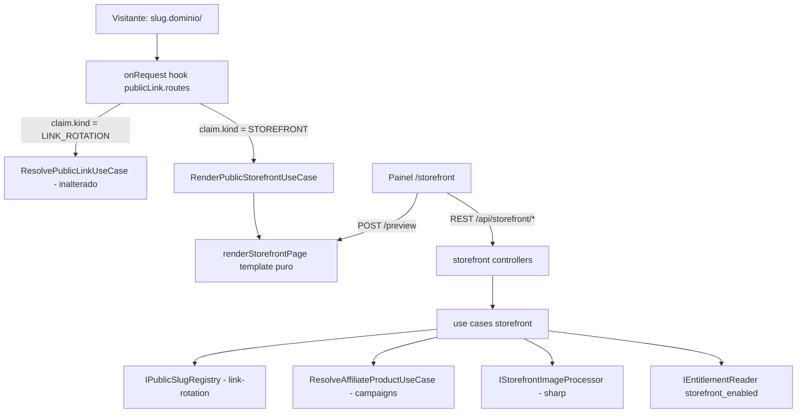

# Página de Ofertas — Design

**Spec**: `spec.md` · **Decisões**: `context.md` · **Status**: Draft (revisado contra código, 4 rodadas, 2026-10-29)

## 1. Visão geral



Módulo novo `api/src/modules/storefront/` (domain/application/infrastructure/presentation).
Painel `app/src/features/storefront/`. Nenhum Baileys. Prisma só em infra.

## 2. Reuso

| Peça | Onde | Uso |
| --- | --- | --- |
| Hook por Host, `matchPublicHost`, `PLATFORM_HOSTNAMES` | `link-rotation/presentation/routes/publicLink.routes.ts:99`, `domain/services/publicHost.ts` | Ganha despacho por `kind`; sem novo hook |
| `ActiveLinkDomainCache` (TTL 60 s) | `link-rotation/infrastructure/cache/` | Domínio ACTIVE para a página |
| `slugRules.ts` (regex, `DEFAULT_RESERVED_SLUGS`, sugestões) | `link-rotation/domain/services/` | Mesma regra de slug |
| `LinkSlugReservation` (30 dias) | schema `:1306` | Troca de nome da página |
| `LinkDomain.reservedNames` + tela admin | `linkDomainAdmin.*` | Ganha `premiumNames` no mesmo padrão (máx. 1000) |
| Gerador passos 2–4 | `campaigns/application/use-cases/GenerateOfferUseCase.ts:101-135` | Extraídos para `ResolveAffiliateProductUseCase` |
| `IOfferImageFetcher` (5 MiB, `image/*`) | `campaigns/domain/contracts/` | Baixar imagem do produto |
| `IMediaFileStore` (S3/local): `saveBuffer`, `publicUrl`, `remove` | `media/domain/contracts/IMediaFileStore.ts:26,30,41` | Base do adapter `StorefrontMediaStore` (infra storefront, molde `MediaOfferStore`): `save(buffer)` grava `storefront-<uuid>.webp` (foto, capa e oferta); `remove(url)` só apaga se o nome casar esse padrão (nunca objeto arbitrário), resolvendo local com `resolveLocalPath(url) ?? url` — exceção consciente ao `@deprecated` (`:39`), mesmo uso de `MediaOfferStore.ts:53` |
| `chunkedUpload` (purpose `media`) + `mediaContainer.uploadStore` | `media/domain/contracts/IUploadSessionStore.ts:76,80`, injeção como `campaigns/infrastructure/offersContainer.ts:73` | Foto/capa; sem porta nova |
| `IEntitlementReader.getBoolean`, `PlanFeatureUnavailableError` | `tenants/domain/contracts/`, `shared/errors/internal/PlanErrors.ts:13` | Gate |
| `linkRotationPlanLimits.ts` + `ApplyPlanLimits…` | `link-rotation/infrastructure/` | Molde do `PAUSED_BY_PLAN` |
| `publicLinkLayout.ts` (`allowedMediaUrl`, marca, 404/429) | `link-rotation/presentation/templates/` | Layout e páginas de erro da página pública |
| `rateLimitPresets.publicLink` | `shared/http/rateLimitPresets.ts:17` | Página pública |
| `PlanLimitBanner` | `app/src/features/linkRotation/components/` | Molde do banner de upgrade |
| `usePersistedState`, `Blurred`, `privacyFlags` | `app/src/hooks/`, `app/src/features/privacy/` | Persistência e borrar |
| `CooldownBar`/`Switch`/`AppIcon` | `docs/padrao-ui-painel.md` | UI padrão |

## 3. Dados

Duas migrations, nesta ordem: `<ts1>_add_storefront_and_public_slug_claims` (T2, ts1 > `20261029020000`) e
`<ts2>_add_premium_slug_audit_actions` (T12, ts2 > ts1; `ALTER TYPE "AuditAction" ADD VALUE` fica sozinho na sua migration).

```prisma
enum PublicSlugKind { LINK_ROTATION STOREFRONT }
enum PremiumSlugGrantSource { MANUAL BILLING }

/// Dono único de <slug>.<domínio>. Rodízio e página disputam o mesmo namespace.
/// Exatamente um de linkRotationId/storefrontId (CHECK no SQL da migration, coerente com `kind`).
model PublicSlugClaim {
  id             String         @id @default(cuid())
  domainId       String
  slug           String
  kind           PublicSlugKind
  tenantId       String
  linkRotationId String?        @unique
  storefrontId   String?        @unique
  createdAt      DateTime       @default(now())
  domain       LinkDomain    @relation(fields: [domainId], references: [id], onDelete: Restrict)
  tenant       Tenant        @relation(fields: [tenantId], references: [id], onDelete: Cascade)
  linkRotation LinkRotation? @relation(fields: [linkRotationId], references: [id], onDelete: Cascade)
  storefront   Storefront?   @relation(fields: [storefrontId], references: [id], onDelete: Cascade)
  @@unique([domainId, slug])
  @@index([tenantId])
  @@map("public_slug_claims")
}

model PremiumSlugGrant {
  id        String                 @id @default(cuid())
  domainId  String
  slug      String
  tenantId  String
  source    PremiumSlugGrantSource
  expiresAt DateTime?
  createdAt DateTime               @default(now())
  domain LinkDomain @relation(fields: [domainId], references: [id], onDelete: Restrict)
  tenant Tenant     @relation(fields: [tenantId], references: [id], onDelete: Cascade)
  @@unique([domainId, slug])
  @@map("premium_slug_grants")
}

enum StorefrontStatus { ACTIVE PAUSED_BY_PLAN }
enum StorefrontOfferStatus { DRAFT PUBLISHED }

model Storefront {
  id              String           @id @default(cuid())
  tenantId        String           @unique
  title           String
  subtitle        String?
  avatarUrl       String?
  coverUrl        String?
  colorPrimary    String           @default("#2563EB")
  colorBackground String           @default("#F5F5F5")
  colorCard       String           @default("#FFFFFF")
  categories      String[]         @default([])
  status          StorefrontStatus @default(ACTIVE)
  createdAt       DateTime         @default(now())
  updatedAt       DateTime         @updatedAt
  tenant Tenant            @relation(fields: [tenantId], references: [id], onDelete: Cascade)
  claim  PublicSlugClaim?  // domínio e slug vêm daqui; sem cópia em Storefront (sem drift)
  offers StorefrontOffer[]
  @@map("storefronts")
}

model StorefrontOffer {
  id                 String                @id @default(cuid())
  tenantId           String
  storefrontId       String
  status             StorefrontOfferStatus @default(DRAFT)
  position           Int
  provider           AffiliateProvider     // enum existente (schema `:573`)
  sourceUrl          String
  affiliateUrl       String
  title              String
  priceCents         Int?
  originalPriceCents Int?
  imageUrl           String?
  category           String?
  publishedAt        DateTime?
  createdAt          DateTime              @default(now())
  updatedAt          DateTime              @updatedAt
  storefront Storefront @relation(fields: [storefrontId], references: [id], onDelete: Cascade)
  tenant     Tenant     @relation(fields: [tenantId], references: [id], onDelete: Cascade)
  @@index([storefrontId, status, position])
  @@index([tenantId])
  @@map("storefront_offers")
}
```

`LinkDomain` ganha `premiumNames String[] @default([])` e back-relations `publicSlugClaims`, `premiumSlugGrants`. `Tenant` ganha `publicSlugClaims`, `premiumSlugGrants`, `storefront Storefront?`, `storefrontOffers`.
`LinkRotation` ganha `claim PublicSlugClaim?`.
Janela de deploy: instância antiga pode criar rodízio sem claim enquanto a nova sobe; `check` consulta `link_rotations` como rede e
T31 roda de novo o backfill idempotente (`ON CONFLICT DO NOTHING`) após o deploy.
Backfill na mesma migration: `INSERT INTO public_slug_claims (id, "domainId", slug, kind, "tenantId", "linkRotationId", "createdAt")
SELECT gen_random_uuid()::text, "domainId", slug, 'LINK_ROTATION', "tenantId", id, now() FROM link_rotations ON CONFLICT DO NOTHING`
(precedente `20261029020000_create_link_rotation/migration.sql:166`; `@default(cuid())`
não existe no banco).
`DeleteLinkDomainUseCase` (`admin/DeleteLinkDomainUseCase.ts:9-11`) passa a contar claims + grants (não só rodízios) e manter
`409 LinkDomainInUseError`; sem isso o `Restrict` vira P2003 cru (500).
Apagar rodízio/página: o use case chama `release` (cria reserva de 30 d) na mesma transação **antes** do delete; o Cascade da
FK é só rede contra claim órfã.
Data migration insere preset `storefront_enabled` em `plan_entitlement_presets` com **`false` explícito no Starter** e `true`
nos outros (coluna JSONB → JSON boolean, molde `20261029020000_create_link_rotation/migration.sql:164`): `SyncTenantEntitlementsUseCase.ts:23`
só faz upsert do que existe, então ausência não desliga tenant rebaixado. Na mesma migration, backfill para tenants com plano
(sync só roda em webhook; `ReconcileSubscriptionsUseCase.reconcileTenant` é stub): `INSERT INTO "tenant_entitlements" ("id","tenantId","key","value")
SELECT gen_random_uuid()::text, t.id, 'storefront_enabled', p."value" FROM "tenants" t JOIN "plan_entitlement_presets" p
ON p."planSlug" = t."planSlug" AND p."key" = 'storefront_enabled' ON CONFLICT ("tenantId","key") DO NOTHING`. Migration roda no boot da Render (`start:migrate`); nunca local.

## 4. Componentes

### 4.1 `IPublicSlugRegistry` (link-rotation, exportado pelo container)

Transação segue a convenção do projeto: `new UnitOfWork().runInTransaction(tx => …)` (`shared/database/UnitOfWork.ts:4`,
precedente `users/application/use-cases/AcceptInviteUseCase.ts:29-33`). A porta de domínio **não** recebe tx: a infra
constrói `new PrismaPublicSlugRegistry(tx)` e `new PrismaLinkRotationRepository(tx)`: construtor passa a aceitar
`PrismaClient | TransactionClient` (hoje só `PrismaClient`, `:33`); `update`, `replaceGroups` e `incrementClick` (`:74,117,184`) usam
`this.prisma.$transaction`, que não existe no tx client — com tx, executam direto, sem `$transaction` aninhado. Use cases recebem uma
fábrica `runInSlugTransaction(fn)` exposta pelo container.

- `check(tenantId, domainId, slug): SlugAvailability` — `INVALID | RESERVED | PREMIUM | TAKEN | OWNED | AVAILABLE` (+ `suggestions`).
  Ordem: formato → `DEFAULT_RESERVED_SLUGS`/`reservedNames` → claim (dono = tenant → `OWNED`, senão `TAKEN`) → linha em
  `link_rotations` sem claim (rede da janela de deploy, ver §3) → `TAKEN` → `LinkSlugReservation` de outro tenant e não expirada →
  `RESERVED` → `premiumNames` sem grant do tenant → `PREMIUM` → `AVAILABLE`. Função pura `decideSlugAvailability` decide; repo só lê
- `claim({tenantId, domainId, slug, kind, ownerId})` — dentro da tx: refaz a leitura de reserva/grant (corrida com release), apaga a
  reserva **do próprio tenant** para esse nome, insere o claim. `P2002` sobe; o use case captura **fora** do `runInTransaction`
  (Postgres aborta a tx) e só então gera sugestões (`withSlugSuggestions`) → `LinkSlugTakenError`
- `move({kind, ownerId, newDomainId?, newSlug})` — troca domínio/slug do claim (rename de rodízio troca domínio,
  `RenameLinkRotationUseCase.ts:36`); reserva 30 d do antigo **no domínio antigo**
- `release({kind, ownerId})` — reserva 30 d + apaga claim, na mesma tx do delete do dono
- Unicidade: o unique do claim cobre claim×claim; reserva/premium são revalidados dentro da tx do claim

Rodízio passa pelo registry em create/rename/delete (hoje delete/update e `reserveSlug` são chamadas separadas sem tx,
`DeleteLinkRotationUseCase.ts:15-16`, `RenameLinkRotationUseCase.ts:36-39`; T11 junta na mesma tx). Mapeamento no rodízio, sem contrato
novo: `OWNED` → `LINK_SLUG_TAKEN` (comportamento atual, `isSlugAvailable` conta o próprio slug); `PREMIUM` → `LINK_SLUG_RESERVED`
(nome especial é vendido para a página; rodízio não o pega). `@@unique([domainId, slug])` de `link_rotations` fica como rede.

### 4.2 Despacho no hook

Despacho por **fallback**, sem custo extra para o clique de rodízio: handler de `GET /` com `state.match.kind === 'slug'` chama o
resolver do rodízio como hoje; só quando ele devolve `not_found` chama `pageRenderers.STOREFRONT?.render({domainId, slug})` (de
`state.match`, sem reparsear Host). Apex (`match.kind === 'apex'`) segue a landing; página não existe no apex.
`ResolvePublicLinkUseCase.ts:77` devolve `unavailable` sem `LINK_CLICK_SALT` **antes** de buscar a rotação (`:79`): T22 move o
`if (!salt)` para depois de `findPublicByHost`, senão vitrine vira 503 quando o salt falta.
`PublicLinkDeps` (`publicLink.routes.ts:19`) ganha `pageRenderers?: Partial<Record<PublicSlugKind, IPublicPageRenderer>>`;
`createPublicLinkDeps({ pageRenderers })` (`link-rotation/infrastructure/publicLinkComposition.ts:16`) chamado de `app.ts:310`, que
injeta o renderer do storefront. Link-rotation não importa storefront. Sem rota pública nova (imagens vêm de `S3_PUBLIC_URL`).

Renderer devolve `{status, html, styleHash}` e a vitrine usa helper de envio **próprio** (o `sendHtml` do rodízio fixa
`Cache-Control: no-store` e CSP com hash do CSS fixo, `publicLink.routes.ts:50-53`, `publicLinkLayout.ts:67-68`):
CSP por resposta com `sha256` do `<style>` renderizado (cores mudam o hash), `img-src` = `S3_PUBLIC_URL` + assets da marca, e
`Cache-Control: public, max-age=60` só no 200 com ofertas. Rodízio intacto.

Status (espelha o rodízio, `ResolvePublicLinkUseCase.ts:81-84`): tenant não `ACTIVE` → 503 `unavailablePage`; `PAUSED_BY_PLAN` →
200 página "pausada"; `ACTIVE` sem publicadas → 200 "em breve"; sem página → 404 da marca.

### 4.3 Use cases (`storefront/application/use-cases/`)

| Use case | Entrada → saída | Regra |
| --- | --- | --- |
| `GetStorefrontUseCase` | tenantId → página + ofertas + `publicUrl` + catálogo de categorias, ou `null` | gate |
| `CheckStorefrontSlugUseCase` | tenantId, slug → `SlugAvailability` | gate; rate limit 30/min |
| `SaveStorefrontUseCase` | dto → página | gate; dto traz `domainId` (painel lista os ACTIVE, como o rodízio) e o use case reusa `requireActiveDomain` (`CreateLinkRotationUseCase.ts:31`); valida; cria (claim) ou atualiza (move se slug mudou) numa transação; limpa categoria órfã das ofertas |
| `SetStorefrontImageUseCase` | tenantId, userId, kind `avatar\|cover`, uploadId → url | gate; injeta `IUploadSessionStore` e chama direto (não `consumeUploadedImage`, que grava cru antes de qualquer resize, `MediaOfferStore.ts:95`): `beginConsume` (só segue com `outcome === 'started'`; `in_progress` → `UPLOAD_IN_PROGRESS`, `incomplete` → `UPLOAD_INCOMPLETE`, `consumed`/`not_found` → `UPLOAD_NOT_FOUND`, sem `discard`, como `consumeUploadedImage`) → tamanho (2/4 MiB) → `readHead`/`binPath` → processor → `StorefrontMediaStore.save` → `discard`; erro antes de gravar → `releaseConsume`; apaga anterior via `StorefrontMediaStore.remove` |
| `RemoveStorefrontImageUseCase` | tenantId, kind | apaga arquivo |
| `ExtractStorefrontOfferUseCase` | tenantId, url, category? → oferta DRAFT | gate; limite 200; `category` ∈ categorias da página ou null; `ResolveAffiliateProductUseCase`; Shopee → `BuildTenantAffiliateLinkUseCase(tenantId, href)` (`:81`; deps `IAffiliateCredentialGateway`, `IShortLinkExpander`, `IShopeeAffiliateClient`, `:22-28`): `kind === 'ok'` → link gerado, `attributionVerified = true`; qualquer outro kind (`credential_missing\|credential_rejected\|failed\|unsupported`, `:13-20`) ou erro não-`AppError` (`:133`, capturado e logado) → link colado, `attributionVerified = false`; imagem `IOfferImageFetcher` → processor `offer` → `StorefrontMediaStore.save`, falha tolerada; rate limit 60/h (conta a requisição, não as expansões) |
| `UpdateStorefrontOfferUseCase` | id, campos editáveis | tenantId no where |
| `SetStorefrontOfferStatusUseCase` | id, DRAFT/PUBLISHED | limite 60 publicadas; vai pro fim da aba |
| `ReorderStorefrontOffersUseCase` | status, ids[] | conjunto exato da aba, senão 400 |
| `DeleteStorefrontOfferUseCase` | id | apaga imagem |
| `PreviewStorefrontUseCase` | rascunho → HTML | gate; usa ofertas publicadas ou 3 exemplos |
| `RenderPublicStorefrontUseCase` | domainId, slug → `{status, html, styleHash}` | sem tenant context; status de §4.2 |
| `ApplyPlanToStorefrontUseCase` | client/tx, tenantId → status | lê `getBoolean(storefront_enabled) === true` no mesmo client; chamado por `integrations/billing/applyPlanSideEffects.ts` |

Admin (link-rotation): `premiumNames` no create/update de domínio; `GrantPremiumSlugUseCase` /
`RevokePremiumSlugUseCase` com `AuditLog`.

### 4.4 `ResolveAffiliateProductUseCase` (campaigns)

`resolve(tenantId, url) → { provider, sourceUrl, affiliateUrl, attributionVerified, product: ProductData, imageSourceUrl }`.
Corpo = passos 2–4 de `GenerateOfferUseCase` sem gravar nem baixar imagem: move `checkOwnership` e `generateMlAffiliateLink` (privados, `GenerateOfferUseCase.ts:182-209`) e recebe `ResolveProductDataUseCase` por injeção (hoje criado no construtor, `:81`); não usa `storeImage`. Gerador passa a chamar este e segue gravando imagem como hoje.

### 4.5 `IStorefrontImageProcessor` (infra, sharp)

`process(buffer, preset) → { buffer, width, height } | throws`. Presets: `avatar` (cover 320², mín. 200²),
`cover` (cover 1500×500, mín. 1200×400), `offer` (inside 600). Detecta formato pelo conteúdo
(`sharp().metadata()`), nunca pelo mime declarado; `limitInputPixels` 40 MP; saída WebP q80 sem EXIF.
Pré-requisito: `sharp` **não** é dependência direta (só `pnpm.onlyBuiltDependencies`, `api/package.json:68`; vem transitivo do Baileys, 0.34.5) e o pnpm isola: T1 adiciona `"sharp": "0.34.5"` em `dependencies`. `node:22-alpine` usa o binário prebuilt linuxmusl, sem `apk`.

### 4.6 Template `renderStorefrontPage(model)` (presentation/templates, função pura)

Recebe strings cruas; o template escapa tudo. `avatarUrl`/`coverUrl`/`imageUrl` passam por `allowedMediaUrl` (`publicLinkLayout.ts:88`): imagem exige `S3_PUBLIC_URL` (sem ele, ex. dev local, cai no fallback sem erro). Devolve também o `sha256` do `<style>` para a CSP. CSS inline com custom properties das 3
cores (validadas `#RRGGBB`). Capa 3:1, avatar circular sobreposto, chips de categoria (radio + `:checked`),
grade 1 col (≤ 640 px) / 2–3 col. Card: imagem, categoria, título (2 linhas), "de" riscado, preço,
"Ver oferta →" (`target="_blank" rel="nofollow sponsored noopener"`). OG tags. Rodapé "Feito com" + `APP_NAME` (marca só em texto exibido). Mesmo template no preview
com flag `isPreview` (selo "Ofertas de exemplo", sem OG).

### 4.7 Rotas (`/api/storefront`, authHook + tenant)

| Método | Rota | Use case |
| --- | --- | --- |
| GET | `/storefront` | Get |
| GET | `/storefront/slug-availability?slug=` | CheckSlug |
| PUT | `/storefront` | Save |
| PUT/DELETE | `/storefront/images/:kind` | Set/RemoveImage |
| POST | `/storefront/preview` | Preview (`text/html`) |
| POST | `/storefront/offers` | Extract |
| PATCH | `/storefront/offers/:id` | Update |
| POST | `/storefront/offers/:id/status` | SetStatus |
| PUT | `/storefront/offers/order` | Reorder |
| DELETE | `/storefront/offers/:id` | Delete |
| POST | `/admin/link-domains/:id/premium-grants` body `{tenantId, slug, expiresAt?}` | Grant (`preHandler = [authHook, superAdminHook]`, igual `linkDomainAdmin.routes.ts:17`) |
| DELETE | `/admin/link-domains/:id/premium-grants/:grantId` | Revoke (idem) |

Rate limit por tenant: `config.rateLimit: { ...preset, hook: 'preHandler', keyGenerator: r => r.user.tenantId }` com `authHook` antes
no `preHandler` (o global `app.ts:108` usa IP no `onRequest`, antes do auth). Presets novos em `rateLimitPresets.ts`:
`storefrontSlug` 30/min, `storefrontPreview` 60/min, `storefrontExtract` 60/h. Store em memória por instância (igual ao global hoje);
store externo segue `arquitetura-escala.md` quando houver mais de uma instância http.

### 4.8 Painel (`app/src/features/storefront/`)

- `services/storefrontApi.ts` (Axios central), `strings.ts`, `types.ts`
- `StorefrontPage.tsx` substitui o placeholder existente (`pages/modules/index.tsx:34-43`, import em `AppRoutes.tsx:19`; menu já existe em `AppLayout.tsx:59` — um rótulo só, "Página de Ofertas"). Redirect só quando `err.code === 'PLAN_FEATURE_UNAVAILABLE'` (`apiClient.ts:181-187` expõe `code`; `PLAN_LIMIT_REACHED` também é 403), helper local, sem mexer no interceptor global
- `components/`: `StorefrontHeader` (endereço + copiar/abrir), `StorefrontConfigCard` (resumo / form), `SlugField` (estados + sugestões), `PremiumSlugBanner`, `ImagePicker` (avatar/cover, regra visível, `chunkedUpload`), `SubtitleField` (4 sugestões), `CategoryChips`, `ColorField` ×3, `StorefrontPreview` (iframe `sandbox=""` `srcdoc`, debounce 500 ms, toggle Mobile/Desktop), `AddOfferCard`, `OfferTabs` (Rascunhos/Publicadas), `OfferRow` (arrastar com `@dnd-kit/sortable` — lib nova, painel não tem DnD — + mover por teclado ▲▼, editar, publicar, apagar com `ConfirmDialog`), `EditOfferDialog`; ícones só `AppIcon`
- Lógica pura em `storefrontForm.ts` (validação, diff, normalização de cor) e `reorder.ts` — testadas
- Persistência (`usePersistedState`, escopo `tab`): rascunho do form, modo editar, aba ativa, URL colada + categoria, modo do preview. Limpa ao salvar
- Privacidade (uma flag por tipo, `privacyFlags.ts:2-4`): `storefront.name`, `storefront.photo`, `storefront.cover`, `storefront.subdomain`, `storefront.offerTitle`, `storefront.offerImage`; `Blurred` por ponto; preview borrado inteiro se qualquer flag ligada; atualizar "Telas cobertas" em `padrao-ui-painel.md`
- `/plans`: lê `feature=storefront` e mostra aviso no topo (`plans/strings.ts`)
- `catalog.ts`: "Página de Ofertas" em `benefits` **só** de Profissional e Business (nunca no Starter; `limits` é só numérico, `catalog.ts:39`); const separada `PREMIUM_SLUG_OFFER { title, benefits[], priceLabel, checkoutUrl: null }` fora de `PLAN_CATALOG` (`catalog.test.ts` conta 3 planos), só texto
- Menu: campo opcional `badge` no item (`AppLayout.tsx:51-64`), renderizado como `Chip` pequeno após `item.label` (`:209-212`); no modo recolhido (`:208`) vai para o `Tooltip` do ícone. Texto em chave nova `plansStrings.badgeProfessional` ("Profissional") em `plans/strings.ts`
- Tooltips (MUI `Tooltip`) nos ícones de ação; modos sistema/claro/escuro via tema

## 5. Erros

| Cenário | Erro | Painel |
| --- | --- | --- |
| Sem plano | `PLAN_FEATURE_UNAVAILABLE` 403 | Redireciona para `/plans?feature=storefront` |
| Slug inválido/reservado/tomado | `LINK_SLUG_INVALID` 400 / `LINK_SLUG_RESERVED` 409 / `LINK_SLUG_TAKEN` 409 (`error.meta.suggestions`) — reuso de `LinkRotationErrors.ts` | Estado no campo |
| Slug premium sem grant | `STOREFRONT_SLUG_PREMIUM` 409 (sem precedente de 402 no painel) | Banner de compra |
| Link fora da regra | `OFFER_URL_UNSUPPORTED` / `OFFER_LINK_NOT_OWNED` / `OFFER_LINK_NOT_AFFILIATE` | Aviso do link do produto |
| Limites | `STOREFRONT_OFFER_LIMIT` / `STOREFRONT_PUBLISHED_LIMIT` 409 | Snackbar |
| Página/oferta não existe | `STOREFRONT_NOT_FOUND` 404 | Recarrega |
| Ordem com ids faltando/estranhos | `STOREFRONT_ORDER_INVALID` 400 | Recarrega a lista |
| Rate limit (slug/preview/extract) | 429 `RATE_LIMITED` do `@fastify/rate-limit` | Aviso "aguarde" |
| Imagem | `MEDIA_TOO_LARGE` / `UNSUPPORTED_MEDIA_TYPE` / `MEDIA_PROCESSING_FAILED` / `UPLOAD_NOT_FOUND` / `UPLOAD_INCOMPLETE` | Regra do campo |
| Público: sem página / pausada / tenant inativo | 404 / 200 pausada / 503 (§4.2) | — |

Erros novos (só os `STOREFRONT_*`) em `shared/errors/internal/StorefrontErrors.ts`. Envelope: `{success:false, error:{code,message,meta}}`.

## 6. Decisões técnicas

| Decisão | Escolha | Por quê |
| --- | --- | --- |
| Unicidade do subdomínio | `PublicSlugClaim` unique (claim×claim) + revalidação de reserva/premium na tx | Corrida entre módulos |
| Gate | `getBoolean(...) === true` (`PrismaEntitlementReader.ts:39` devolve `null` p/ ausente) + `PlanFeatureUnavailableError` existente | Ausente = bloqueado; teste obrigatório |
| Página pública sem JS | CSS `:checked` | Webview de Instagram/TikTok, CSP simples, leve |
| Cache | `public, max-age=60` só na vitrine (rodízio segue `no-store`), sem cache em memória | `arquitetura-escala.md`; Cloudflare cobre |
| Ordem | `position` inteiro reescrito em lote numa transação | ≤ 200 linhas; simples |
| Rótulos de categoria | Na API (pt-BR), entregues ao painel no `GET` | Fonte única para painel e página pública |
