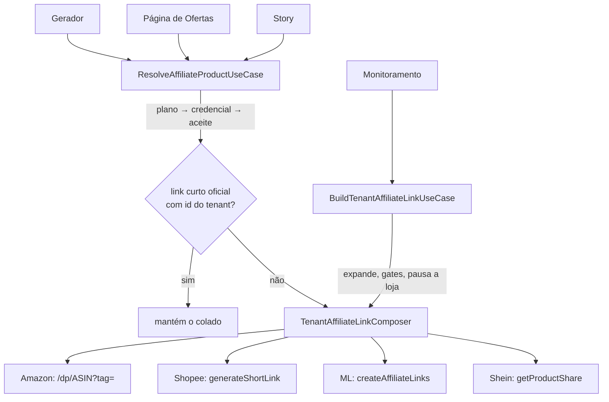

# Link de afiliado sempre do tenant — Design

**Spec**: `.specs/features/tenant-affiliate-link/spec.md`
**Status**: Rascunho

## Visão

Um ponto só decide o link: `ResolveAffiliateProductUseCase`. Ele deixa de classificar-e-recusar e passa a
**provar ou recriar**. A recriação usa o mesmo código do monitoramento, extraído do
`BuildTenantAffiliateLinkUseCase` para um núcleo sem efeito colateral.

## Reuso

| Existente | Local | Uso |
| --- | --- | --- |
| Switch por marketplace do builder | `BuildTenantAffiliateLinkUseCase.ts:113-172` | Vira o corpo do composer, sem mudar lógica |
| `mlRefFromPage` (vitrine social) | idem `:190-203` | Vai junto para o composer |
| `verifyAffiliateLink` | `domain/services/` | Só para decidir "manter o colado" (TLINK-04); deixa de gerar erro |
| `isSupportedShareLink` | `domain/services/` | Validação do link devolvido, agora nos 4 marketplaces |
| `resolveState` do gateway | `IAffiliateCredentialGateway.ts` | Resolve passa a usar nos 4 (hoje só Shein) |
| `ResolveProductDataUseCase` | `application/use-cases/` | Dados do produto quando o composer não trouxer |
| Erros `AffiliateApiRateLimited/Unavailable/CredentialRejected` | `OfferErrors.ts:69-84` | Propagados como estão |
| `CredentialAlerts` (monitoramento) | `app/src/features/monitoring/components/` | Modelo visual do botão "Configurar" com `returnTo` |
| `FakeBuildAffiliateLink`, `setup()` do teste do builder | `storefrontTestFakes.ts:250`, `Build….test.ts:19-42` | Fakes dos testes novos |

## API

### Aplicação (`campaigns/application`)

**`services/TenantAffiliateLinkComposer.ts`** (novo; mesmo padrão de `OfferTextComposer`)

- Propósito: dado marketplace, URL final e credencial já lida, devolve o link do tenant. Sem expandir, sem gate de
  plano, sem `markRejected`, sem log de URL.
- Interface: `compose(input: { tenantId, provider, final: URL, cred: OfferAffiliateCredential }): Promise<ComposedTenantLink>`
- `ComposedTenantLink` = `ok {sourceUrl, affiliateUrl, productRef, product?}` (`productRef` = id do produto que o
  composer usou: ASIN, `shopId.itemId`, `MLB…` inclusive o achado na vitrine social, `goodsId`) | `unsupported` | `credential_missing` |
  `risk_not_accepted` | `failed {code}`. `AppError` da loja **sobe** (quem chama decide pausar ou avisar).
- Deps: `shopee`, `mercadoLivre`, `pageReader`, `shein`, `riskGate`.
- Código extraído sem mudança de comportamento (TLINK-23). A allowlist do link devolvido para Shopee e ML
  (TLINK-09) é aplicada **no Resolve**, não aqui: no builder esses dois ramos devolvem `ok` sem checar
  (`:126-128`, `:139-149`) e o monitoramento não pode mudar.

**`BuildTenantAffiliateLinkUseCase.ts`** (muda)

- Mantém `execute(tenantId, href)` e a união `TenantAffiliateLink` idênticas.
- Passa a: expandir → plano → `resolveState` → `composer.compose` → traduzir `AppError`
  (`AFFILIATE_CREDENTIAL_REJECTED` → `markRejected` + `credential_rejected`; demais → `failed`).
- Monitoramento não percebe a troca (TLINK-23).

**`ResolveAffiliateProductUseCase.ts`** (muda)

Fluxo novo de `execute`:

1. `parseUrl` → allowlist → plano na URL colada → `expand` → `detectMarketplace` → plano de novo se mudou →
   `parseProductRef` e gate `ref || mlSocial` → `OfferUrlUnsupportedError` (tudo igual a hoje, `:67-79`, e
   **antes** da credencial: link de cupom/lista sem produto segue "não suportado" mesmo sem loja conectada).
2. `resolveState` nos 4 marketplaces: `missing` → `AffiliateCredentialRequiredError(provider)`; `rejected` →
   `AffiliateCredentialRejectedError(provider)`.
3. Aceite de risco (igual a hoje, `:85-88`: checado logo após existir credencial). Detalhe que falta na credencial
   (Shein sem `AT`, Shopee sem secret, ML sem sessão) só aparece no passo 5 como `credential_missing`; logo, Shein
   sem `AT` **e** sem aceite mostra primeiro o erro de aceite. Aceito: credencial Shein só nasce pela extensão, com `AT`.
4. `keepPasted` = `shouldKeepPastedLink(...)`: `verified` **e** URL colada é link curto oficial (`isShortLink`) **e**
   provider ≠ `AMAZON`. Se sim: `affiliateUrl = source` e os dados do produto seguem **exatamente o caminho de
   hoje** para link verificado: ML/Shopee via `products.resolve` (melhor esforço; vitrine social sem card = produto
   vazio e preenchimento manual, como hoje); Shein com `AT` chama `getProductShare` só para os dados (como
   `resolveShein` `:126-136` faz hoje) e sem `AT` devolve produto vazio (`:122-124`). Nenhum link é trocado aqui.
5. Senão: `composer.compose(...)`, e o `affiliateUrl` devolvido passa por `isSupportedShareLink` **no Resolve**
   (fora da allowlist → `OfferLinkRebuildFailedError`). Mapa:

| Retorno do composer | Erro lançado |
| --- | --- |
| `ok` | — (`affiliateUrl` do tenant) |
| `unsupported` | `OfferUrlUnsupportedError('Product not recognized')` |
| `credential_missing` | `AffiliateCredentialRequiredError` |
| `risk_not_accepted` | `MarketplaceRiskNotAcceptedError` |
| `failed {code}` | `OfferLinkRebuildFailedError(provider, code)` |
| `AppError` da loja | sobe sem tradução (`REJECTED`, `RATE_LIMITED`, `UNAVAILABLE`, `ACCESS_DENIED`) |

6. Produto (caminho recriado): `composed.product` quando vier (vitrine social ML com dado, Shein), convertido para
   `ProductData` com o `productRef` do `ok` do composer (na vitrine social o Resolve tem `ref = null`, `:77-78`,
   e `TenantLinkProductData` não tem `productRef`);
   senão `products.resolve`, sobrepondo `productRef` com o do composer. A vitrine social só é relida quando o card veio sem dado.
7. Retorno: `sourceUrl` continua sendo o **colado** (`source.toString()`, `:104`); o `sourceUrl` canônico do
   composer é descartado (a vitrine grava `resolved.sourceUrl`, `ExtractStorefrontOfferUseCase.ts:54`).
   `attributionVerified` sempre `true`; novo campo `linkRebuilt: boolean` (`true` no caminho do passo 5).

Removidos: `checkOwnership` como porta de erro, `generateMlAffiliateLink` (engolia erro, F8), o ramo de troca de
link de `resolveShein` (fica só a leitura de dados do passo 4), `readCredential` com exceção da Shein. Deps: sai
`mercadoLivre`, entra `composer`; `shein` fica (dados no keep); `credentials` vira
`Pick<IAffiliateCredentialGateway, 'resolveState'>`.

**`GenerateOfferUseCase.ts`** — para de montar instância própria do Resolve (`:77-80`); recebe a do container.
`GenerateOfferDeps` perde `expander`, `credentials`, `mercadoLivre`, `shein`, `riskGate` (só o Resolve interno
usava) e ganha a instância; ficam `offers`, `texts`, `now`, `shopee`, `pageReader`, `imageFetcher`, `mediaStore`, `entitlements`. O literal
de `generate` em `offersContainer.ts:106-119` muda junto (senão `tsc` acusa propriedade em excesso). O envelope
de saída da geração ganha `linkRebuilt` (repassado do Resolve).

**`UpdateOfferUseCase.ts`** — antes de gravar texto: `findForeignMarketplaceLinks(newText, offer.text, offer.affiliateUrl)`;
achou → `OfferTextForeignLinkError`.

### Domínio (`campaigns/domain/services`)

- **`findForeignMarketplaceLinks.ts`** (novo, função pura, sem rede): `(newText, storedText, affiliateUrl)` →
  URLs do texto novo cujo host é de marketplace (`detectMarketplace`, que não exige `https`; `isSupportedProductUrl`
  exige e deixaria `http://` passar), que não são o `affiliateUrl` e que **não aparecem no texto gravado**.
  Comparação sempre pelo `href` normalizado do `extractUrls` nos dois lados (ele devolve `{raw, href}`). Motivo: oferta do monitoramento nasce `DRAFT` editável com até 8 links do tenant no texto e
  só o 1º em `affiliateUrl` (`ProcessPendingCapturedOffersUseCase.ts:146,173-174`, `EnqueueOfferUseCase.ts:71-77`).
  Extração de URL: `extractUrls` vai para `campaigns/domain/services/extractUrls.ts` **junto com** `URL_PATTERN`,
  `TRAILING`, `toHref` e o tipo `FoundUrl` (exportados; `rewriteOfferLinks`, `hasTextBeyondLinks` e `previewText`
  usam os mesmos, `offerMessageText.ts:8,11,20,42`). `offerMessageText.ts` importa de lá e **reexporta**
  `extractUrls`, para `offerMessageText.test.ts:2-3` seguir sem edição (sentido
  automation → campaigns, que já existe).
- **`pickPreviewUrl.ts`** (muda): devolve `affiliateUrl` se estiver no texto; senão `null`.
- **`isShortLink`**: hoje só existe em `infrastructure/http/HttpShortLinkExpander.ts:21` (com `SHORT_HOSTS`). Vai
  para `domain/services/isShortLink.ts` (função pura) e o expander passa a importar de lá; domínio não importa infra.
  Atenção: ele trata `mercadolivre.com/social|sec/…` como curto; só `www.mercadolivre.com.br/social/…` é longo.
- **`verifyAffiliateLink.ts`** (muda, fase FH): só muda a precedência no ML (juntar as URLs já acontece, `:70-71`).
  Se existir algum `matt_word` (em qualquer URL), o conjunto é só de `matt_word`; `/social/<x>`
  entra apenas quando não há nenhum. Motivo: `/social/<x>` é o apelido do perfil, não a etiqueta (84 de 86 URLs
  reais divergem). `affiliateIdentifiersOf` não tem outro consumidor além do próprio arquivo e do teste; a
  precedência fica numa função nova `ownershipIdentifiersOf(provider, urls)`. Depois da T4 o resultado deixa de virar erro e só decide
  "manter o colado".

### Erros (`shared/errors/internal/OfferErrors.ts`)

| Código | HTTP | meta | Situação |
| --- | --- | --- | --- |
| `AFFILIATE_CREDENTIAL_REQUIRED` | 422 | `{provider}` | Novo, em `OfferErrors.ts`. **Não** reusar `AFFILIATE_CREDENTIAL_NOT_FOUND`: ele já existe em `AffiliateCredentialErrors.ts:5-9` com 404 e sem `meta` (CRUD de credencial; teste `AffiliateCredentialUseCases.test.ts:112` espera 404) e fica intocado |
| `OFFER_LINK_REBUILD_FAILED` | 422 | `{provider, reason}` | Novo. Loja não devolveu link (`ML_100`, `SHEIN_LINK_NOT_CREATED`, fora da allowlist) |
| `OFFER_TEXT_FOREIGN_LINK` | 422 | `{}` | Novo. Sem URL no meta nem no log |
| `STOREFRONT_OFFER_LINK_UNVERIFIED` | 409 | `{}` | Novo, em `shared/errors/internal/StorefrontErrors.ts` |
| `OFFER_LINK_NOT_OWNED`, `OFFER_LINK_NOT_AFFILIATE` | — | — | Deixam de ser lançados na T4; classes só saem na T10b, depois que os testes que as importam (`offer.routes.test.ts:18`, `OfferStoryUseCases.test.ts:9`, `GenerateOfferUseCase.test.ts`, `ExtractStorefrontOfferUseCase.test.ts:6`) foram reescritos |

### Infraestrutura

- `offersContainer.ts`: cria `composer`; injeta em `tenantLinks` (builder) e em `affiliateProduct` (Resolve);
  `generate` recebe `affiliateProduct`.
- `storefrontContainer.ts`: deixa de injetar `buildTenantAffiliateLink`.
- Sem migration. `attributionVerified` e `sourceUrl` ficam (legado e auditoria).

### Apresentação

- `linkRebuilt` tem **uma fonte**: o retorno do Resolve. Ninguém deriva de `sourceUrl ≠ affiliateUrl` (oferta do
  monitoramento também tem os dois diferentes e ganharia o aviso por engano).
- Gerador: não há presenter; a rota devolve a saída do use case (`offer.routes.ts:79`) por um schema de resposta (`generateOfferResponse`, que não é fechado; declarar o campo mesmo assim). O campo
  vai no **envelope** da geração (`{offer, needsManualData, …, linkRebuilt}`), calculado no `GenerateOfferUseCase`
  e declarado em `generateOfferResponse` (`offer.schema.ts:177-180`). `toOfferDto`/`OfferDTO` **não** mudam
  (são usados por Get/Update/Send/Regenerate).
- Vitrine: `POST /storefront/offers` responde `{success, data: item}` (`httpResponse.ts:16-18`) com `envelope()`
  fechado no topo (`storefront.schema.ts:32-35`) e o painel só lê `res.data.data` (`storefront.service.ts:64-67`).
  Por isso o campo vai **dentro do item da resposta de criação**: o use case devolve `{offer, linkRebuilt}`, a rota
  responde `data: {...presenter.offer(offer), linkRebuilt}` e o schema do item ganha `linkRebuilt` opcional. Listagem
  e demais rotas não enviam o campo. Aviso aparece ao adicionar, não na linha da lista.
- Story: a saída do `RenderOfferStoryUseCase` (`:96-107`) repassa `resolved.linkRebuilt`; campo em
  `renderOfferStoryResponse` (`offerStory.schema.ts:50-52`, `additionalProperties: false`).
- `offer.routes.ts`: preset de limite de taxa novo em `rateLimitPresets.ts` (T10).
- OpenAPI/schemas das três rotas: campo novo e códigos novos.

## Painel

**`app/src/features/affiliateLinks/`** (novo, compartilhado)

- `linkErrors.ts`: `describeAffiliateLinkError(code, meta) → { message, action: 'credentials' | 'none' } | null`
  (`null` = código que não é deste módulo). É só a **fonte comum de texto e ação**; cada feature mantém o seu
  adaptador e o seu formato de retorno, que são diferentes hoje: offers `{code,message,action:'credentials'|'config'|'sessions'|'none',isLinkField,planLimit?}`
  (`offerErrors.ts:6,39`), vitrine `string` (`storefrontForm.ts:214`), story `{field,message,backToTemplates}`
  (`productForm.ts:121,130`). Ficam em cada feature: `PLAN_LIMIT_REACHED`/`planLimit`, ações `config`/`sessions`,
  `PLAN_FEATURE_UNAVAILABLE`, `OFFER_STORY_TEMPLATE_NOT_FOUND`/`backToTemplates`, `OFFER_URL_UNSUPPORTED`.
  Cobre `AFFILIATE_CREDENTIAL_REQUIRED|REJECTED`, `AFFILIATE_API_ACCESS_DENIED|RATE_LIMITED|UNAVAILABLE`,
  `OFFER_LINK_REBUILD_FAILED`, `MARKETPLACE_RISK_NOT_ACCEPTED` (ação `credentials`, como o gerador já faz).
  `AFFILIATE_CREDENTIAL_NOT_FOUND` (404 do CRUD) continua mapeado onde já está.
- `strings.ts`: textos únicos, **por loja** (nome via `affiliateProviders.ts`). `AFFILIATE_CREDENTIAL_REQUIRED` traz só
  `meta.provider`, e isso basta: o caminho de conexão é fixo por loja (ML e Shein = extensão; Shopee = AppID e
  senha da API; Amazon = ID de rastreamento). Sem `meta.reason`.
- `components/ConnectStoreAction.tsx`: botão para `AFFILIATE_CREDENTIALS_PATH?returnTo=<rota atual>`.
- `components/LinkRebuiltNotice.tsx`: aviso `info` com `AppIcon` (`RefreshCw`, `inline`) + `Tooltip arrow describeChild`.

**Consumidores**: `offers/utils/offerErrors.ts`, `storefront/storefrontForm.ts`, `offerStory/productForm.ts`
delegam ao mapa comum e apagam as cópias. `OfferResultPanel`, `ResultStep` e o fluxo de adicionar da vitrine (`useStorefrontPage`) mostram o aviso.
`OfferGeneratorForm`: rótulo/ajuda novos, sai `shopeeNotice`. Selo "comissão não verificada" fica só para legado.

**Privacidade**: sem flag nova. No gerador o link só aparece dentro do texto da prévia (`OfferResultPanel.tsx:131`
→ `OfferChatPreview.tsx:49,53`), já coberto por `offers.productText` (`privacyFlags.ts:43`); `:95` é só `href`. O
aviso de recriado não traz URL. Story segue com `offerStory.link`.
**Ação na vitrine**: `AddOfferCard` recebe `error?: string` (`:28`) e mostra em helperText; para caber o botão,
a prop passa a aceitar a ação (`errorAction?: 'credentials'`) e o botão é renderizado abaixo do campo.
**Persistência**: nada novo persistido (`linkRebuilt` é dado do servidor).
**Textos**: skill `copywriting` na T11; sem nome da marca; sem ícone de brilho.

## Etiquetas da conta por plano (fase FE)

Independe de D1–D3. Ordem recomendada: FH → FE → F1 (as duas últimas mexem no `ResolveAffiliateProductUseCase`;
a T4 preserva o passo de etiqueta descrito aqui).

### Dados

- `AffiliateCredential` (`schema.prisma:721-750`) ganha duas colunas, genéricas e sem tabela nova (`String[]` já é
  usado em `:567`, `:1441`):
  - `accountIdentifiers String[] @default([])` — etiquetas da conta vistas na última sincronização.
  - `linkedIdentifiers String[] @default([])` — vinculadas **além** da principal (`publicIdentifier`), em ordem.
- Na entidade (`integrations/domain/entities/AffiliateCredential.ts:10-27`), no DTO de sessão
  (`AffiliateCredentialDTO.ts:23-42`) e em `OfferAffiliateCredential` (`IAffiliateCredentialResolver.ts:4-9`) os dois
  campos são **opcionais** (ausente = `[]`): as fixtures tipadas existentes (`BuildTenantAffiliateLinkUseCase.test.ts:9-12`,
  `ResolveAffiliateProductUseCase.test.ts:20-25`, `GenerateOfferUseCase.test.ts:29-32`, `AffiliateCredentialUseCases.test.ts:20-27`,
  presenter, repositório, rotas da Shein) seguem compilando sem edição.
- Chave nova `MERCADO_LIVRE_AFFILIATE_TAGS = 'mercado_livre_affiliate_tags'` (`entitlementKeys.ts`); presets LITE 1,
  PRO 2, MAX 10 (`planPresets.ts:50,72,94`). O `seed` e o `syncPlanEntitlements` (webhook do billing) passam a
  incluí-la por estar no preset.
- **Limite efetivo** = `getNumber(key) ?? 1`. Nesta chave ausente/`null` **não** é ilimitado (nenhum plano é):
  tenant sem `planSlug` ou fora de LITE/PRO/MAX (`schema.prisma:144`; trial, legado, admin) vale 1. Função pura
  única `identifierLimitOf(value)` em `tenants/domain/services/affiliateIdentifierLimit.ts`, importada em todos os pontos. (A tela de Assinatura mostra "sem limite" para chave
  ausente, `subscriptionLimits.ts:107-115`; divergência só para tenant sem plano, aceita.)
- Uma migration `add_affiliate_account_identifiers_and_ml_tags_entitlement`: as duas colunas + `INSERT` dos presets
  com `ON CONFLICT DO NOTHING` + backfill em `tenant_entitlements` por `tenants.planSlug` **filtrado por
  `p."key" = 'mercado_livre_affiliate_tags'`** (como a migration-modelo `20261104130000_…`; sem o filtro copiaria
  todos os presets e mudaria chaves ausentes de outros recursos). Sem `ALTER TYPE "AuditAction"`: a auditoria reusa
  `AFFILIATE_CREDENTIAL_UPSERTED`. Roda só na Render, no boot.

### API

- **`IMercadoLivreAffiliateClient`**: novo `listAccountTags(cookies): Promise<{ tags: string[] | null; active: string | null }>`
  (bootstrap + `TAGS_PATH`). `tags: null` = não deu para ler (rede, JSON ilegível — hoje viram `null` sem lançar,
  `:230-233,246-248`); 401/403/429 seguem lançando. `getActiveTag` delega e devolve `active` (a rota continua
  decidindo `sessionCheck` como hoje, `extension.routes.ts:242-243`).
- **Sincronização**: a rota (`extension.routes.ts:242`) troca `getActiveTag` por `listAccountTags` e passa `tags` ao
  use case no campo novo `accountIdentifiers` de `UpsertAffiliateSessionInput` (`active` segue alimentando
  `affiliateTag` e o `sessionCheck`). No `UpsertAffiliateSessionUseCase`: com `tags` não nula, grava
  `accountIdentifiers` (cada item por `validatePublicIdentifier`, inválido descartado) e **remove de
  `linkedIdentifiers` o que não estiver mais na conta**; com `tags: null` não toca nas duas colunas. Principal
  continua "só preenche se vazia" (`:77`). A rota do painel `PUT /integrations/affiliate-credentials/:provider/session`
  (`affiliateCredential.routes.ts:150-178`, sem chamador no app nem na extensão) não envia lista e não mexe nela.
- **Desconexão e troca de conta**: `clearSession` (`PrismaAffiliateCredentialRepository.ts:139-157`; único chamador
  é `DELETE /marketplaces/ml/session`, `extension.routes.ts:143`) passa a zerar as duas colunas. Troca de conta
  **sem** desconectar não tem detecção própria hoje (`sessionAccountHash` é só lido e zerado, nunca gravado nem
  comparado, `PrismaAffiliateCredentialMapper.ts:42,57-66`; a única comparação é de token, `UpsertAffiliateSessionUseCase.ts:67`,
  e token novo não significa conta nova). Não se cria detecção nesta fase: a sincronização com `tags` lida substitui
  a lista e poda as vinculadas que não são da conta nova, o que cobre a troca. Nada é zerado por mudança de token.
- **Regra pura** `integrations/domain/services/effectiveLinkedIdentifiers.ts`:
  `(primary, linked, limit) → string[]` = principal + primeiras `limit − 1` vinculadas.
- **Use cases novos** (`integrations/application/use-cases`):
  - `GetAffiliateIdentifiersUseCase` → `{ account, primary, linked, limit, used }`.
  - `SetLinkedAffiliateIdentifiersUseCase` (`{ primary, linked }`): tudo ∈ `accountIdentifiers`, sem repetição,
    `1 + linked.length ≤ limit` senão `PlanLimitReachedError(key, limit)`; auditoria `AFFILIATE_CREDENTIAL_UPSERTED`
    com `meta { provider, identifiersChanged: true }` (sem as etiquetas).
  - Rotas `GET|PUT /integrations/affiliate-credentials/:provider/identifiers` (não colidem com `/:provider` nem
    `/:provider/session`); mesma proteção das demais rotas de credencial (`authHook`/`tenantHook`, `:84-127`); só
    provider com sessão (hoje ML).
  - Item da listagem: campos novos em `affiliateCredentialItemSchema` (`affiliateCredential.schema.ts:6-22`; o
    serializador descarta o que não está declarado) e em `AffiliateCredentialPresenter.toItem` (`:10-23`).
- **`ResolveAffiliateCredentialUseCase`** (`:36-51`): só repassa `linkedIdentifiers` e `accountIdentifiers` crus.
  **Construtor não muda** (segue `repo, cipher`).
- **`verifyAffiliateLink`**: terceiro argumento aceita `string | readonly string[]`; `verified` se o identificador
  único do link ∈ conjunto. Demais regras iguais (inclusive a precedência da TH1).
- **`ResolveAffiliateProductUseCase`**: o limite vem de `this.deps.entitlements.getNumber` (dep que já existe,
  `:41`). Vinculadas efetivas = regra pura; `verifyAffiliateLink` recebe esse conjunto (`:83`). **Entre `:83` e o
  `throw` de `:84`**: se o resultado é `not_owned` e o identificador do link ∈ `accountIdentifiers` → `used < limit`
  ? `AffiliateIdentifierNotLinkedError` : `PlanLimitReachedError(key, limit)` (`used` = tamanho do conjunto
  efetivo). Link de etiqueta vinculada segue como `verified`, com a etiqueta do link. Gerador, vitrine e story
  herdam por usarem esse use case.
- **Recriação com etiqueta vinculada não principal** (F1, link longo): TE0 confirmou que `createLink` aceita qualquer
  etiqueta da conta (`docs/extensao-ml-endpoints.md` §4). O composer recebe a etiqueta do link quando ela é vinculada
  efetiva; senão usa a principal. Etiqueta fora da conta o ML troca pela `in_use` em silêncio (não gera erro).
- **Assinatura**: na TE1 a chave entra em `SUBSCRIPTION_HIDDEN_KEYS` (`subscriptionLimits.ts:49`; o teste `:17-20`
  exige toda chave em `ITEMS` ou `HIDDEN`). Na TE6 vai para `SUBSCRIPTION_LIMIT_ITEMS` (`:57-72`) com uso real:
  campo novo em `SubscriptionUsage` (`:18-27`), **ramo próprio em `usedOf`** como o de `OFFER_GENERATIONS_PER_DAY`
  (`:101`; `KEY_TO_COUNT` `:95` é tipado por canal e não serve; sem o ramo `used` sai nulo), leitura em
  `PrismaTenantUsageReader.ts:7,33`. No app a chave entra já na TE1 (o teste `subscription/__tests__/strings.test.ts:24`
  compara com **todas** as `ENTITLEMENT_KEYS` da API, sem olhar `HIDDEN`).
- **Erro novo** `AFFILIATE_IDENTIFIER_NOT_LINKED` (422, `{provider, limit, used}`), em `AffiliateCredentialErrors.ts`.
  Sem a etiqueta no `meta` nem no log.

### Painel

- **Catálogo** (`plans/catalog.ts:49-68`, feito na TE1): campo `limits.mercadoLivreTags` 1/2/10. O `catalog.test.ts` compara com
  **literais** (`:50-54`, `:67-71`), não lê `planPresets.ts`: acrescentar o campo nos dois literais. Não repetir o
  número em `benefits` (`docs/planos.md`).
- **Número visível no card**: `ChannelLimitsTable` só tem colunas de canal (`:21-38`) e o `PlanCard` só renderiza
  `benefits` e a tabela (`:210`, `:214`). O limite aparece numa linha própria do `PlanCard`, abaixo da tabela
  ("Etiquetas do Mercado Livre: N"), lida de `limits.mercadoLivreTags`.
- **Banner** (`PlansHero.tsx:75-94`): o selo da Shein é um booleano fixo (`:76`, `:82`); vira um mapa
  `provider → selo` e o Mercado Livre ganha o seu. Texto em `plans/strings.ts`. `PlansFeatureNotice` ganha a chave
  `?feature=` do recurso (só string, `strings.ts:41-44`).
- **Aviso de upgrade com PRO e MAX**: hoje `nextPlanFor` devolve **um** plano (`planUpsell.ts:21-24,44-50`) e o
  `PlanLimitBanner` renderiza um só (`:65`, `:170-216`). Entra `plansAbove(kind, limit): NextPlanOffer[]` e o
  banner passa a listar todos os planos acima quando o kind pede (config por kind; os kinds existentes seguem
  mostrando só o próximo). `PlanLimitKind` novo `mercadoLivreTags` em `LIMIT_OF` (`:26-37`) e `UPGRADE_KINDS`
  (`linkRotation/strings.ts:55,359-382`).
- **Gerador**: `toOfferError` ganha **ramo próprio** para `PLAN_LIMIT_REACHED` com
  `meta.key = mercado_livre_affiliate_tags` → `planLimit: { kind: 'mercadoLivreTags', limit }` e texto próprio (hoje
  cairia no texto de limite diário, `offerErrors.ts:51-52`; `CHANNEL_LIMIT_KEYS` `:19-24` não serve, exige canal).
  `OfferGeneratorPage` **não** renderiza `PlanLimitBanner` hoje (só o assistente, `OfferConfigWizard.tsx:104,159,224`):
  ganha estado e render a partir de `pageError.planLimit`. `AFFILIATE_IDENTIFIER_NOT_LINKED` entra em
  `CREDENTIAL_CODES` (`:26`) para ganhar o botão de credenciais.
- **Vitrine e story**: os dois códigos entram em `STOREFRONT_ERROR_CODES` (`storefrontForm.ts:183-206`) /
  `ADD_FIELD_CODES` (`useStorefrontPage.ts:50`) e em `OFFER_STORY_ERROR_CODES` (`productForm.ts:78-95`). A ação da
  visão ganha o valor `'plans'` além de `'credentials'` (vitrine: `errorAction` do `AddOfferCard`; story: campo novo
  no retorno de `mapRenderError`, `:130-136`), que renderiza link para `AFFILIATE_PLANS_PATH?feature=…`.
  Sem `PlanLimitBanner` nessas duas telas.
- **Credenciais**: o diálogo do ML hoje recebe só `open/spec/onClose/onSynced`
  (`BrowserSessionCredentialDialog.tsx:20-26`) e mostra a etiqueta vinda da **extensão** (`:57-59`,
  `extensionApi.ts:84-103`); a página não passa `item` no ramo ML (`AffiliateCredentialsPage.tsx:140-146`). Passa a
  receber o `item` da API. **Fonte única das etiquetas = API** (principal, vinculadas, lista da conta, limite); a
  extensão fica só com status de login e o botão de sincronizar, e a etiqueta dela deixa de ser exibida.
  `AffiliateCredentialItem` (`api.types.ts:193-206`) ganha `accountIdentifiers`, `linkedIdentifiers`,
  `identifierLimit`. No diálogo: escolha da principal e das vinculadas, contador "x de y", item além do limite com
  `UnavailableReason` + `HideUnavailableSwitch` (`docs/padrao-ui-painel.md:16`) e botão para
  `AFFILIATE_PLANS_PATH` quando o limite impede, `AppIcon`. Card (`AffiliateCredentialCard.tsx:68-86`) mostra
  "N etiquetas vinculadas". Flag nova `affiliateCredentials.accountIdentifiers` em `privacyFlags.ts:101-105` +
  `Blurred` no card e no diálogo. Rascunho da seleção em `usePersistedState`, limpo ao salvar.
- **Assinatura**: `SUBSCRIPTION_LIMIT_KEYS`, `CATALOG_FIELD` (precisa de `mercadoLivreTags` para `minPlanFor` não
  ser nulo), labels `satisfies Record` (`subscription/strings.ts:17-39,49-60,176-196`); o teste
  `subscription/__tests__/strings.test.ts:24,28-31` trava igualdade com `ENTITLEMENT_KEYS` da API.

### Riscos aceitos (FE)

- Conta com várias etiquetas e **nenhuma** `in_use`: a principal fica vazia (`MercadoLivreAffiliateClient.ts:255`), a
  credencial não resolve (`ResolveAffiliateCredentialUseCase.ts:38`) e o link passa como hoje (`unverified`) até o
  usuário escolher a principal na tela de credenciais (que mostra o pedido de escolha). A F1 fecha (sem credencial →
  bloqueia).
- Troca de conta do ML sem desconectar **e** com a leitura de etiquetas falhando (`tags: null`): as vinculadas da
  conta antiga seguem valendo até a próxima sincronização que conseguir ler. Janela curta, aceita.
- Lista da conta pode estar até 60 min atrasada (alarme da extensão); mitigação: sincronizar manual.
- Formato multi-etiqueta e `createLink` com etiqueta não `in_use` dependem do portão TE0.
- LITE com 2+ etiquetas no ML passa a ver aviso de plano onde hoje vê erro: comportamento pedido (D4).

## Tratamento de erro

| Cenário | Código | O que o usuário vê |
| --- | --- | --- |
| Etiqueta da conta ainda não vinculada, com vaga | `AFFILIATE_IDENTIFIER_NOT_LINKED` | "Este link usa outra etiqueta da sua conta. Vincule-a para usar." + botão para credenciais |
| Etiqueta da conta não vinculada, limite cheio | `PLAN_LIMIT_REACHED` (`mercado_livre_affiliate_tags`) | aviso de upgrade com PRO e MAX |
| Loja não conectada | `AFFILIATE_CREDENTIAL_REQUIRED` | "Conecte sua conta <loja> para gerar o link com a sua comissão." + botão |
| Credencial recusada | `AFFILIATE_CREDENTIAL_REJECTED` | "A <loja> recusou sua conexão. Revise a credencial." + botão |
| Loja negou acesso à API (Shopee 10035, API de afiliados não aprovada) | `AFFILIATE_API_ACCESS_DENIED` | texto atual do gerador (`offers/strings.ts:444-447`), ação `none`, no campo |
| Loja limitou / fora do ar | `…RATE_LIMITED` / `…UNAVAILABLE` | "A <loja> não respondeu agora. Tente de novo em instantes." (no campo, sem botão) |
| Loja não cria link para o produto | `OFFER_LINK_REBUILD_FAILED` | "A <loja> não gerou link para este produto." |
| Aceite pendente (Shein) | `MARKETPLACE_RISK_NOT_ACCEPTED` | texto atual + botão |
| Texto com link de outra loja/conta | `OFFER_TEXT_FOREIGN_LINK` | "O texto tem um link de produto que não é o desta oferta. Remova-o para salvar." |

Roteamento no gerador (`offerErrors.ts`): `AFFILIATE_CREDENTIAL_REQUIRED` entra em `CREDENTIAL_CODES` (`:26`, é o que
dá `action:'credentials'` e o botão em `OfferGeneratorPage.tsx:67-70`). `OFFER_LINK_REBUILD_FAILED`,
`AFFILIATE_API_RATE_LIMITED` e `AFFILIATE_API_UNAVAILABLE` entram em `LINK_CODES` (`:28`, erro no campo).
`OFFER_LINK_NOT_OWNED`/`NOT_AFFILIATE` saem de `LINK_CODES`. `OFFER_TEXT_FOREIGN_LINK` é erro de página (Snackbar
de `OfferGeneratorPage.tsx:275-282`, caminho `gen.update` → `fail`).

## Decisões técnicas

| Decisão | Escolha | Por quê |
| --- | --- | --- |
| Onde mora a recriação | Composer extraído do builder | Um código para monitoramento e fluxos com usuário; sem duplicar expansão/gates |
| Pausar a loja nos fluxos com usuário | Não | Decisão já registrada (`affiliate-credential-alerts/design.md:21-25`): pausa "num ponto só"; usuário vê o erro na hora |
| Credencial recusada | `resolveState` nos 4, sem chamar a loja | Fecha F9; destrava pelos caminhos existentes (novo secret, sync da extensão) |
| `linkRebuilt` | Campo de resposta vindo do Resolve, sem coluna | Só interessa no momento da geração; derivar de `sourceUrl ≠ affiliateUrl` marcaria as ofertas do monitoramento |
| Link do tenant colado | Mantém só link curto oficial verificado | Evita chamada à loja no caso comum; link longo é reescrito (F6) |
| Sem credencial | Bloqueia | Única forma de garantir a regra; `unverified` some |

## Riscos aceitos

- **Limite do ML não medido**: todo link ML alheio/limpo passa a custar bootstrap + `createLink`. A cota diária do
  plano não protege: conta só oferta gravada (`GenerateOfferUseCase.ts:91-95,135`), tentativa que falha não gasta.
  Mitigação: limite
  de taxa na rota (T10), erro `RATE_LIMITED` claro, sem retry automático.
- **Shein cria `onelink` novo a cada recriação**, sem dedupe (`docs/afiliado-shein.md:178`). Aceito; TLINK-04 reduz.
- **Shopee sem API aprovada deixa de gerar** (D1). Comunicar no texto do erro e na doc; link do formulário de
  ativação já está no AGENTS.md.
- **Atribuição por parâmetros secundários** (`matt_tool`, `ascsubtag`) não confirmada: a reescrita canônica elimina
  a dúvida para link longo; link curto oficial do tenant é confiado.
- **Políticas dos programas**: nada documentado sobre Amazon/Shopee; Shein já tem aceite versionado. Sem mudança.

## O que não fazer

- Devolver o link colado como alternativa quando a recriação falha.
- Chamar `markRejected` fora do `BuildTenantAffiliateLinkUseCase`.
- Chamar builder ou clientes de loja direto em storefront/offer-story.
- Logar URL colada, link gerado ou corpo da loja.
- Ler página de produto Shein; instalar lib de prévia; criar tabela ou cache.
- Reintroduzir `unverified` como resultado aceito.
